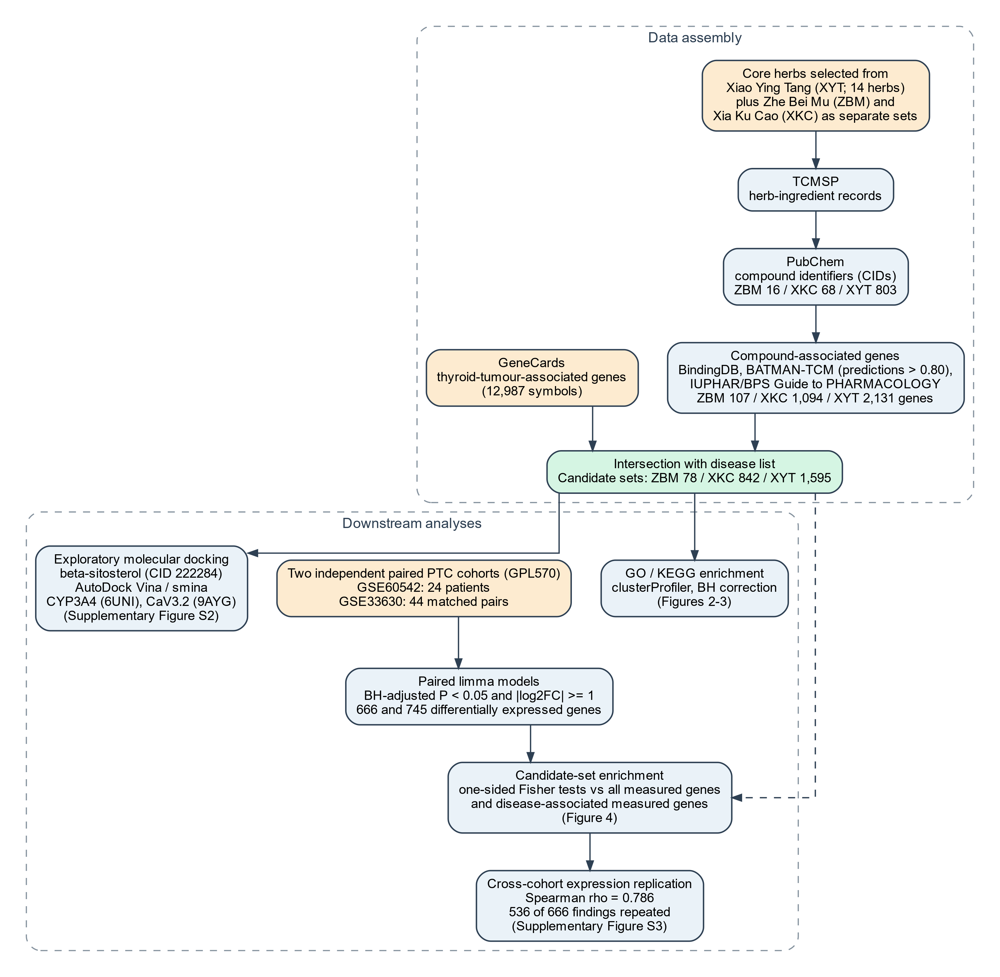
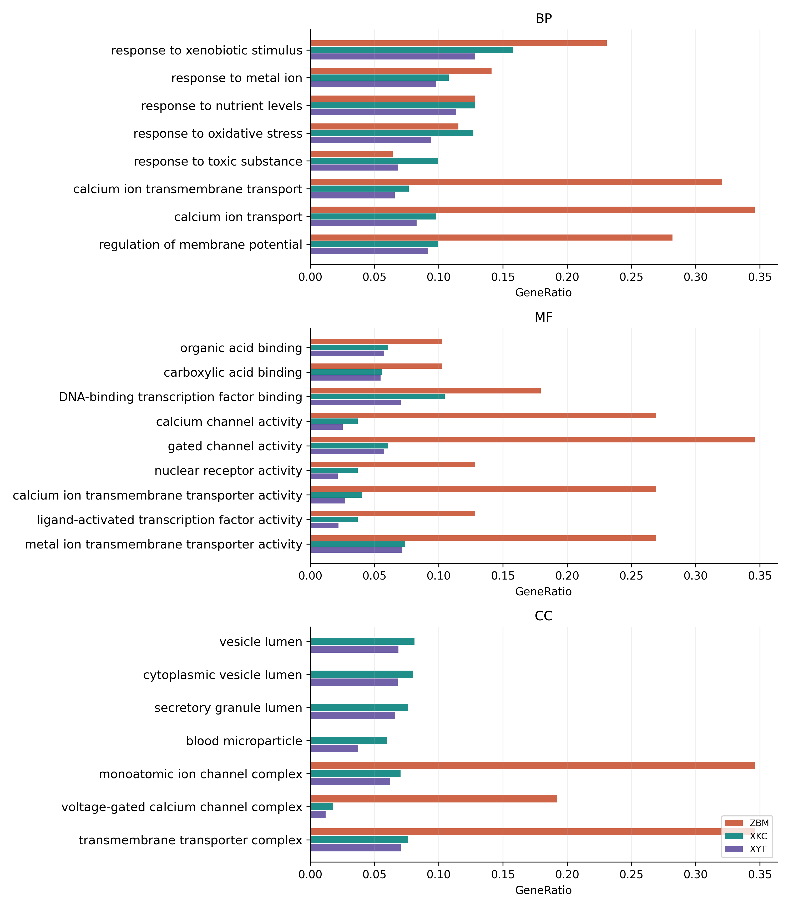
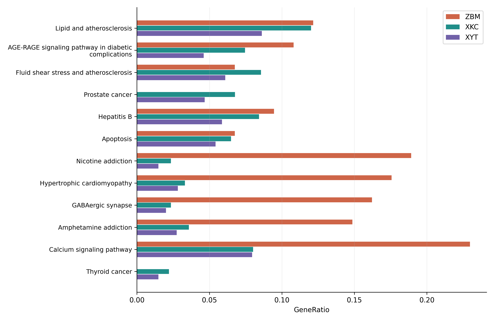
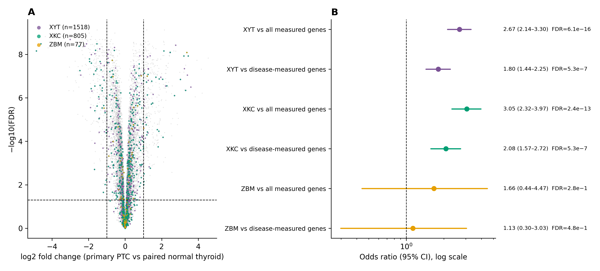

# Network Pharmacology of Xiao Ying Tang Core Herbs with Transcriptomic Assessment in Papillary Thyroid Carcinoma

Running title: Xiao Ying Tang Gene Associations in Papillary Thyroid Carcinoma

Tao Li^1^\*, Jiacai Li^2^\*, Yajie Ding^3^\*, Zhiyu Luo^4^, Xing Zhang^5^

^1^Department of Acupuncture and Moxibustion, Affiliated Hospital of Hangzhou Normal University, Hangzhou, Zhejiang, China.

^2^Practical Teaching Center, Shanghai University of Medicine & Health Sciences, Shanghai, China.

^3^Department of Oncology, Longhua Hospital Affiliated to Shanghai University of Traditional Chinese Medicine, Shanghai, China.

^4^Jiangsu Sanshu Biotechnology Co., Ltd., No. 259 Shibei Gaoxin Road, Tangzha Town Subdistrict, Chongchuan District, Nantong, Jiangsu, China.

^5^Department of Respiratory Disease, Shuguang Hospital Affiliated to Shanghai University of Traditional Chinese Medicine, Shanghai 201203, China.

\*Tao Li, Jiacai Li, and Yajie Ding contributed equally to this work and share first authorship.

Correspondence: Xing Zhang, Department of Respiratory Disease, Shuguang Hospital Affiliated to Shanghai University of Traditional Chinese Medicine, Shanghai 201203, China. Tel: 021-20256375; Email: zhangxing2012@shutcm.edu.cn

Additional author contact details: Yajie Ding, Email: dingyajie2018@163.com.

# Abstract

**Objective:** To assess whether genes associated with selected Xiao Ying Tang herbs are enriched among genes altered in papillary thyroid carcinoma.

**Methods:** Compound-associated genes for Xiao Ying Tang, Zhe Bei Mu and Xia Ku Cao were intersected with a GeneCards disease list and analysed for functional enrichment. Paired limma models assessed tumour and non-tumoral thyroid tissue from 24 patients in GSE60542 and 44 in GSE33630. Differential expression required Benjamini–Hochberg-adjusted P <0.05 and |log2 fold change| ≥1. Candidate-set enrichment was tested against all measured genes and the disease-associated subset.

**Results:** Disease intersections contained 1,595, 78 and 842 genes for Xiao Ying Tang, Zhe Bei Mu and Xia Ku Cao, respectively. Among 20,848 measured genes, 666 and 745 met the differential-expression criteria in the two cohorts. Xiao Ying Tang and Xia Ku Cao candidates were enriched in both: disease-restricted odds ratios were 1.80 and 2.08 in GSE60542 and 1.59 and 1.80 in GSE33630 (all adjusted P <0.001). Of the 666 initial findings, 536 met the same criteria with concordant direction in GSE33630, including 83 Xiao Ying Tang candidates. Zhe Bei Mu was not significantly enriched. POLB, CACNA1H and CYP3A4 met the combined criteria in neither cohort.

**Conclusion:** The selected Xiao Ying Tang and Xia Ku Cao gene sets showed reproducible associations with tumour expression. These findings identify candidates for functional testing; treatment response was not assessed.

**Keywords:** Xiao Ying Tang; network pharmacology; papillary thyroid carcinoma; transcriptome; molecular docking; traditional Chinese medicine; differential expression; beta-sitosterol.

# 1. Introduction

Thyroid cancers differ in their molecular features and clinical course [1]. Established management of differentiated thyroid cancer includes surgery, radioactive iodine for selected patients and thyroid hormone management [2]. Persistent or treatment-resistant disease has prompted investigation of additional therapeutic approaches. Their biological rationale needs to be assessed within a defined tumour subtype because the molecular drivers differ across thyroid malignancies [3].

Network pharmacology offers a way to connect herbal constituents with genes and biological processes. The approach is most useful for generating testable hypotheses, although the gene sets it produces are sensitive to database coverage and to how predicted interactions are handled. An external tumour-expression dataset can then show whether those genes are actually altered in disease tissue, even though it cannot say whether they respond to herbal treatment.

We examined the database-derived herb set labelled Xiao Ying Tang (XYT) in the source analysis. XYT refers to this selected set throughout, rather than a chemically characterised preparation. Zhe Bei Mu (ZBM; Fritillariae Thunbergii Bulbus) and Xia Ku Cao (XKC; Prunellae Spica) were analysed separately to describe their contributions to the combined gene set. We compared compound-associated genes and functional annotations, then assessed the fixed candidate sets in paired papillary thyroid carcinoma (PTC) and non-tumoral thyroid samples from two independent cohorts. Existing β-sitosterol docking outputs were reviewed for structural plausibility and technical limitations.

# 2. Materials and Methods

The analysis brought together herb–compound and compound–gene data, functional enrichment, paired tumour-expression profiles and exploratory molecular docking; Figure 1 summarises the overall workflow.

**Figure 1:** Technical route of the study. TCMSP herb–ingredient records were mapped to PubChem compound identifiers (CIDs); compound-associated genes from BindingDB, BATMAN-TCM and the IUPHAR/BPS Guide to PHARMACOLOGY were then intersected with 12,987 GeneCards thyroid-tumour-associated genes, giving the ZBM, XKC and XYT candidate sets. Downstream analyses covered GO/KEGG enrichment, paired limma differential-expression analysis in two independent PTC cohorts (GSE60542 and GSE33630) together with candidate-set enrichment tests and cross-cohort validation, and exploratory docking of β-sitosterol to CYP3A4 (6UNI) and CaV3.2 (9AYG).

Herb–ingredient records came from TCMSP and were linked to PubChem compound identifiers (CIDs) by matching lower-case compound names against a synonym table [4, 5]. For compound-associated genes we drew on BindingDB, the known and predicted interactions in BATMAN-TCM, and the IUPHAR/BPS Guide to PHARMACOLOGY [6-8]. UniProt protein identifiers in BindingDB were converted to gene symbols. All recorded associations were retained; BATMAN-TCM predictions were added only when the prediction score exceeded 0.80. CID–gene records were then merged and gene symbols deduplicated within each CID, so that TCMSP supplied the herb–ingredient inventory while the retained gene associations came from the three target resources above.

The retained XYT inventory comprised E Zhu, Bai Shao, Dang Gui, Chai Hu, Qing Pi, Huang Yao Zi, Xia Ku Cao, Zao Jiao Ci, Mu Dan Pi, Bai Zhu, Fu Ling, Bai Mao Xia Ku Cao, Xuan Shen, and Zhe Bei Mu (Supplementary Table T02). The historical extraction used Chinese-name pattern matching; the Xia Ku Cao pattern also matched Bai Mao Xia Ku Cao (Ajugae Decumbentis Herba), a distinct herb. We therefore checked whether excluding those records changed the disease-intersecting gene set. ZBM and XKC records were extracted by exact Chinese herb names and processed using the same target-association workflow. Duplicate herb–compound records were collapsed, and distinct CIDs were counted at three stages: all mapped ingredients, ingredients linked to retained genes, and ingredients linked to disease-overlapping genes. No oral-bioavailability or drug-likeness threshold was applied. Herb doses, preparation chemistry and constituent concentrations were not modelled.

Thyroid-tumour-associated genes came from the archived GeneCards export for the query “Thyroid tumor”, containing 12,987 unique gene symbols [9]. The complete export was used without an additional relevance-score threshold. Ingredient-associated symbols were split on semicolons, deduplicated and intersected with that list to define the ZBM, XKC and XYT candidate sets. Analyses used the archived database exports; exact original retrieval dates and database release versions were not recorded in the available analysis files.

Expression analyses used two Affymetrix GPL570 cohorts: GSE60542 from Belgium and France [10], and GSE33630 from the Ukrainian Chernobyl Tissue Bank [11]. The submitted fRMA-normalised GSE60542 and RMA-normalised GSE33630 log2 matrices were analysed separately, without further log transformation or between-cohort normalisation. All eligible matched primary PTC and non-tumoral thyroid samples were included; sample size was determined by their availability. Repeated GSE60542 tissue blocks were averaged within patient and tissue type. Title-based pairing in GSE33630 was confirmed against clinical bank identifiers, with five unpaired tumours, one unpaired normal sample and 11 anaplastic cancers excluded. The cohorts had distinct recruitment sources and no shared GEO sample identifiers. Probes with missing or ambiguous gene annotation were dropped, and probes mapping to a single gene were averaged on the log2 scale, leaving 20,848 genes per cohort.

Paired limma models (`~ patient_id + tissue_group`) were fitted in R 4.3.1 with limma 3.58.1 and robust empirical Bayes moderation [12]; positive log2 fold changes indicate higher tumour expression. Differential expression required Benjamini–Hochberg-adjusted P <0.05 across all measured genes and |log2FC| ≥1. The unchanged XYT, XKC and ZBM sets were tested with one-sided Fisher tests against all measured genes and against the 10,655 disease-associated measured genes. Within each background, candidate membership and differential-expression status formed a 2 × 2 table; the comparator was the background excluding the candidate set. Six enrichment P values were adjusted together within each cohort. Conditional odds ratios are reported with two-sided exact 95% confidence intervals. Cross-cohort replication required both differential-expression criteria and the same direction of change; Spearman correlation and direction alone were also reported descriptively. Exposure-stratified analyses in GSE33630 used the same paired model and thresholds, with 12 enrichment P values adjusted together. POLB, CACNA1H and CYP3A4, highlighted in the original structural screen, were examined individually without changing the genome-wide adjustment. Replicated candidate genes were listed in Supplementary Table T39 in descending order of mean absolute log2 fold change across cohorts; examples discussed in the text were selected after this analysis.

Unique gene symbols were converted to Entrez identifiers with `bitr` and org.Hs.eg.db, and every returned identifier went into the clusterProfiler enrichment analysis [13]. GO covered biological process (BP), molecular function (MF) and cellular component (CC); KEGG used the human annotations. Enrichment was tested with upper-tail hypergeometric tests under Benjamini–Hochberg correction (`pvalueCutoff = 0.05`, `qvalueCutoff = 0.2`), against the default backgrounds of 18,888 (BP), 18,522 (MF), 19,894 (CC) and 8,859 (KEGG) genes. Terms reaching adjusted P <0.05 are reported.

The GO figures show the union of the three lowest-adjusted-P terms per set within each ontology, and the KEGG figures the union of the five lowest-adjusted-P pathways per set, with the thyroid cancer pathway (hsa05216) added because of the study question. GeneRatio is based on the annotated input size recorded for each analysis, which can differ between ontologies; a missing bar means the term did not appear in that significant-result table. These figures are meant as a descriptive comparison of annotation profiles.

Ligands were prepared with Open Babel and receptor structures were taken from RCSB PDB [14, 15]. AutoDock Vina served for initial screening and smina for the supplementary β-sitosterol docking [16, 17]. Structural assessment concentrated on human CYP3A4 (6UNI) and apo CaV3.2/CACNA1H (9AYG) [15, 18]. The original screen also included 4P5A, a bacterial UMP/dUMP methylase named PolB, which is not human DNA polymerase β; it was excluded from human-target interpretation. The initial Vina protocol used a 20 × 20 × 20 Å search box centred on the mean receptor ATOM coordinates rounded to whole angstroms, with exhaustiveness 32 and five CPU threads. Supplementary smina runs used exhaustiveness 8, nine output modes and one CPU thread, with `--autobox_add 4` applied to the extracted reference structure. We reviewed minimum-score poses alongside receptor identity, cofactor retention and the residues defining the search region. These unvalidated docking calculations were not used to establish binding affinity or target engagement.

OpenAI Codex (GPT-6) assisted with manuscript revision, reference-metadata checks, verification scripts and figure-layout code during final preparation. Its outputs require author review; the authors retain responsibility for the submitted text, analyses and interpretations.

# 3. Results

The ingredient tables yielded 16, 68 and 803 distinct non-missing PubChem CIDs for ZBM, XKC and XYT. Gene associations were retained for 8, 57 and 501 of these, and 8, 57 and 492 were linked to at least one gene in the disease intersection. In total the three sets comprised 107, 1,094 and 2,131 unique ingredient-associated genes, of which 78/107 (72.9%), 842/1,094 (77.0%) and 1,595/2,131 (74.8%) overlapped the common disease list; 12,909, 12,145 and 11,392 genes were disease-only, and 29, 252 and 536 ingredient-only (Supplementary Figure S1). The 1,595-gene XYT intersection contained all 78 ZBM and all 842 XKC disease-overlapping genes. XYT thus covered the largest gene set, although the fraction overlapping the disease list was much the same across the three sets.

GO analysis returned 1,026, 3,925 and 4,782 terms at adjusted P <0.05 for ZBM, XKC and XYT, based on annotated inputs of 78/78/78, 835/840/839 and 1,582/1,588/1,587 genes in BP/MF/CC order. These input sizes are annotation-specific and therefore differ from the initial disease-intersection totals. Oxidative-stress response (GO:0006979) was represented by 9/78 ZBM genes (adjusted P =5.98 × 10^-4^), 106/835 XKC genes (6.35 × 10^-50^) and 149/1,582 XYT genes (7.06 × 10^-57^). Calcium homeostasis and the voltage-gated calcium channel complex also appeared; for the latter (GO:0005891) the GeneRatio was 15/78, 15/839 and 19/1,587. Figure 2 shows the annotation profiles.

{height=8.4in}

**Figure 2:** Selected GO annotations. The three panels show biological process (BP), molecular function (MF) and cellular component (CC), with terms taken as the union of the three lowest-adjusted-P terms per group within each ontology. Bar length gives the GeneRatio; colours denote ZBM (orange), XKC (teal) and XYT (purple). A missing bar means the term was absent from that group's exported significant-result table. The selected terms and their statistics are given in the accompanying source table.

KEGG analysis gave 83, 221 and 239 significant pathways (adjusted P <0.05) for ZBM, XKC and XYT from 74, 724 and 1,346 annotated input genes. Calcium signalling, MAPK signalling and apoptosis appeared in all three sets. The thyroid cancer pathway was enriched for XKC (16/724 genes; adjusted P =2.56 × 10^-8^) and XYT (20/1,346; 1.16 × 10^-7^) but did not reach significance for ZBM. Lipid and atherosclerosis carried the lowest adjusted P for XKC and XYT, while nicotine addiction ranked first for ZBM (Figure 3).

**Figure 3:** Selected KEGG pathways, taken as the union of the five lowest-adjusted-P pathways per group plus hsa05216 (thyroid cancer). Bars show GeneRatio; colours and the missing-bar interpretation follow Figure 2. Full enrichment results and figure source data accompany the manuscript.

**Paired PTC transcriptome analysis.** The GSE60542 dataset comprised 24 patients contributing 28 primary-tumour and 27 non-tumoral thyroid blocks, averaged into 48 patient–tissue observations. Of the 20,848 measured genes, 666 met the differential-expression criteria, 347 higher and 319 lower in tumour tissue (Figure 4). Among 1,518 measured XYT candidates, 111 were differentially expressed, giving odds ratios of 2.67 against all measured genes (adjusted P =6.08 × 10^-16^) and 1.80 against the disease-restricted background (adjusted P =5.31 × 10^-7^). For XKC the counts were 69/805 with odds ratios of 3.05 and 2.08 (adjusted P =2.44 × 10^-13^ and 5.31 × 10^-7^). ZBM contributed only 4/77 differentially expressed genes and was not significant under either background (adjusted P =0.278 and 0.482). POLB decreased slightly (log2FC =−0.070; adjusted P =0.00271) but fell short of the fold-change threshold, whereas CACNA1H and CYP3A4 showed small, non-significant changes (log2FC =−0.053 and −0.031; adjusted P =0.273 and 0.338); none of the three genes met both criteria.

**Figure 4:** Paired PTC transcriptome analysis in GSE60542 (24 patients). (A) Paired-limma volcano plot of the 20,848 measured genes; dashed lines mark adjusted P =0.05 and |log2FC| =1. Because the candidate sets overlap, XYT points (purple) were drawn first, then XKC (teal) and ZBM (orange); the visible colour therefore does not imply exclusive membership. (B) Conditional odds ratios with two-sided exact 95% confidence intervals for over-representation among differentially expressed genes, using either all measured genes or the disease-listed measured genes as background. FDR labels give Benjamini–Hochberg-adjusted P values from the six one-sided Fisher tests.

GSE33630 contributed 44 matched pairs and 745 differentially expressed genes (407 higher, 338 lower in tumour tissue). Among the measured candidates, 112/1,518 XYT and 68/805 XKC genes were differentially expressed, with odds ratios of 2.35 and 2.64 against all measured genes and 1.59 (95% CI 1.27–1.97) and 1.80 (1.36–2.35) against disease-associated genes (adjusted P =4.99 × 10^-5^ for both disease-restricted tests). ZBM (2/77 genes) again showed no enrichment (adjusted P =0.913 for both backgrounds). Log2 fold changes correlated across the 20,848 genes between cohorts (Spearman ρ =0.786). Of the 666 initial findings, 664 agreed in direction and 536 met the same criteria with concordant direction in GSE33630, including 83/111 XYT and 51/69 XKC genes (Supplementary Figure S3). Examples of replicated candidates were DIO1 (log2FC =−4.86 and −3.24 in the two cohorts), TPO (−4.61 and −3.24), LRRK2 (3.59 and 4.29), DPP4 (3.45 and 3.60) and FN1 (3.02 and 2.51). These are illustrative examples; all 83 candidates are listed in Supplementary Table T39. POLB, CACNA1H and CYP3A4 again failed the combined criteria. XYT and XKC enrichment persisted in both exposure strata (22 pairs each; all adjusted P <0.001), whereas ZBM remained non-significant. This stratified analysis did not test an exposure-by-tissue interaction.

Excluding Bai Mao Xia Ku Cao from the herb inventory reduced the ingredient-associated gene count from 2,131 to 2,128. The three excluded symbols (EcR, MICAL1 and usp) were absent from the disease list, so the 1,595-gene XYT candidate set and all downstream analyses based on that set were unchanged.

β-Sitosterol (CID 222284), a compound shared by all three ingredient sets, was chosen for structural exploration; repeated CID–receptor combinations under different herb labels represented the same compound–protein pair.

Minimum smina scores were −9.12 kcal/mol for CYP3A4 (6UNI) and −9.68 kcal/mol for CaV3.2 (9AYG) (Supplementary Figure S2). CYP3A4 was prepared without its haem cofactor, whereas the automatic box reference still contained both the haem and the crystallographic inhibitor; for 9AYG the box reference held several non-protein residue types. These preparation and search-region problems prevent the displayed poses from supporting a claim of specific binding.

# 4. Discussion

XYT and XKC candidate genes were over-represented among genes altered in paired PTC tissue in both cohorts. The association remained when the comparison was restricted to measured genes already on the disease list, although the odds ratios were smaller. This reduction indicates that broad thyroid-disease annotation accounts for part of the enrichment. The replicated candidates included DIO1 and TPO, both down-regulated in tumour tissue. Their expression differences provide a reproducible disease context for selecting experiments, but do not establish that the herbs act on these genes.

Both single-herb candidate sets are subsets of XYT, but neither is a subset of the other. Their tests therefore overlap and do not constitute independent evidence for separate herbal effects. Broader XYT coverage is expected from combining ingredient records and does not establish synergy. ZBM contributed only 77 measured genes, with four differentially expressed in GSE60542 and two in GSE33630, yielding wide confidence intervals. Its non-significant enrichment does not establish a difference from XYT or XKC; that would require a direct comparison. Overlap percentages and GeneRatios likewise do not measure treatment effects.

The oxidative-stress annotations fit with the established place of redox regulation in thyroid cancer [19]. The calcium-related annotations also merit follow-up, given experimental work linking TRPC1 to thyroid cancer cell migration and proliferation [20]. TRPC1 and CACNA1H, however, encode different channel types, and a shared calcium annotation does not tie them together mechanistically. The transcriptome analysis also assessed whole candidate sets rather than the independent activity of each GO or KEGG pathway, and enrichment of the KEGG thyroid cancer pathway is partly conditioned on having used a thyroid-tumour gene list to select the inputs.

The three genes highlighted by the original structural screen were not supported by the combined expression criteria. POLB decreased modestly (log2FC =−0.070 in GSE60542 and −0.116 in GSE33630), whereas CACNA1H and CYP3A4 did not differ significantly. Expression alone cannot confirm or exclude protein binding. CYP3A4 may be relevant through drug metabolism, including vandetanib oxidation [21], rather than through altered transcript abundance. The docking outputs do not resolve this question: CYP3A4 lacked its haem cofactor, and the automatic search regions were not validated binding sites. Their scores should not be interpreted as measured binding energies or used to rank affinity across the two receptors.

Earlier β-sitosterol studies offer useful context but were done in different systems: Cao and colleagues worked in non-small-cell lung cancer [22], and Chen and colleagues tested Prunella vulgaris components in inflammatory thyrocyte models of Hashimoto's disease [23]. Neither establishes the proposed interactions in PTC. Wnt and Keap1/Nrf2 signalling are both relevant to thyroid cancer biology [24, 25], but whether the selected herbs modulate them was not measured here.

Thyroid differentiation is a useful context for interpreting DIO1 and TPO: both contribute to the thyroid differentiation score described in the Cancer Genome Atlas analysis of PTC [26]. Their repeated down-regulation is consistent with altered thyroid differentiation, but this interpretation remains distinct from pharmacological target validation. The highlighted genes were selected after examining the expression results and should be treated as exploratory priorities.

The target assignments combine recorded and predicted associations of differing evidentiary strength. BindingDB records were integrated without organism- or affinity-based restriction; matching a gene symbol to a human disease list does not establish a human compound–protein interaction. The broad disease list and annotation-wide GO/KEGG backgrounds may favour well-studied genes. Fisher tests also treat genes as exchangeable units and do not account for expression correlation, so their P values describe overlap under that model rather than independent biological effects. The disease-restricted analysis addresses background selection but not these dependencies. Shared database and platform biases remain possible despite replication in separate patient cohorts.

Both cohorts represent PTC, and the non-tumoral samples were obtained from patients with cancer rather than healthy donors. Tissue composition may contribute to the expression differences. GSE33630 involved young patients (median age 16.82 years; range 12.38–24.55), evenly divided between radiation-exposed and unexposed groups; transferability to older or other thyroid-cancer populations is uncertain. The archived herb inventory does not specify dose, preparation or achievable constituent exposure, and name matching included two distinct herbs containing Xia Ku Cao in their Chinese names. Excluding Bai Mao Xia Ku Cao left the disease candidate set unchanged, but the inventory still requires botanical and preparation-level definition before experimental use. Missing database retrieval dates further limit exact reconstruction from live resources.

Further work should bring together concentration–response experiments, non-malignant controls and target perturbation with binding or functional assays; structural follow-up should retain essential cofactors, define the binding site explicitly and benchmark the docking protocol against a reference ligand.

# 5. Conclusion

XYT and XKC candidate genes were over-represented among the genes altered in paired PTC tissue in two independent cohorts, including against disease-restricted backgrounds. Eighty-three XYT candidates, including the thyroid-differentiation markers DIO1 and TPO, met the differential-expression criteria in both cohorts. ZBM enrichment was inconclusive, and none of the three individually examined genes met the combined differential-expression criteria. These findings prioritise disease-associated genes for functional study of the selected herbs.

# List of Abbreviations

CID: PubChem compound identifier; DE: differential expression; GO: Gene Ontology; KEGG: Kyoto Encyclopedia of Genes and Genomes; log2FC: log2 fold change; PTC: papillary thyroid carcinoma; TCMSP: Traditional Chinese Medicine Systems Pharmacology; XKC: Xia Ku Cao; XYT: Xiao Ying Tang; ZBM: Zhe Bei Mu.

# Ethics Approval and Consent to Participate

This study used database records, molecular structures, and publicly available, de-identified GEO expression data. It involved no new participant recruitment, intervention, or animal experiments.

# Human and Animal Rights

No new experiments involving human participants or animals were performed. The study reanalysed publicly available, de-identified human tissue-expression data.

# Consent for Publication

Not applicable.

# Availability of Data and Materials

Gene lists, sample and pairing manifests, differential-expression results, enrichment tests, and quality-control summaries are included in the supplementary material. Expression data and platform annotations are available from GEO under GSE60542, GSE33630 and GPL570. Cross-cohort comparisons and exposure-stratified results are included in the supplementary material. The underlying network-pharmacology data are available from the corresponding author upon reasonable request. Analysis code is not publicly available.

# Funding

This work was supported by the Shanghai Clinical Research Center of Traditional Chinese Medicine Oncology, Science and Technology Commission of Shanghai Municipality (21MC1930500). Additional support was provided by the 2025 Research Project of the Shanghai Research Center for the Theory of Education for Older Adults (ZX0551-25) and the 2025 project “Policies and Pathways for Training Interdisciplinary Digital Health Professionals in Shanghai in the Context of the Digital and Intelligent Transformation of Healthcare” (2025JZ02). The listed funding sources provided support for this work.

# Conflict of Interest

Zhiyu Luo is an employee of Jiangsu Sanshu Biotechnology Co., Ltd. The remaining authors declare no conflicts of interest related to this work.

# Acknowledgements

Declared none.

# Author Contributions

Tao Li: Data collection; data curation; formal analysis. Jiacai Li: Supervision; writing – review and editing. Yajie Ding: Data curation; writing – review and editing. Zhiyu Luo: Formal analysis. Xing Zhang: Data curation; writing – review and editing. All authors have reviewed and approved the final manuscript.

# Supportive/Supplementary Material

Supplementary Tables T01–T39 are supplied in `05_Supplementary_Tables.xlsx`: herb and gene inventories, functional annotations, sample manifests, expression results, enrichment tests, quality-control records and replicated candidates. Supplementary Figures S1–S3 and their legends are supplied in `06_Supplementary_Figures.docx`: gene-set intersections, exploratory docking outputs and the GSE33630 replication analysis. The graphical abstract is provided separately.

# References

[1] Cabanillas ME, McFadden DG, Durante C. Thyroid cancer. Lancet 2016; 388(10061): 2783-2795. doi: 10.1016/s0140-6736(16)30172-6. [PMID: 27240885]

[2] Haugen BR, Alexander EK, Bible KC, Doherty GM, Mandel SJ, Nikiforov YE, et al. 2015 American Thyroid Association Management Guidelines for Adult Patients with Thyroid Nodules and Differentiated Thyroid Cancer: The American Thyroid Association Guidelines Task Force on Thyroid Nodules and Differentiated Thyroid Cancer. Thyroid 2016; 26(1): 1-133. doi: 10.1089/thy.2015.0020. [PMID: 26462967]

[3] Xing M. Molecular pathogenesis and mechanisms of thyroid cancer. Nat Rev Cancer 2013; 13(3): 184-199. doi: 10.1038/nrc3431. [PMID: 23429735]

[4] Ru J, Li P, Wang J, Zhou W, Li B, Huang C, et al. TCMSP: a database of systems pharmacology for drug discovery from herbal medicines. J Cheminform 2014; 6: 13. doi: 10.1186/1758-2946-6-13. [PMID: 24735618]

[5] Kim S, Chen J, Cheng T, Gindulyte A, He J, He S, et al. PubChem 2023 update. Nucleic Acids Res 2023; 51(D1): D1373-D1380. doi: 10.1093/nar/gkac956. [PMID: 36305812]

[6] Gilson MK, Liu T, Baitaluk M, Nicola G, Hwang L, Chong J. BindingDB in 2015: A public database for medicinal chemistry, computational chemistry and systems pharmacology. Nucleic Acids Res 2016; 44(D1): D1045-53. doi: 10.1093/nar/gkv1072. [PMID: 26481362]

[7] Kong X, Liu C, Zhang Z, Cheng M, Mei Z, Li X, et al. BATMAN-TCM 2.0: an enhanced integrative database for known and predicted interactions between traditional Chinese medicine ingredients and target proteins. Nucleic Acids Res 2024; 52(D1): D1110-D1120. doi: 10.1093/nar/gkad926. [PMID: 37904598]

[8] Harding SD, Armstrong JF, Faccenda E, Southan C, Alexander SPH, Davenport AP, et al. The IUPHAR/BPS Guide to PHARMACOLOGY in 2024. Nucleic Acids Res 2024; 52(D1): D1438-D1449. doi: 10.1093/nar/gkad944. [PMID: 37897341]

[9] Safran M, Dalah I, Alexander J, Rosen N, Iny Stein T, Shmoish M, et al. GeneCards Version 3: the human gene integrator. Database (Oxford) 2010; 2010: baq020. doi: 10.1093/database/baq020. [PMID: 20689021]

[10] Tarabichi M, Saiselet M, Trésallet C, Hoang C, Larsimont D, Andry G, et al. Revisiting the transcriptional analysis of primary tumours and associated nodal metastases with enhanced biological and statistical controls: application to thyroid cancer. Br J Cancer 2015; 112(10): 1665-1674. doi: 10.1038/bjc.2014.665. [PMID: 25965298]

[11] Dom G, Tarabichi M, Unger K, Thomas G, Oczko-Wojciechowska M, Bogdanova T, et al. A gene expression signature distinguishes normal tissues of sporadic and radiation-induced papillary thyroid carcinomas. Br J Cancer 2012; 107(6): 994-1000. doi: 10.1038/bjc.2012.302. [PMID: 22828612]

[12] Ritchie ME, Phipson B, Wu D, Hu Y, Law CW, Shi W, et al. limma powers differential expression analyses for RNA-sequencing and microarray studies. Nucleic Acids Res 2015; 43(7): e47. doi: 10.1093/nar/gkv007. [PMID: 25605792]

[13] Yu G, Wang LG, Han Y, He QY. clusterProfiler: an R package for comparing biological themes among gene clusters. OMICS 2012; 16(5): 284-287. doi: 10.1089/omi.2011.0118. [PMID: 22455463]

[14] O'Boyle NM, Banck M, James CA, Morley C, Vandermeersch T, Hutchison GR. Open Babel: An open chemical toolbox. J Cheminform 2011; 3: 33. doi: 10.1186/1758-2946-3-33. [PMID: 21982300]

[15] Burley SK, Bhikadiya C, Bi C, Bittrich S, Chen L, Crichlow GV, et al. RCSB Protein Data Bank: powerful new tools for exploring 3D structures of biological macromolecules for basic and applied research and education in fundamental biology, biomedicine, biotechnology, bioengineering and energy sciences. Nucleic Acids Res 2021; 49(D1): D437-D451. doi: 10.1093/nar/gkaa1038. [PMID: 33211854]

[16] Trott O, Olson AJ. AutoDock Vina: improving the speed and accuracy of docking with a new scoring function, efficient optimization, and multithreading. J Comput Chem 2010; 31(2): 455-461. doi: 10.1002/jcc.21334. [PMID: 19499576]

[17] Koes DR, Baumgartner MP, Camacho CJ. Lessons learned in empirical scoring with smina from the CSAR 2011 benchmarking exercise. J Chem Inf Model 2013; 53(8): 1893-1904. doi: 10.1021/ci300604z. [PMID: 23379370]

[18] Huang J, Fan X, Jin X, Lyu C, Guo Q, Liu T, et al. Structural basis for human Cav3.2 inhibition by selective antagonists. Cell Res 2024; 34(6): 440-450. doi: 10.1038/s41422-024-00959-8. [PMID: 38605177]

[19] Cazarin J, Dupuy C, Pires de Carvalho D. Redox Homeostasis in Thyroid Cancer: Implications in Na+/I− Symporter (NIS) Regulation. Int J Mol Sci 2022; 23(11): 6129. doi: 10.3390/ijms23116129. [PMID: 35682803]

[20] Asghar MY, Magnusson M, Kemppainen K, Sukumaran P, Löf C, Pulli I, et al. Transient Receptor Potential Canonical 1 (TRPC1) Channels as Regulators of Sphingolipid and VEGF Receptor Expression: IMPLICATIONS FOR THYROID CANCER CELL MIGRATION AND PROLIFERATION. J Biol Chem 2015; 290(26): 16116-16131. doi: 10.1074/jbc.m115.643668. [PMID: 25971967]

[21] Indra R, Pompach P, Martínek V, Takácsová P, Vavrová K, Heger Z, et al. Identification of Human Enzymes Oxidizing the Anti-Thyroid-Cancer Drug Vandetanib and Explanation of the High Efficiency of Cytochrome P450 3A4 in its Oxidation. Int J Mol Sci 2019; 20(14): E3392. doi: 10.3390/ijms20143392. [PMID: 31295928]

[22] Cao W, Yuan F, Liu T, Yin R. Network pharmacology analysis, molecular docking integrated experimental verification reveal β-sitosterol as the active anti-NSCLC ingredient of Polygonatum cyrtonema Hua by suppression of PI3K/Akt/HIF-1α signaling pathway. J Ethnopharmacol 2024; 328: 117900. doi: 10.1016/j.jep.2024.117900. [PMID: 38432577]

[23] Chen Y, Jiang B, Qu C, Jiang C, Zhang C, Wang Y, et al. Bioactive components in prunella vulgaris for treating Hashimoto's disease via regulation of innate immune response in human thyrocytes. Heliyon 2024; 10(16): e36103. doi: 10.1016/j.heliyon.2024.e36103. [PMID: 39253271]

[24] Sastre-Perona A, Santisteban P. Role of the wnt pathway in thyroid cancer. Front Endocrinol (Lausanne) 2012; 3: 31. doi: 10.3389/fendo.2012.00031. [PMID: 22645520]

[25] Renaud CO, Ziros PG, Chartoumpekis DV, Bongiovanni M, Sykiotis GP. Keap1/Nrf2 Signaling: A New Player in Thyroid Pathophysiology and Thyroid Cancer. Front Endocrinol (Lausanne) 2019; 10: 510. doi: 10.3389/fendo.2019.00510. [PMID: 31428048]

[26] Cancer Genome Atlas Research Network. Integrated genomic characterization of papillary thyroid carcinoma. Cell 2014; 159(3): 676-690. doi: 10.1016/j.cell.2014.09.050. [PMID: 25417114]
