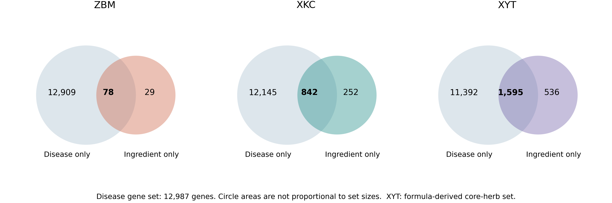
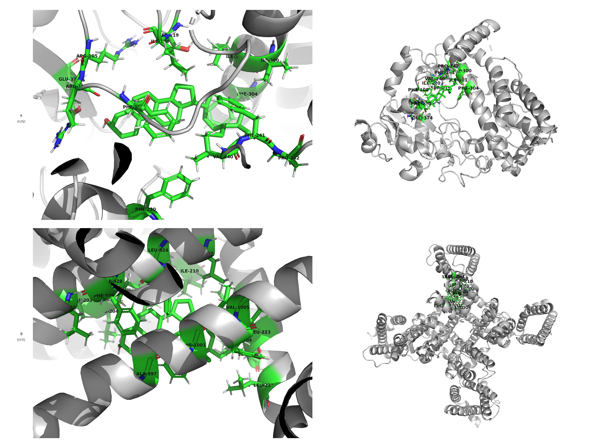
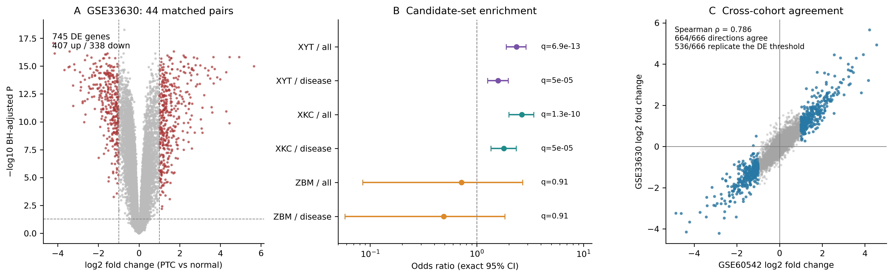

# Supplementary Figures

Network Pharmacology of Xiao Ying Tang Core Herbs with Transcriptomic Assessment in Papillary Thyroid Carcinoma

{width=6.2in}

**Supplementary Figure S1:** Gene-set intersections for ZBM, XKC and the XYT herb set. Disease-overlapping genes total 78, 842 and 1,595, respectively. All comparisons use the same 12,987-gene disease list. Circle areas are schematic and are not proportional to set sizes. XYT denotes the database-derived herb inventory defined in the Methods, not a chemically characterised preparation.

{width=6.2in}

**Supplementary Figure S2:** Exploratory docking outputs for β-sitosterol (CID 222284). (A) Human CYP3A4 (PDB 6UNI); (B) human CaV3.2/CACNA1H (PDB 9AYG). Left panels show the ligand (green sticks) and surrounding residues; right panels show the receptor overview. Poses correspond to minimum smina scores of −9.12 and −9.68 kcal/mol, respectively. CYP3A4 was prepared without haem, although the autobox reference contained both haem and inhibitor; the 9AYG reference included several non-protein residue types. Binding sites and docking accuracy were not validated. Scores are computational outputs, not measured binding energies, and cannot establish specific binding or relative affinity across receptors.

{width=6.2in}

**Supplementary Figure S3:** Independent expression replication in GSE33630 (44 matched patients). (A) Paired-limma differential expression, with Benjamini–Hochberg-adjusted P <0.05 and |log2FC| ≥1. (B) Candidate-set enrichment against all 20,848 measured genes or 10,655 disease-associated measured genes. Points show conditional odds ratios; bars show two-sided exact 95% confidence intervals. q labels are adjusted P values from six one-sided Fisher tests in this cohort. (C) Gene-level log2 fold changes across cohorts; blue points mark the 666 genes meeting the differential-expression criteria in GSE60542. Of these, 664 agreed in direction and 536 met the same criteria with concordant direction in GSE33630. Spearman correlation uses all 20,848 genes. Gene-set replication indicates disease association, not response to herbal treatment.
