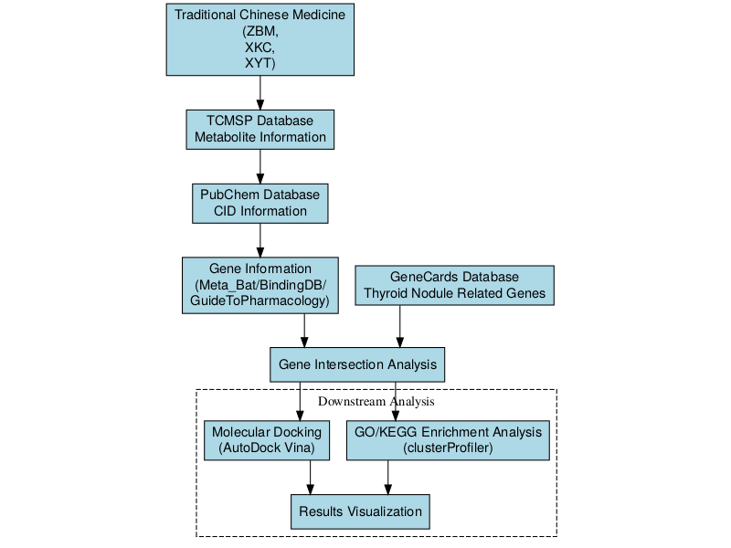

An Integrative Analysis of TCM Metabolites in Thyroid Cancer Pathogenesis: Insights from Network Pharmacology and Molecular Docking

Tao Li^1^\*, Yajie Ding^2^\*, Zhiyu Luo^3^\*, Xing Zhang^4^, and Pengfei Yang^5^

^1^Affiliation for Tao Li
^2^Affiliation for Yajie Ding
^3^Affiliation for Zhiyu Luo
^4^Affiliation for Xing Zhang
^5^Clinical College of Chinese Medicine, Gansu University of Chinese Medicine, No. 35 Dingxi East Road, Chengguan District, Lanzhou City, Gansu Province, People's Republic of China

\*These authors contributed equally to this work.

Correspondence: Pengfei Yang, Clinical College of Chinese Medicine, Gansu University of Chinese Medicine, No. 35 Dingxi East Road, Chengguan District, Lanzhou City, Gansu Province, People's Republic of China. Tel: +8618293195696; Email: ypf@gszy.edu.cn

\newpage

**Abstract**

**Objective:** This study aims to use network pharmacology to compare the active components, key targets, mechanisms of action, and related pathways of three classic traditional Chinese medicine (TCM) formulations---Xiao Ying Tang (XYT), Zhe Bei Mu (ZBM), and Xia Ku Cao (XKC)---in the treatment of thyroid cancer.

**Study design:** In silico network pharmacology and molecular docking study.

**Place & duration of study:** Not applicable (in silico study).

**Methodology:** We employed network pharmacology and molecular docking to identify the most therapeutically effective active components and analyse their mechanisms of action.

**Results:** ZBM had the fewest action targets (78 targets, 1%), followed by XKC (842 targets, 6%), while XYT had the most (1,595 targets, 12%). Gene Ontology analysis indicated that XYT and XKC share similarities in biological processes, molecular functions, and cellular components, particularly in voltage-gated calcium channel complexes. These genes play roles in angiogenesis, calcium homeostasis, steroid hormone responses, and oxidative stress responses. Elevated reactive oxygen species (ROS) are linked to thyroid cancer development because oxidative stress causes DNA damage and genomic instability. In addition, transient receptor potential canonical (TRPC) channels were found to contribute significantly to cancer cell growth. The enriched pathways associated with XYT and XKC included immune response, signal transduction, and apoptosis.

**Conclusion:** This study highlights the potential of Xiao Ying Tang (XYT) in the treatment of thyroid cancer because of its strong binding affinities and interactions with key target proteins. Among the three formulations examined, XYT showed the highest gene enrichment and binding affinity, suggesting a notable therapeutic effect. The integration of network pharmacology and molecular docking provides useful insights into the mechanisms of traditional Chinese medicine in thyroid cancer treatment and may guide future research.

**Keywords:** Thyroid cancer; Traditional Chinese Medicine; Molecular docking; Gene ontology; KEGG pathways

\newpage

# Introduction

Thyroid cancer is a malignant tumour that develops from the thyroid gland's follicular epithelium or parafollicular cells. It is the most common cancer in the head and neck region. In recent years, the incidence of thyroid cancer has rapidly increased, surpassing that of other malignant tumours, and it has now become the eighth most prevalent cancer globally.^1^

According to data from China's National Cancer Center, thyroid cancer ranked seventh among all malignant tumours in terms of incidence in 2015, and fourth among female malignant tumours. Overall, the prognosis for thyroid cancer in China is relatively good, with a five-year survival rate of 84.3%. However, this is still far below the rate in developed nations such as the United States, where the five-year survival rate is reported to be 98%.^2^

Currently, Western medicine lacks a perfect curative therapy. The primary treatment strategy is surgical excision of the thyroid gland combined with radioactive iodine therapy or lifelong thyroid hormone replacement medication to control symptoms.^3^ Nevertheless, long-term medication can cause side effects that produce considerable discomfort for patients, who also face risks of persistent or recurrent cancer along with local and distant metastases. Even molecular targeted drugs such as Dabrafenib, Trametinib, Selpercatinib, and Pralsetinib have limited practical use because of their high cost and uncertain long-term effectiveness.^4,5^ Therefore, it is essential to actively pursue effective treatments for thyroid cancer and investigate the underlying regulatory mechanisms.

Traditional Chinese medicine (TCM) provides unique experiences and treatments for thyroid cancers. Over the last fifteen years, researchers have used a TCM legacy assistance platform to conduct statistical analyses on clinical effectiveness observations related to TCM in the prevention and treatment of thyroid illnesses. By classifying 131 recorded TCM prescriptions by frequency, a total of 163 herbal medications were discovered. Xia Ku Cao (*Prunella vulgaris*) and Zhe Bei Mu (*Fritillaria thunbergia*) were the two most often utilized herbs, with 116 and 108 occurrences respectively.^6^

Xia Ku Cao has been shown to exert bidirectional regulatory effects on the immune system; its aqueous extract affects NF-κB and MAP kinase activity and stimulates macrophage activity.^7^ Modern pharmacological studies have confirmed that Zhe Bei Mu contains various alkaloids, saponins, flavonoids, and polysaccharides with effects including phlegm elimination, cough relief, anti-inflammatory activity, pain relief, and anti-tumour activity, as well as the ability to reverse tumour resistance.^8^ Network pharmacology analyses of Zhe Bei Mu have identified 2,357 disease-related targets and 96 core targets linked to thyroid cancer, including key genes such as NPM1, HSPA5, and HDAC5.

Researchers have conducted network pharmacology and molecular docking studies on Zhe Bei Mu and Xia Ku Cao, identifying 108 targets related to the treatment of thyroid nodules. Overlapping targets such as AKT1, tumour protein p53 (TP53), and mitogen-activated protein kinase 1 (MAPK1) were identified as core targets. Both herbs may treat thyroid cancer through multiple components, multiple targets, and multiple pathways.^9^

The Xiao Ying Tang formula, developed by renowned TCM expert Professor Xu Zhuyin, consists of Chai Hu, Yu Jin, Hou Po, Ban Xia, Dang Gui, Huang Qi, Bai Zhu, Cang Zhu, Ban Zhi Lian, Mao Zhua Cao, and Xia Ku Cao.

# Methodology

Metabolite data for *Fritillaria thunbergii* (ZBM), *Prunella vulgaris* (XKC), and the Xiao Ying Tang formula (XYT) were obtained from the Traditional Chinese Medicine Systems Pharmacology (TCMSP) database.^10^ The chemical identifiers (CIDs) for these metabolites were retrieved from PubChem.^11^ Using these CIDs, gene information for the metabolites was collected from the MetaBat, BindingDB, and Guide to Pharmacology databases.^12^ GeneCards was also used to obtain genes associated with thyroid cancer.^13^ The intersection of genes related to TCM metabolites and thyroid cancer-related genes was then identified for further analysis.

Using the enrichGO and enrichKEGG functions from the clusterProfiler package in R, Gene Ontology (GO) and Kyoto Encyclopedia of Genes and Genomes (KEGG) enrichment analyses were performed on the intersecting genes.^14^ The enriched biological processes, pathways, and functions linked to thyroid cancer and metabolites were visualised based on these results (Figures 3 and 4). Significantly enriched terms were identified using a significance threshold of p < 0.05.^15^ The SMILES data derived from CIDs were converted into Structure Data Format (SDF) files using Open Babel for molecular docking experiments.^16^ These SDF files were used as ligand inputs for docking simulations. Protein structures corresponding to the intersecting genes were retrieved from the Protein Data Bank (PDB) through the RCSB website.^17^ The binding affinities between metabolites and target proteins were predicted using AutoDock Vina.^18^

Bar graphs were used to display the results of the KEGG and GO enrichment analyses, as shown in Figures 3 and 4. These figures provide insights into possible mechanisms of action by highlighting key biological pathways and processes involved in metabolite-disease relationships.

Figure 1: Network pharmacology workflow for investigating the mechanism of traditional Chinese medicine in treating thyroid cancer.

# Results

To identify potential therapeutic targets and mechanisms, we systematically analysed the overlapping genes between the three TCM formulations and thyroid cancer. The following sections present the results of target screening, functional enrichment analysis, and molecular docking validation.

**Screening of Disease-Related Targets.** Venn diagrams were constructed for the three traditional Chinese medicine (TCM) formulations---ZBM, XKC, and XYT---to compare disease-related genes with TCM-related genes. For ZBM (Figure 2A), 12,909 disease-related genes and 29 TCM-related genes were identified; 78 of these genes overlapped, accounting for 1% of the total. For XKC (Figure 2B), 12,145 disease-related genes and 252 TCM-related genes were identified, with 842 overlapping genes (6% of the total). For XYT (Figure 2C), 11,392 disease-related genes and 536 TCM-related genes were identified, with 1,595 overlapping genes (12% of the total). These overlapping genes represent potential therapeutic targets associated with each TCM formulation.

![Figure 2: Venn diagram analysis of disease-related genes and TCM-related genes for the traditional Chinese medicine formulas. (A) ZBM formula showing 12,909 disease-related genes and 29 TCM-related genes with 78 overlapping genes (1% of total). (B) XKC formula revealing 12,145 disease-related genes and 252 TCM-related genes with 842 overlapping genes (6% of total). (C) XYT formula displaying 11,392 disease-related genes and 536 TCM-related genes with 1,595 overlapping genes (12% of total). The overlapping genes indicate potential therapeutic targets associated with each TCM formula.](media/image2.png)

Figure 2: Venn diagram analysis of disease-related genes and TCM-related genes for the traditional Chinese medicine formulas. (A) ZBM formula showing 12,909 disease-related genes and 29 TCM-related genes with 78 overlapping genes (1% of total). (B) XKC formula revealing 12,145 disease-related genes and 252 TCM-related genes with 842 overlapping genes (6% of total). (C) XYT formula displaying 11,392 disease-related genes and 536 TCM-related genes with 1,595 overlapping genes (12% of total). The overlapping genes indicate potential therapeutic targets associated with each TCM formula.

**Functional Annotation - GO.** To comprehensively understand the functional differences among the ZBM, XKC, and XYT groups, we compared the three groups across Biological Processes (BP), Molecular Functions (MF), and Cellular Components (CC) based on GO enrichment analysis results.

As illustrated in Figure 3, the XYT group exhibited the highest representation across most entries, particularly in key biological processes related to tumours, inflammation, and proliferation. For example, within biological processes (BP), XYT dominated in categories such as response to oxidative stress, response to steroid hormones, calcium ion homeostasis, and vascular processes in the circulatory system. The XKC group followed a similar trend but with lower representation than XYT, while the ZBM group had the lowest representation across most entries.

In terms of molecular functions (MF), the XYT group again led in several entries, especially in voltage-gated ion channel activity, transcription factor binding, and oxidoreductase activity. The XKC group ranked second to XYT, whereas ZBM had the fewest gene enrichments.

Regarding cellular components (CC), XYT dominated multiple entries related to cell membranes, synapses, and ion channels, such as voltage-gated calcium channel complexes and synaptic membranes. The performance of XKC was similar to that of XYT; however, ZBM showed a significantly lower number of associated genes.

Overall, the XYT group had the highest representation across most entries, followed by XKC and then ZBM. This indicates that XYT has the highest degree of gene enrichment in functional annotations and may exert a more substantial impact on biological processes related to tumours, inflammation, and proliferation. Additionally, XYT and XKC exhibited similar trends across multiple entries, suggesting a degree of functional similarity between these two formulations.

![Figure 3: Gene Ontology (GO) enrichment analysis of functional annotations for three traditional Chinese medicine (TCM) formulas: ZBM, XKC, and XYT. The bar chart displays the enriched GO terms in three categories: biological processes (BP), molecular functions (MF), and cellular components (CC). Each formula is represented by a different colour: ZBM (light blue), XKC (orange), and XYT (green). The x-axis shows the gene ratio for each GO term, while the y-axis lists the enriched GO terms. The length of each bar indicates the level of enrichment for that particular GO term in the respective formula. This analysis reveals distinct functional profiles for each TCM formula, with XYT showing the highest representation across most entries, followed by XKC and then ZBM, suggesting varying degrees of impact on biological processes related to tumours, inflammation, and proliferation.](media/image3.png)

Figure 3: Gene Ontology (GO) enrichment analysis of functional annotations for three traditional Chinese medicine (TCM) formulas: ZBM, XKC, and XYT. The bar chart displays the enriched GO terms in three categories: biological processes (BP), molecular functions (MF), and cellular components (CC). Each formula is represented by a different colour: ZBM (light blue), XKC (orange), and XYT (green). The x-axis shows the gene ratio for each GO term, while the y-axis lists the enriched GO terms. The length of each bar indicates the level of enrichment for that particular GO term in the respective formula. This analysis reveals distinct functional profiles for each TCM formula, with XYT showing the highest representation across most entries, followed by XKC and then ZBM, suggesting varying degrees of impact on biological processes related to tumours, inflammation, and proliferation.

**Functional Annotation - KEGG.** To gain a comprehensive understanding of functional differences among ZBM, XKC, and XYT within signalling pathways, we conducted comparative analyses based on KEGG enrichment results.

According to the results, the XYT group had the highest enrichment in the majority of signalling pathways, especially those related to signal transduction and apoptosis. ZBM showed comparatively lower enrichment across most pathways, whereas XKC had the next-highest overall enrichment level.

In cancer-related pathways---such as PD-L1 expression and PD-1 checkpoint pathways, as well as various specific cancer pathways---the XYT group displayed the highest enrichment levels, followed by XKC. This suggests that both groups may play significant roles in regulating tumour-associated pathways.

Both XYT and XKC showed comparable enrichment patterns in pathways linked to the immune system and inflammatory response, which were noticeably greater than those seen in ZBM. This pattern was especially evident in pathways related to rheumatoid arthritis and autoimmune disorders. In proliferation-related pathways such as cell growth and death, as well as signalling molecules and interactions, XYT again demonstrated the highest enrichment levels while XKC closely followed. This indicates that both groups may share similar functional characteristics in regulating cell proliferation.

XYT and XKC showed comparable enrichment patterns across a variety of signalling pathways, including those related to metabolism, signal transduction, and immune responses, which suggests a functional resemblance between these two formulations. ZBM, on the other hand, displayed lower enrichment values across the majority of pathways, indicating that its contribution to related biological activities may be relatively limited.

![Figure 4: ZBM, XKC, and XYT are three traditional Chinese medicine (TCM) formulations that were subjected to KEGG pathway enrichment analysis. The dot plot displays enriched KEGG pathways that are divided into key functional areas, such as signal transduction, metabolism, immune system, and disease-specific pathways. The gene count is shown by the size of the dots, and the modified p-value significance level is indicated by the colors (red: least significant; purple: most significant). The gene ratio is displayed on the x-axis, while the enriched KEGG pathways are arranged according to functional categories on the y-axis. The three TCM formulae (XYT, XKC, and ZBM) are represented by different forms.](media/image8.png)

Figure 4: ZBM, XKC, and XYT are three traditional Chinese medicine (TCM) formulations that were subjected to KEGG pathway enrichment analysis. The dot plot displays enriched KEGG pathways that are divided into key functional areas, such as signal transduction, metabolism, immune system, and disease-specific pathways. The gene count is shown by the size of the dots, and the modified p-value significance level is indicated by the colors (red: least significant; purple: most significant). The gene ratio is displayed on the x-axis, while the enriched KEGG pathways are arranged according to functional categories on the y-axis. The three TCM formulae (XYT, XKC, and ZBM) are represented by different forms.

**Molecular Docking.** The analysis reveals significant differences in binding energies among compounds from ZBM, XKC, and XYT across 20 compound-protein pairs. Molecular docking and interaction studies between core gene target proteins and TCM components were conducted using AutoDock Vina. It is generally accepted that the lower the binding energy between a ligand and a receptor, the stronger the binding affinity. Binding energies less than 0 kcal/mol indicate spontaneous binding, values below −5 kcal/mol suggest good binding affinity, and values below −7 kcal/mol indicate a highly active binding conformation.

Compared with the other compounds, XYT had the lowest free energy of binding to proteins and the strongest binding capabilities, as it was most frequently represented across all entries. XKC ranked second, also showing strong presence across many entries. ZBM, in contrast, was the least represented, suggesting weaker binding capacity and relatively higher binding energy.

Specifically, among the compound-protein interactions examined, β-Sitosterol (CID 222284) showed strong binding affinity with proteins 6UNI, 9AYG, and 4P5A. XYT demonstrated the best performance at these protein targets, while ZBM showed minimal representation, reflecting its weaker binding energy.

Furthermore, XYT and XKC showed consistent patterns in binding to proteins, suggesting that their functional mechanisms may overlap. These two formulations may therefore have comparable roles in certain biological processes or pathways related to thyroid cancer. In summary, XYT appears to have the strongest functional impact among the three compound types, followed by XKC, while ZBM's contribution seems relatively minor. This discrepancy may arise from their varying binding capabilities at different protein targets.

![Figure 5: Molecular docking analysis comparing binding energies of top 20 compounds from three traditional Chinese medicine (TCM) formulas: ZBM, XKC, and XYT. The horizontal bar chart displays binding energy scores (kcal/mol) for protein-ligand interactions, with each compound labelled by its identifier and target protein. The compounds are ranked by binding affinity and colour-coded by formula type (XKC: green, XYT: orange, ZBM: purple). Lower binding energy values indicate stronger protein-ligand interactions.](media/image9.png)

Figure 5: Molecular docking analysis comparing binding energies of top 20 compounds from three traditional Chinese medicine (TCM) formulas: ZBM, XKC, and XYT. The horizontal bar chart displays binding energy scores (kcal/mol) for protein-ligand interactions, with each compound labelled by its identifier and target protein. The compounds are ranked by binding affinity and colour-coded by formula type (XKC: green, XYT: orange, ZBM: purple). Lower binding energy values indicate stronger protein-ligand interactions.

**Detailed Molecular Docking Validation of β-Sitosterol.** To verify the binding stability of β-Sitosterol (CID 222284) with the core targets, we performed molecular docking against three representative proteins: 4P5A, 6UNI, and 9AYG. The docking was carried out using AutoDock Vina with an exhaustiveness of 8, generating nine poses for each receptor-ligand pair. The lowest binding energy pose was selected for visualisation and interaction analysis.

Row A presents the docking results for the 4P5A protein target. β-Sitosterol achieved a binding energy of −9.23 kcal/mol for the top-ranked pose, satisfying the strong binding criterion (< −7 kcal/mol). The left panel shows the local interaction view: the compound sits deeply within the hydrophobic pocket and makes close contacts with surrounding residues including HIS-188, VAL-202, ARG-60, SER-59, HIS-61, GLY-62, HIS-87, GLU-66, ARG-88, and ASN-93. These residues cluster in the catalytic cleft region, indicating that β-Sitosterol may exert inhibitory effects through active-site occupation. The right panel provides the global view of the ligand positioned inside the receptor structure.

Row B shows the docking results for the 6UNI protein target. The best pose yielded a binding energy of −9.12 kcal/mol. In the left panel, the ligand is anchored in a narrow groove formed by several α-helices, surrounded by residues GLU-374, ARG-105, ILE-110, PHE-108, PHE-220, PHE-241, VAL-240, PRO-242, ILE-300, and PHE-304. Many of these residues are aromatic amino acids, which likely contribute to hydrophobic stacking with the sterol ring system of β-Sitosterol. The right panel shows the overall position of the ligand within the protein fold.

Row C displays the docking results for the 9AYG protein target, where β-Sitosterol showed the strongest binding among the three receptors with a score of −9.68 kcal/mol. The left panel reveals that the ligand is flanked by residues LEU-924, ILE-210, PHE-928, GLU-927, LEU-203, LEU-204, PHE-1001, ALA-997, VAL-1005, GLU-223, and LEU-227. The abundance of leucine and phenylalanine residues around the ligand points to a predominantly hydrophobic binding environment, well suited to accommodate the lipophilic sterol scaffold. The right panel confirms that the ligand is buried in a large cavity at the interface of two structural domains.

Figure 6: Integrated molecular docking results of β-Sitosterol with three target proteins. Rows A--C correspond to proteins 4P5A, 6UNI, and 9AYG, respectively. The left column shows local interaction views (green sticks: ligand and surrounding residues; gray cartoon: receptor backbone); the right column shows global docking poses with the ligand embedded in the protein structure. Binding energies for the top-ranked poses are −9.23, −9.12, and −9.68 kcal/mol, respectively.

Taken together, the docking scores for all three protein targets fell well below the −7 kcal/mol threshold, and the top pose for 9AYG even reached −9.68 kcal/mol. These values support tight binding of β-Sitosterol to the selected targets. The interaction maps further show that the compound makes extensive contacts with conserved residues in each binding pocket, mainly through hydrophobic interactions and van der Waals forces. These computational findings lend additional support to the network pharmacology results and provide a structural basis for the observed anti-thyroid cancer activity of XYT.

# Discussion

This study employed network pharmacology to compare the active components, key targets, mechanisms of action, and related pathways of three classic traditional Chinese medicine formulations for the treatment of thyroid tumours: XYT, XKC, and ZBM. We also identified the most therapeutically effective active components through molecular docking to analyse the mechanisms by which these traditional formulations treat thyroid cancer.

The findings showed that ZBM (78 targets, 1%), XKC (842 targets, 6%), and XYT (1,595 targets, 12%) differed substantially in the number of action targets. Gene Ontology analysis indicated that XYT and XKC are comparable across biological processes (BP), molecular functions (MF), and cellular components (CC). These genes are essential components of voltage-gated calcium channel complexes and are involved in regulating transcription factor binding, oxidoreductase activity, and voltage-gated ion channel activity. They play important roles in calcium homeostasis, angiogenesis, steroid hormone responses, and oxidative stress responses. Reactive oxygen species (ROS) are linked to cancer and other chronic inflammatory disorders. Under normal conditions, the production of ROS and the maintenance of antioxidants are balanced to preserve cellular redox state. Thyroid cancer and oxidative responses are related; increased ROS levels may accelerate the growth of malignant thyroid cancer.^19^ Oxidative stress induces DNA damage and genomic instability, sustains proliferation pathways and cell survival, and promotes angiogenesis and metastasis, thereby supporting multiple stages of tumour development. Thyroid cancer tissues exhibit higher levels of thyroid hormones compared with normal thyroid tissue.^20^

Transient receptor potential canonical (TRPC) channels are non-selective calcium channels activated by various stimuli that allow calcium ions to enter cells. Several TRPC channels contribute to cancer cell proliferation. Studies have shown that TRPC1 and TRPC2 influence the migration and adhesion of follicular thyroid cancer cells as well as RAC, calcium, and MMP2.^21^ These ion channels are also widely present in vascular endothelial cells; calcium-regulating proteins can modulate calcium ion influx from these channels into endothelial cells, subsequently regulating tumour angiogenesis.^22^ Thus, Xiao Ying Tang and Xia Ku Cao may play significant roles in regulating redox reactions and inhibiting calcium channels to suppress angiogenesis in thyroid cancer.

XYT and XKC target genes are associated with enriched pathways such as apoptosis, signal transduction, immune system regulation, and pathological responses. Abnormal apoptotic pathways within tumour cells can impede the normal clearance of abnormal cells. The Bcl-2-associated gene BAG-1 is a unique anti-apoptotic gene that binds to the Bcl-2 protein, inhibiting the release of apoptotic factors such as cytochrome c and thereby exerting anti-apoptotic effects. Research indicates that 74% of thyroid cancer cells express BAG-1, which is significantly higher than in thyroid adenomas or normal thyroid tissues.^23^ Recent studies have used nanomaterials to induce apoptosis for anti-tumour benefits.^24^

Molecular docking findings indicated a hierarchical binding affinity pattern, with ZBM having the lowest affinity, followed by XKC, and XYT showing the strongest binding. Among the compounds examined, β-Sitosterol (CID 222284) had the strongest binding interactions with protein structures 6UNI, 9AYG, and 4P5A, demonstrating favourable binding affinities. The top-ranked binding molecules are engaged in several pathways, including those involving CYP3A4, CACNA1H, and POLB. CYP3A4 is an important enzyme for the metabolism of chemotherapeutic drugs in thyroid malignancies; for example, Vandetanib, a tyrosine kinase inhibitor used to treat medullary thyroid cancer, is largely metabolised by CYP3A4.^25^ CYP3A4 expression is regulated by several signalling mechanisms. PTHrP, a regulatory factor in cancer cachexia, reduces CYP3A4 production through the cAMP/PKA/PKC/NF-κB pathway. Inhibiting these pathways can restore this suppression.^26^

**Literature-Based Experimental Support.** Although the present study is based on computational predictions, the anti-cancer activity of β-sitosterol has been experimentally validated in multiple malignancies, which lends indirect support to our docking and network pharmacology results. For instance, β-sitosterol has been shown to induce apoptosis via the BCL-2/Bax/Caspase-3 axis in bladder cancer cells,^30^ suppress proliferation and migration through the PI3K/Akt/HIF-1α pathway in non-small cell lung cancer,^31^ and trigger cell cycle arrest and apoptotic death in leukaemia cells.^32^ A comprehensive review further summarised that β-sitosterol exerts broad-spectrum anti-tumour effects against breast, gastric, lung, prostate, and colorectal cancers through diverse mechanisms including pro-apoptotic, anti-proliferative, and anti-metastatic actions.^33^ Notably, a recent study demonstrated that β-sitosterol, identified as a key bioactive component of *Prunella vulgaris* (one of the constituent herbs in XYT), exerts anti-inflammatory and anti-apoptotic effects in human thyrocytes (Nthy-ori-31 cells) by inhibiting NF-κB and IRF-3 activation and reducing the expression of inflammatory cytokines including TNF-α, IL-6, and IFN-β.^34^ This finding is particularly relevant because it confirms that β-sitosterol can indeed act on thyroid tissue. Taken together, these independent experimental findings support the plausibility of our computational predictions and suggest that the anti-thyroid cancer effects of XYT may be partially mediated by β-sitosterol through the predicted targets and pathways.

Major signalling pathways in thyroid cancer include MAPK, PI3K, Wnt/β-catenin, Shh, Keap1/Nrf2, JAK-STAT, and NF-κB. Wnt/β-catenin signalling activation promotes the growth of thyroid carcinoma by stabilising β-catenin.^27^ Keap1/Nrf2 signalling is involved in both benign and malignant thyroid disorders and can serve as a prognostic indicator or therapeutic target.^28^ The activation of MAPK signalling is closely associated with several forms of thyroid malignancy, notably papillary thyroid carcinoma (PTC) and follicular thyroid carcinoma (FTC), making MAPK and PI3K pathways key activation mechanisms in thyroid tumorigenesis.^29^

**Limitations.** Several limitations of this study should be acknowledged. First, the findings are based entirely on computational predictions from network pharmacology and molecular docking, without experimental validation at the cellular or animal level. Second, the TCMSP database has known limitations in data completeness and accuracy; therefore, the identified active components and targets may not fully represent the true pharmacological profile of the studied formulations. Third, molecular docking provides only a static snapshot of ligand-receptor interactions and does not account for dynamic conformational changes, solvent effects, or protein flexibility. Fourth, this study focused on only three representative protein targets for docking validation, which may not capture the full complexity of the polypharmacology involved. Finally, the clinical relevance of the predicted pathways and binding interactions remains to be confirmed through in vitro and in vivo experiments, as well as clinical trials.

# Conclusion

This study investigated the potential mechanisms of XYT in the treatment of thyroid cancer using network pharmacology. Our findings indicate that active components such as β-Sitosterol may produce therapeutic benefits by interacting with target proteins including 6UNI, 9AYG, and 4P5A. Molecular docking experiments revealed that the major active components had high binding affinities for the target proteins, providing a basis for further research. Our network pharmacology analysis and molecular docking validation suggest that the pharmacodynamic effects of β-Sitosterol are likely mediated through interactions between its active molecules and target proteins. However, its pharmacokinetic properties require additional investigation. While this research provides interesting insights, it is important to recognise its limitations. Further pharmacological and clinical studies are needed to confirm our findings.

\newpage

# Conflict of Interest

None to declare.

# Funding

This work was supported by the construction project of the inheritance studio of Wang Wenchun, a nationally renowned expert in traditional Chinese medicine, under the National Administration of Traditional Chinese Medicine (Document No. Guo Zhong Yi Yao Ren Jiao Fa [2010] 59); and Shanghai Clinical Research Center of Traditional Chinese Medicine Oncology Science and Technology Commission of Shanghai Municipality (21MC1930500).

# Patient Consent

Not applicable (this study did not involve human or animal subjects).

# Ethics Approval

The Ethics approval and informed consent is not necessary for our study.

# Disclosure

None.

# Acknowledgments

We would like to express our sincere gratitude to all those who contributed to this research. First and foremost, we thank Dr. Pengfei Yang, who assisted with data collection and analysis. His meticulous attention to detail was crucial in ensuring the accuracy of our findings. Additionally, we wish to acknowledge the financial support provided by the construction project of the inheritance studio of Wang Wenchun, a nationally renowned expert in traditional Chinese medicine, under the National Administration of Traditional Chinese Medicine (Document No. Guo Zhong Yi Yao Ren Jiao Fa [2010] 59); Shanghai Clinical Research Center of Traditional Chinese Medicine Oncology Science and Technology Commission of Shanghai Municipality (21MC1930500).

# Author Contributions

All authors made a significant contribution to the work reported, whether that is in the conception, study design, execution, acquisition of data, analysis and interpretation, or in all these areas; took part in drafting, revising or critically reviewing the article; gave final approval of the version to be published; have agreed on the journal to which the article has been submitted; and agree to be accountable for all aspects of the work.

\newpage

# References

1. Cabanillas M, McFadden D, Durante C. Thyroid cancer. Lancet. 2016;388(10061):2783-95.

2. Du L, Zhao Z, Zheng R, et al. Epidemiology of thyroid cancer: Incidence and mortality in China in 2015. Front Oncol. 2020;10:1702.

3. Haugen BR, Alexander EK, Bible KC, Doherty GM, Mandel SJ, Nikiforov YE, et al. 2015 American Thyroid Association Management Guidelines for Adult Patients with Thyroid Nodules and Differentiated Thyroid Cancer: The American Thyroid Association Guidelines Task Force on Thyroid Nodules and Differentiated Thyroid Cancer. Thyroid. 2016;26(1):1-133.

4. American Cancer Society. Cancer facts & figures 2016. Atlanta: American Cancer Society; 2016.

5. Xing M. Molecular pathogenesis and mechanisms of thyroid cancer. Nat Rev Cancer. 2013;13:184-99.

6. Xu JS, Zhao X, Zhou B, et al. Study on medication rules of TCM in treatment of thyroid nodules based on real-world data analysis. J Clin Med Pract. 2024;28(4):28-33.

7. Wang SJ, Wang XH, Dai YY, Ma MH, Rahman K, Nian H, Zhang H. Prunella vulgaris: a comprehensive review of chemical constituents, pharmacological effects and clinical applications. Curr Pharm Des. 2019;25(3):359-69.

8. Nile SH, Kim DH, Keum YS, et al. Fritillaria thunbergii Miq. (Zhe Beimu): A review on its traditional uses, phytochemical profile and pharmacological properties. Food Chem Toxicol. 2021;153:112306.

9. Wang GQ, Liu W, Huang F. Exploring the mechanism of Zhebeimu-Xiakucao drug pair on thyroid nodules based on network pharmacology and molecular docking. Henan Tradit Chin Med. 2023;43(10):1526-33.

10. Ru J, Li P, Wang J, Zhou W, Li B, Huang C, et al. TCMSP: a database of systems pharmacology for drug discovery from herbal medicines. J Cheminform. 2014;6:13.

11. Kim S, Chen J, Cheng T, Gindulyte A, He J, He S, et al. PubChem 2023 update. Nucleic Acids Res. 2023;51(D1):D1373-80.

12. Gilson MK, Liu T, Baitaluk M, Nicola G, Hwang L, Chong J. BindingDB in 2015: A public database for medicinal chemistry, computational chemistry and systems pharmacology. Nucleic Acids Res. 2016;44(D1):D1045-53.

13. Safran M, Dalah I, Alexander J, Rosen N, Iny Stein T, Shmoish M, et al. GeneCards Version 3: the human gene integrator. Database (Oxford). 2010;2010:baq020.

14. Yu G, et al. clusterProfiler: An r package for comparing biological themes among gene clusters. OMICS: A Journal of Integrative Biology. 2012;16(5):284-7.

15. R Core Team. R: A language and environment for statistical computing. Vienna, Austria: R Foundation for Statistical Computing; 2024.

16. O'Boyle NM, Banck M, James CA, Morley C, Vandermeersch T, Hutchison GR. Open Babel: An open chemical toolbox. J Cheminform. 2011;3:33.

17. Burley SK, Bhikadiya C, Bi C, Bittrich S, Chen L, Crichlow GV, et al. RCSB Protein Data Bank: powerful new tools for exploring 3D structures of biological macromolecules for basic and applied research and education in fundamental biology, biomedicine, biotechnology, bioengineering and energy sciences. Nucleic Acids Res. 2021;49(D1):D437-51.

18. Trott O, Olson A. Auto Dock vina: Improving the speed and accuracy of docking with a new scoring function, efficient optimization, and multithreading. Journal of Computational Chemistry. 2010;31(2):455-61.

19. Heydarzadeh S, Kia SK, Zarkesh M, Pakizehkar S, Hosseinzadeh S, Hedayati M. The cross-talk between polyphenols and the target enzymes related to oxidative stress-induced thyroid cancer. Oxid Med Cell Longev. 2022;2022:2724324.

20. Cazarin J, Dupuy C, Pires de Carvalho D. Redox homeostasis in thyroid cancer: implications in Na+/I- symporter (NIS) regulation. Int J Mol Sci. 2022;23(11):6129.

21. Asghar MY, Magnusson M, Kemppainen K, et al. Transient receptor potential canonical 1 (TRPC1) channels as regulators of sphingolipid and VEGF receptor expression: Implications for thyroid cancer cell migration and proliferation. J Biol Chem. 2015;290(26):16116-31.

22. Scarpellino G, Genova T, Munaron L. Calcium-permeable channels in tumor vascularization: Peculiar sensors of microenvironmental chemical and physical cues. Rev Physiol Biochem Pharmacol. 2020;178:1-49.

23. Lu X, Wang Y, Chen W. Advances in research on thyroid cancer-related genes and their clinical significance. Shandong Med J. 2020;60(2):108-11.

24. More P, Syed MMK, Basu S. Nanoparticle-mediated mitochondrial damage induces apoptosis in cancer. ACS Appl Mater Interfaces. 2016;8(21):13253-64.

25. Indra R, Pompach P, Vavrová K, et al. Identification of human enzymes oxidising the anti-thyroid-cancer drug vandetanib and explanation of the high efficiency of cytochrome P450 3A4 in its oxidation. Int J Mol Sci. 2019;20(14):3392.

26. Fujita I, Yamada T, Mori K, et al. Involvement of the parathyroid hormone-related protein on changes in CYP3A expression in cancer cachexia model rats. Mol Pharm. 2024;21(1):178-86.

27. Sastre-Perona A, Santisteban P. Role of the Wnt pathway in thyroid cancer: Focus on β-catenin signaling and tumor progression. Front Endocrinol. 2024;15:1-15.

28. Renaud CO, Martin A, Dupuy C. Keap1/Nrf2 signaling: A new player in thyroid pathophysiology and cancer development. Front Endocrinol. 2024;15:510.

29. Zeballos MA, Santisteban P. Key signaling pathways in thyroid cancer: MAPK and PI3K cascades in tumor development. J Endocrinol. 2024;235(2):R43-61.

30. Bao X, Zhang Y, Zhang H, Xia L. Molecular mechanism of β-sitosterol and its derivatives in tumor progression. Front Oncol. 2022;12:926975.

31. Cao W, Yuan F, Liu T, Yin R. Network pharmacology analysis, molecular docking integrated experimental verification reveal β-sitosterol as the active anti-NSCLC ingredient of Polygonatum cyrtonema Hua by suppression of PI3K/Akt/HIF-1α signaling pathway. J Ethnopharmacol. 2024;328:117900.

32. Chen Y, Jiang B, Qu C, Jiang C, Zhang C, Wang Y, et al. Bioactive components in Prunella vulgaris for treating Hashimoto's disease via regulation of innate immune response in human thyrocytes. Heliyon. 2024;10(16):e36103.

33. Moon DO, Lee KJ, Choi YH, Kim SN, Kim GY. Beta-sitosterol-induced-apoptosis is mediated by the activation of ERK and the downregulation of Akt in MCA-102 murine fibrosarcoma cells. Int Immunopharmacol. 2007;7(8):1044-53.

34. Nandi S, Nag A, Khatua S, et al. Anticancer activity and other biomedical properties of beta-sitosterol: bridging phytochemistry and current pharmacological evidence for future translational approaches. Phytother Res. 2024;38(2):592-619.

\newpage

# Figure Legends

**Figure 1:** Network pharmacology workflow for investigating the mechanism of traditional Chinese medicine in treating thyroid cancer.

**Figure 2:** Venn diagram analysis of disease-related genes and TCM-related genes for the traditional Chinese medicine formulas. (A) ZBM formula showing 12,909 disease-related genes and 29 TCM-related genes with 78 overlapping genes (1% of total). (B) XKC formula revealing 12,145 disease-related genes and 252 TCM-related genes with 842 overlapping genes (6% of total). (C) XYT formula displaying 11,392 disease-related genes and 536 TCM-related genes with 1,595 overlapping genes (12% of total). The overlapping genes indicate potential therapeutic targets associated with each TCM formula.

**Figure 3:** Gene Ontology (GO) enrichment analysis of functional annotations for three traditional Chinese medicine (TCM) formulas: ZBM, XKC, and XYT. The bar chart displays the enriched GO terms in three categories: biological processes (BP), molecular functions (MF), and cellular components (CC). Each formula is represented by a different colour: ZBM (light blue), XKC (orange), and XYT (green). The x-axis shows the gene ratio for each GO term, while the y-axis lists the enriched GO terms. The length of each bar indicates the level of enrichment for that particular GO term in the respective formula. This analysis reveals distinct functional profiles for each TCM formula, with XYT showing the highest representation across most entries, followed by XKC and then ZBM, suggesting varying degrees of impact on biological processes related to tumours, inflammation, and proliferation.

**Figure 4:** ZBM, XKC, and XYT are three traditional Chinese medicine (TCM) formulations that were subjected to KEGG pathway enrichment analysis. The dot plot displays enriched KEGG pathways that are divided into key functional areas, such as signal transduction, metabolism, immune system, and disease-specific pathways. The gene count is shown by the size of the dots, and the modified p-value significance level is indicated by the colors (red: least significant; purple: most significant). The gene ratio is displayed on the x-axis, while the enriched KEGG pathways are arranged according to functional categories on the y-axis. The three TCM formulae (XYT, XKC, and ZBM) are represented by different forms.

**Figure 5:** Molecular docking analysis comparing binding energies of top 20 compounds from three traditional Chinese medicine (TCM) formulas: ZBM, XKC, and XYT. The horizontal bar chart displays binding energy scores (kcal/mol) for protein-ligand interactions, with each compound labelled by its identifier and target protein. The compounds are ranked by binding affinity and colour-coded by formula type (XKC: green, XYT: orange, ZBM: purple). Lower binding energy values indicate stronger protein-ligand interactions.

**Figure 6:** Integrated molecular docking results of β-Sitosterol with three target proteins. Rows A--C correspond to proteins 4P5A, 6UNI, and 9AYG, respectively. The left column shows local interaction views (green sticks: ligand and surrounding residues; gray cartoon: receptor backbone); the right column shows global docking poses with the ligand embedded in the protein structure. Binding energies for the top-ranked poses are −9.23, −9.12, and −9.68 kcal/mol, respectively.

\newpage

# Abbreviations

TCM: Traditional Chinese Medicine; XYT: Xiao Ying Tang; ZBM: Zhe Bei Mu; XKC: Xia Ku Cao; TCMSP: Traditional Chinese Medicine Systems Pharmacology; CIDs: chemical identifiers; ROS: reactive oxygen species; TRPC: transient receptor potential canonical; KEGG: Kyoto Encyclopedia of Genes and Genomes; GO: Gene Ontology; SDF: Structure Data Format; PDB: Protein Data Bank; BP: Biological Processes; MF: Molecular Function; CC: Cellular Components; PTC: Papillary Thyroid Carcinoma; FTC: Follicular Thyroid Carcinoma.
