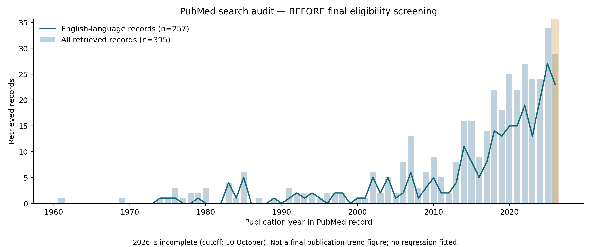
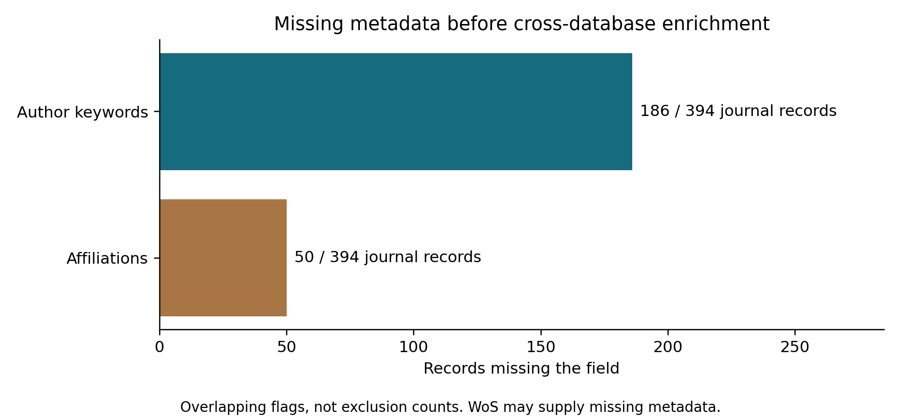

# 针灸治疗痉挛的研究格局、干预特征与发展趋势：文献计量及内容分析

中文优化工作稿｜2026年10月14日

稿件状态：本版参照Qi等（通信作者Shihua Cao）发表于JMIR的研究[16]，将文献计量与结构化内容分析结合。现有PubMed数据仅完成部分初筛；WoS导出、最终纳入集及正式图谱分析尚未完成。涉及后续分析的内容均以计划或待分析形式标明。本版为可继续完善的研究工作稿。

作者、单位、通信作者及目标期刊：待研究团队填写。

## 摘要

背景：针灸治疗痉挛的相关研究涉及不同疾病、干预方式和结局指标。文献数量及关键词分布能够描述学术关注，但要理解具体研究内容及其临床指向，还需要考察疾病、干预与结局之间的对应关系。

目的：从研究主体、知识结构和文献内容三个层面，梳理针灸治疗痉挛研究的组织格局、主题演变与干预特征，识别需要进一步验证的研究方向。

方法：拟检索Web of Science核心合集与PubMed建库至2026年10月10日发表的相关英文研究论文和综述，经合并去重、资格筛选和字段补全后，开展年度发文、国家与机构及作者合作、来源期刊、关键词共现、聚类、时间演变和突现分析。在此基础上，对原始研究提取疾病类型、干预方式、对照措施、结局领域及机制测量信息，建立疾病—干预—结局关联矩阵；临床研究、基础研究与综述分别分析。共被引分析限于参考文献覆盖充分的子集。

结果：当前原式PubMed检索获得395条记录，其中257条具有英文语言标记。394条期刊记录中186条缺少作者关键词，50条缺少机构信息。扩展敏感性检索获得604条记录，较原式增加209条候选，并检出原式遗漏的一篇相近主题文献计量研究。上述结果属于检索与数据质量检查。最终纳入规模、合作结构、主题聚类以及疾病—干预—结局分布均待正式分析。

结论：现有检查提示，检索覆盖与书目信息完整性是后续分析的重要前提。将知识图谱与按疾病分层的内容分析结合，有望提高对干预特征及研究空白的解释能力；具体热点与发展趋势仍需由最终纳入文献及分析结果确定。

关键词：针灸；痉挛；痉挛状态；文献计量学；知识图谱；内容分析。

## 1 引言

### 1.1 研究背景

针灸治疗痉挛的研究横跨神经康复及其他临床领域，相关文献中的研究对象并不完全一致。痉挛状态通常指上运动神经元病变相关、具有速度依赖性的牵伸阻力增高[1]；广义痉挛检索还可能涉及面肌痉挛及内脏平滑肌痉挛。不同病种在病理基础、干预目标与结局评价方面存在差异，因而整体研究图景需要建立在疾病分层的基础上。

现有文献涵盖针灸及电针治疗卒中后痉挛的系统评价[2–5]、干针相关随机试验[6]，以及围绕脊髓反射和抑制性信号开展的动物研究[7]。结肠镜检查期间的结肠痉挛[8]和面肌痉挛[9]也构成不同的研究场景。这些研究共同提出了值得梳理的问题：不同干预主要用于哪些疾病，关注哪些功能或生理结局，基础研究与临床研究之间是否形成了可以追溯的联系？

### 1.2 现有研究与分析切入点

既有研究已将文献计量与荟萃分析结合，用于讨论针灸治疗卒中后痉挛性偏瘫[10]。本研究拟在广义痉挛范围内，进一步呈现疾病及干预的异质性，并通过结构化内容提取解释关键词背后的具体研究内容。跨库补全、检索敏感性检查和参数核查为这一分析提供质量控制，但研究的实质问题仍是不同疾病情境下的干预特征及其发展变化。

文献计量可揭示合作关系、研究主题与共同知识基础[11,12]，结构化内容分析则能够补充书目字段难以呈现的干预方案、对照条件及测量对象。Qi等[16]在人工智能与痴呆生物标志物研究中，将常规计量分析与按疾病亚型开展的算法—标志物分类及关联分析结合，为理解技术的具体应用提供了方法参照。本研究拟借鉴这一分析思路，将其转化为适合本主题的疾病—干预—结局框架，并单独梳理基础研究中的机制测量。

### 1.3 研究目的

本研究拟回答四个相互衔接的问题。第一，针灸治疗痉挛研究的年度产出及主要研究主体如何分布，合作网络具有怎样的结构？第二，关键词及共被引分析呈现哪些主题与知识基础，其时间变化是否一致？第三，不同疾病对应哪些干预、对照和结局领域，这些组合在临床研究与基础研究中有何差异？第四，哪些方向已有持续研究积累，哪些尚需补充验证，其判断能否得到文献内容与时间分析的共同支持？

## 2 资料与方法

### 2.1 研究设计与范围

本研究拟采用文献计量、知识图谱与结构化文献内容分析相结合的方法，检索范围为数据库建库至2026年10月10日。当前依据原检索式覆盖广义痉挛及痉挛状态，不预先限定为卒中后痉挛。临床研究、基础实验与已完成的综述均进入候选范围，并分别记录疾病类型与研究设计。检索报告参照系统评价检索报告扩展规范的透明性原则[13]，但本研究本身不等同于临床疗效系统评价。

主要干预拟包括针刺、电针、艾灸、火针和干针。研究方案类论文、激光针灸及经皮穴位电刺激等边界记录，需在最终纳入集确定前统一处理口径。目前仅作标记，未将其全部视为已完成研究，也未依据未声明的标准直接删除。

### 2.2 数据来源与检索策略

PubMed部分已按照用户提供的“针灸相关术语”与“痉挛相关术语”组合进行检索，发表日期上限设为2026年10月10日。执行用检索式、数据库返回的检索式转换结果及原始响应均已保存[14]。检索阶段不预先限制语言或文献类型，以便在后续筛选中记录非英文、病例报告、社论和信函等排除数量。原式命中的全部记录已分批下载为可扩展标记语言文件，并与检索标识符清单逐一核对。

第二数据来源拟为Web of Science核心合集。实际使用的引文索引、可检索年份、检索日期、命中数与完整检索历史，应随导出文件一并保存。其主题检索沿用针灸、电针、艾灸、火针、干针与痉挛相关术语的组合；精确英文检索代码保留在配套研究方案中，以保证可重复性。数据拟采用“纯文本”格式，导出内容选择“完整记录与被引参考文献”[15]。目前尚未取得该数据库导出，故不将其写为已经完成的检索。

为评估原式对词形变化的敏感性，另行开展补充试检，增加“肌肉痉挛状态”医学主题词、电针的连字符拼写，以及痉挛、痉挛性、干针和火针的相关词形。补充结果与原式记录分开保存，不直接混入主数据。若后续采用扩展策略作为正式主检索，应同步调整另一数据库的策略，并依据新的检索版本重新核对和筛选。

实际检索时间与文献发表截止时间分别报告。本次检索不能重建截止日期当天的数据库历史状态。对电子发表与纸刊发表日期不同的文献，拟以最早能够核实的公开发表日期判断是否符合截止时间，并另行明确年度发文统计采用的年份规则。临近截止日期且日期精度不足的记录，应核查原文或出版信息。

### 2.3 纳入与排除标准

纳入文献应满足：发表于建库至2026年10月10日期间；论文语言为英文；可获取摘要或全文；属于研究论文或综述；研究内容与纳入范围内的针灸相关干预治疗痉挛直接相关。排除重复记录或重复发表、会议摘要、个案报告、报告、通知、信函、编辑材料及无关文献。撤稿声明、勘误和已撤稿原文分别标记。具有分析性设计的病例系列应依据实际研究设计判断，不仅凭题名中的“病例系列”字样决定去留。

缺少发表年份、作者姓名、机构或关键词的记录，拟在跨数据库匹配补全和来源核查之后，再按预定标准决定是否排除。PubMed缺少摘要并不等同于全文不可获取，应进一步检查全文来源。非英文论文即使提供英文摘要，也不能据此直接满足英文发表语言的要求。

筛选表保留原始文献类型标记、多重诊断标记、单一首要排除原因及相关性判断依据。拟按重复记录、出版类型不符、非英文、发表日期不符、主题无关、摘要及全文均不可获取、必要书目信息仍缺失的顺序，进行互斥原因统计。病例报告、社论、信函与无关文献分别报告，避免同一记录重复计入多个排除阶段。正式筛选建议由两名研究者独立复核并处理分歧；当前仅完成部分人工智能辅助初筛，未声称已经完成双人独立筛选。

### 2.4 合并去重与数据规范化

匹配前对数字对象标识符、PubMed标识符及Web of Science入藏号进行规范化。相同标识符构成优先核查的重复候选；标识符冲突或题名明显不同的记录需进一步核查。规范化题名与年份相同的条目也应复核，不作无条件合并。研究方案与后续结果论文原则上视为不同出版物，除非最终纳入规则另有明确规定。

合并记录保留数据库来源、原始标识符和字段来源。对应记录或可核实原始来源中的机构、作者关键词等信息，可用于补全缺项。作者关键词、医学主题词与数据库扩展关键词分别保存，不混作同一类字段。主关键词分析拟采用作者关键词；其他词源如需使用，应作为单独的敏感性分析，并保存原始词与规范词之间的对应关系。

国家依据作者机构地址识别，不从期刊出版国或作者姓名推断。机构规范化时区分院系、医院和大学；作者消歧结合姓名、机构、共同作者和可用的研究者标识符。每篇论文内同一国家、机构、作者或关键词重复出现时只计一次。国家、机构和作者发文量拟采用全计数法，因此不同主体的发文量之和可以大于总论文数。

### 2.5 发文趋势与描述性统计

年度发文量应基于最终去重且符合纳入标准的文献集计算，并保留研究时段内零发文年份。主趋势分析拟采用年度计数对年份的普通最小二乘线性回归，纳入截至2025年的完整年份，报告拟合区间、方程及决定系数。2026年仅统计至10月10日，拟单独标记，不纳入主回归，不按已过天数简单推算全年发文量。决定系数仅用于描述拟合程度，不作为因果证据或临床进步的检验。

电子表格软件中的趋势分析尚未执行，实际软件版本与计算过程将在运行后记录。国家、机构、作者和来源期刊按发文量排序，关键词按出现频次排序，报告前10位及并列处理规则。未完成筛选的检索集合不能直接用于生成正式的领域排名。

### 2.6 网络构建与可视化

国家、机构和作者网络拟表示论文共同署名形成的合作关系。关键词网络表示同篇论文内关键词共同出现的关系；文献共被引网络表示参考文献被同一篇来源论文共同引用的关系。参考文献可用性应按数据库来源分别检查。仅见于PubMed且缺少完整参考文献列表的记录，不能被当作“没有引用文献”的论文；必要时建立单独的共被引分析子集，并说明其与描述性统计总体的差异。

节点大小表示相应的发文量、词频或被引频次，连线粗细表示已定义的关系权重，颜色在各图图例中说明为聚类类别或时间信息。网络布局中的空间距离不直接解释为定量关联强度。国家图拟将地理分布与合作连线合并展示，并记录底图来源及实际绘图软件。

期刊表中的“连接强度”需先明确网络定义。本工作方案拟采用来源期刊的文献耦合关系，即汇总不同期刊论文之间共享参考文献形成的连接。该指标不同于被引期刊的共被引强度。正式填入数值前，应统一计算定义、参考文献覆盖范围和计数方式。

### 2.7 知识图谱软件参数、聚类与突现分析

知识图谱拟主要采用CiteSpace进行计算与展示[11,12]。依照原研究要求，主分析计划使用6.2.R6高级版，图5计划使用6.2.R7，图10计划使用6.2.R3。这些为拟使用版本，尚不代表实际运行记录；正式方法部分应以能够核实的安装版本、参数和运行日志为准。

初始设置拟采用1年时间切片，以g指数选择节点，参数取25，并以15和50进行敏感性检查。原始未剪枝网络与用于可视化的剪枝网络分别保留；拟考察寻径剪枝及切片网络剪枝，并明确中心性和聚类究竟基于哪个网络计算。中介中心性用于描述节点的桥接位置；是否对中心性大于0.1的节点显示紫色圆环，将在实际软件运行中核实。

聚类结果拟报告模块度、聚类规模、平均年份及轮廓系数。常见的模块度大于0.3、轮廓系数大于0.5或0.7等界值，仅作为描述性经验参考，不等同于统计学显著性检验。对于规模很小但轮廓系数较高的聚类，需谨慎解释。基于论文题名的对数似然比与潜在语义索引标签分别导出，并结合代表文献判断其含义，不以自动标签替代内容核查。

关键词突现拟识别词语出现频率随时间的快速变化，而非引文次数突现。初始参数拟设突现检测参数为1.0、最短持续时间为2年，并在实际版本支持时检查其他参数。报告突现强度、起始年、结束年及完整设置。延续至2026年的突现存在观察窗口右端截断，不能解释为该热点已于当年结束。

### 2.8 时间演变与作者—关键词—期刊关联分析

关键词时间演变拟结合逐年词频表和时间线图进行分析。桑基图连接作者、总体出现频次排名前10的规范化关键词及来源期刊。为避免多作者或多关键词论文造成权重膨胀，设一篇论文有a位作者、涉及m个所选关键词，则每条作者—关键词连接赋权1／（a×m），每条关键词—期刊连接赋权1／m，使每篇被展示论文在两侧均贡献总权重1。

如为提高可读性而限制展示作者或期刊，应说明筛选规则及“其他”类别的归并方式。桑基图与地理图所用的实际绘图软件，应与知识图谱软件和电子表格软件一起如实报告。

### 2.9 文献内容提取与分类

参照文献计量与内容分析相结合的思路[16]，拟在最终纳入集内建立结构化编码表。书目计量保留符合标准的研究论文与综述；干预应用及结局统计以原始研究为主体，综述另行汇总，以避免综述重复描述既有试验造成应用频次膨胀。研究方案类记录继续保留边界标记，不计入已完成研究的结局统计。

疾病分类首先区分神经源性痉挛状态、面肌痉挛及其他痉挛情境，并在神经源性类别下记录卒中、脑瘫等具体病因。分类以原文诊断及研究对象为依据；动物模型单独编码，不直接归入患者研究。包含多个疾病且无法拆分的论文记录为混合样本，不将同一组结果重复分配给不同疾病。

干预提取毫针、电针、艾灸、火针、干针及其联合形式，同时记录穴位或施治部位、频次、疗程，以及电针参数等原文可获得信息。联合康复或药物治疗分别记录针灸成分、共同干预与对照组措施。不同操作形式保留独立类别；未报告的字段编码为“未报告”，不按常见做法补填。干预边界沿用2.1节的主分析范围，其他穴位刺激方式待统一资格口径后处理。

结局按肌张力或痉挛表现、运动及活动能力、日常生活与生活质量、症状体验、安全性及随访等领域编码，保留量表原名和评估时间点。机制测量另记神经电生理、脑功能或可塑性、分子及组织指标等原文实际报告内容。仅在引言或讨论中提及的机制假说不计为已测量指标；背景中提到的疾病或干预也不计为实际应用。

拟由两名研究者先对覆盖不同病种和研究设计的文献进行试编码，修订类别定义后独立提取，分歧经讨论或第三名研究者裁决。单标签字段报告一致率及适用的一致性指标，多标签字段逐类别核查。当前尚未完成该过程，不预填评估者人数的实际执行记录、一致性系数或专家审核结论。每个判断保留原文页码、表号或段落定位；仅有摘要且信息不足的记录标明证据来源，并进行全文可得子集的敏感性比较。

### 2.10 疾病—干预—结局关联与时间比较

拟分别构建疾病—干预和干预—结局矩阵，并以疾病分层呈现。仅对原文中能够确认对应关系的组合建立连接；多干预、多结局论文不自动生成所有笛卡尔组合。联合干预作为明确的方案编码，组成成分可另作描述，但不将联合方案的结局解释为其中单一治疗的独立作用。

矩阵单元表示报告相应组合的去重论文数，同篇论文在同一组合内只计一次。对可确认的多个组合允许多标签计数，并注明各类别之和可能超过论文总数。百分比的分母为相应疾病及研究设计层内可编码的原始研究数；同时报告未能分类的数量。由同一试验或样本形成的多篇报告保留关联标识，补充按独立研究合并后的敏感性统计，以免论文数量被理解为独立验证次数。

拟以热图呈现疾病—干预分布，以分层关联图呈现干预—结局联系。若使用桑基图，须按逐篇确认的完整路径构建，每篇有k条可追溯路径时各赋权1/k，以保持每篇论文总权重为1；该图与2.8节作者—关键词—期刊图分别报告。临床结局与动物机制指标采用不同图层，不串接为已经证实的因果通路。

时间比较结合年度论文数、主题论文占当年可分析文献的比例及关键词突现结果进行。2026年单独显示为不完整年份。研究阶段如需划分，应根据可复核的时间变化和代表文献共同论证，并披露分段依据；数据稀疏或无清晰变化时保留逐年描述。预先规定的类别用于编码，最终出现的热点、阶段名称和增长方向由实际数据决定。

### 2.11 代表文献核查与结果整合

拟对主要聚类的代表文献、经核实的高被引文献以及近期主题的相关原始研究进行内容核查。记录选择依据、疾病与设计、干预和对照、主要结局及解释限制。引文指标统一数据库来源和统计日期；局部被引与全局被引分别报告。较新或较低被引论文可用于解释主题内涵，但不称为高影响力文献。

最终将关键词聚类标签与内容编码分布对照：同一聚类是否包含多个病种，机制术语来自实际测量还是背景讨论，某类干预的频繁出现是否集中于少数重复报告。内容编码与自动聚类不一致时保留差异并回查来源。本文不开展疗效合并分析；研究设计分类不等同于偏倚风险评价，尚未进行质量评价的文献不能仅凭频次、引文数或设计名称判定证据确定性。

## 3 结果

### 3.1 检索与数据准备进展

原式PubMed检索获得395个不重复标识符，全部已下载并核对，包括394条期刊记录和1条报告记录。其中257条具有英文语言标记。394条期刊记录中，186条缺少作者关键词，50条缺少机构信息；两类缺项可重叠，均为补全前状态。

当前202条记录被暂时标记排除，193条尚未排除；后者包含182条待相关性判断及11条初步相关记录。扩展检索获得604条记录，覆盖原式全部395条并新增209条候选，还检出原式未命中的相近主题研究[10]。以上数字不构成最终筛选流程。详细初筛说明及审计图置于附录A；正式结果各节须在最终纳入集冻结后填写。

### 3.2 年度产出与研究发展

【待分析】本节对应图1—图2，报告两库最终筛选流程、文献类型构成、首篇纳入文献年份、完整年度产出与趋势拟合。若观察到阶段变化，需同时核对主题占比及代表研究。当前尚不能确定发文峰值、增长阶段及其起止年份。

### 3.3 研究主体、合作结构与来源期刊

【待分析】本节对应图3—图5及表1—表4，依次报告国家、机构、作者和期刊分布，再描述主要合作群体及其连接。讨论合作格局时结合网络覆盖范围、孤立节点和跨机构连接等实际结果。尚未开展连续年度作者活动统计，因此本稿不报告研究者进入或退出比例。

### 3.4 知识基础、热点主题与时间演变

【待分析】本节对应图6—图10、表5—表6及可用的共被引补图，报告关键词频次、聚类质量、代表文献、时间演变及突现区间。围绕疾病、干预和结局解释聚类内涵，区分高频主题与近期变化主题。共被引结果同时说明参考文献完整子集的覆盖范围。

### 3.5 不同疾病的干预与结局分布

【待分析】在原有图表之外，拟增加补图S2“疾病—干预分布热图”、补图S3“按疾病分层的干预—结局关联图”及补表S1“原始研究内容编码汇总”。本节报告各病种中原始研究数量、干预形式、联合治疗及对照构成、结局领域与信息缺失情况。图表完成前不预设某种干预占主导，也不根据组合出现频次排列疗效优劣。

### 3.6 机制研究与临床研究的对应情况

【待分析】拟在补表S2汇总代表文献及其研究设计、实际测量和解释边界，比较临床研究与基础研究是否围绕相近疾病、干预及测量问题展开。已有参考文献[6–9]仅用于说明分析维度，在完成资格筛选前不视为最终样本，也不据此推断整个领域的主题比例。

## 4 讨论

### 4.1 从研究规模进一步理解研究内容

本研究拟通过研究主体、主题结构和具体研究内容三个层面解释针灸治疗痉挛的文献格局。当前已完成的检索检查首先表明，候选集对检索术语及拼写覆盖较为敏感：扩展检索增加209条候选，并找回原式遗漏的一篇相近研究。该发现支持在开展正式图谱分析前继续核查检索覆盖，而新增候选的相关性仍需逐篇判断。

完成分析后，讨论应优先围绕主要实证发现展开，例如主要疾病情境的研究分布、干预及结局组合的集中程度，以及近期主题变化能否得到内容提取支持。Qi等[16]通过算法与标志物分类补充了常规计量指标的解释，本研究据此增加疾病—干预—结局分析，以便将关键词反映的关注度落实到具体研究问题。现阶段这一部分属于方法上的改进，尚不能称为已经发现了新的研究热点。

### 4.2 疾病分层有助于解释干预差异

广义痉挛检索覆盖多个临床情境。以卒中后痉挛相关研究[2–7]、结肠镜检查中的痉挛研究[8]及面肌痉挛研究[9]为例，疾病背景与观察目标不同，即使共享“针灸”或“电针”等关键词，也需要分别解释研究意义。最终图谱若出现相互分离的主题群，应回查其病种构成和研究设计，判断分离是由临床问题、术语使用还是合作群体差异形成。

疾病—干预矩阵能够显示哪些应用情境受到较多研究，哪些在当前语料中报道较少。然而，较少的文献也可能与英文限制、索引覆盖或术语不一致有关。因此，只有在核对分类与检索范围后，才能将某一空白作为后续研究问题；其临床优先级还需结合该疾病的实际需求及既有证据讨论。

### 4.3 结局与对照设置决定干预研究的解释范围

干预名称相同的论文可能在施治部位、疗程、共同治疗和对照条件上存在差异。内容提取应使这些差异进入结果解释。例如，针灸联合康复研究中观察到的结局，需要结合两组共同干预和组间差别判断其含义；单纯统计“针灸”出现次数无法提供这些信息。

结局分析则应区分症状或肌张力测量、活动能力、生活质量和安全性等领域，并保留时间点。若最终发现某类研究主要报告短期指标，而随访或功能结局报道较少，可据此提出改进测量和随访的研究建议；在编码完成前，这只能作为待检验问题。论文未报告不良事件或某一结局时，应编码为未报告，避免把信息缺失写成没有风险或没有效果。

### 4.4 机制线索与临床验证需要分别呈现

Mu等[7]在卒中后痉挛性肌张力增高的大鼠模型中研究了KCC2相关脊髓GABAA信号，为本稿设计机制测量字段提供了具体例子。对此类文献的解释需保留模型、干预和测量层级，不能仅因临床论文也使用相同关键词，就认定机制已在患者中得到验证。

内容分析可进一步检查，基础研究提出的测量问题是否在临床研究中得到对应观察，以及相应关系是否具有时间上的延续性。实际测量、作者提出的解释与讨论中的假说应分别记录。即使存在共同指标或一致方向，仍需回查研究设计和替代解释，才能讨论可能的转化价值。

### 4.5 合作与主题演变对后续研究的启示

合作网络有助于识别围绕相近问题开展研究的团队，但发文多或中心性高主要反映产出及网络位置。若正式结果显示某些疾病或技术主题之间连接有限，可进一步检查这些主题是否具有共同结局或互补方法，再讨论跨团队合作的具体内容。未开展学科编码时，不依据机构名称直接断言已经存在或缺少某种学科合作。

研究前沿的判断需要综合关键词变化、相关论文占比和原始研究内容。突现词可能来自新技术，也可能受到命名变化、小样本波动或数据库收录变化影响。研究阶段应依据本领域数据确定；曹老师文章中的阶段年份、作者流动比例及具体技术结论不适用于直接填入本研究。

### 4.6 优势与局限性

拟采用的分析框架将书目网络与结构化内容结合，并保留疾病、研究设计及联合干预的差异，有助于提升研究主题解释的可追溯性。双数据库补全和敏感性检查能够帮助识别部分数据缺陷，但不能保证全面消除遗漏或偏倚。

本研究仍受到英文限制、数据库覆盖差异、机构及关键词缺项、作者消歧误差和网络参数选择的影响。因缺项排除文献可能改变年代构成，应比较补全前后缺项比例，并检查保留与排除文献的年度分布。PubMed与WoS的参考文献覆盖不同，共被引子集的结论未必适用于全部纳入论文。2026年为不完整年份，也限制了增长及突现趋势的解释。

内容分类存在人工判断误差，摘要与全文的信息详尽程度不同，多篇论文可能来自同一研究，均需通过来源定位、独立复核与敏感性分析处理。由于本研究不开展疗效合并，且尚未对纳入研究实施偏倚风险评价，文献分布仅描述研究活动，不能直接形成治疗推荐。当前工作稿的直接限制是最终筛选及正式分析尚未完成，因此关于热点、合作格局和发展方向的论断仍待数据支持。

## 5 结论

本研究已完成PubMed原式记录采集及部分初筛，并通过敏感性检查识别出需要进一步核查的检索覆盖与字段完整性问题。在此基础上，形成了文献计量、知识图谱与疾病—干预—结局内容分析相结合的研究框架。后续需完成双库合并、最终筛选、内容复核及网络计算，方能确定不同疾病的干预特征、主要研究主题和发展趋势。

## 声明

基金资助、利益冲突、作者贡献及致谢：待作者团队提供并核实。

伦理说明：本研究拟分析已公开发表的书目信息，不招募受试者。是否需要伦理审查或豁免应依据所在机构要求确认；本稿未填写未经核实的批准号或豁免声明。

数据与代码：本地项目已保存原式检索响应、原始文献记录、文件校验值、逐篇筛选表、敏感性检索新增标识符和可重复运行的脚本。尚未取得Web of Science核心合集导出，也未形成最终分析数据集。公开共享摘要或订阅数据库记录时应遵守相应许可；本稿不声称已经向公共仓库提交数据。

人工智能辅助说明：本项目使用人工智能辅助检索脚本编写、部分初筛、方法检查与稿件起草。作者应核实资格判断、解释与引用，并按目标期刊要求披露辅助使用情况；现有工作不能视为两名研究者的独立复核。

## 附录A：检索与数据质量检查

### A.1 初筛明细

原式PubMed检索获得395个不重复标识符，包括394条期刊记录和1条英国国家卫生与临床优化研究所的证据综述报告记录。下载文件中的标识符与检索清单完全一致。395条记录中，257条带有英文语言标记。394条期刊记录中，186条未提供作者关键词，50条未提供机构信息。这些缺项标记可以重叠，属于补全前的数据质量指标，不是最终排除数量。

数据库文献类型标记识别出49条病例报告、1条信函，未发现带有社论类型标记的记录。题名及部分摘要复核另识别出1篇双病例报告、1条信函和1条撤稿通知。因此，本轮暂记病例报告50条、信函2条；社论类型标记计数为0，但这不能替代全部记录的最终类型复核。另有10条记录被初步判断与预定治疗问题无关，逐条依据已保存在筛选表中。

按当前首要排除原因统计，共有202条记录被暂时标记排除，193条尚未排除。其中182条仍待相关性判断，11条初步判断相关，后者包括7条基本字段齐全和4条仍需补全字段的记录。相关或字段齐全均不等于最终纳入，以上数字不能作为已完成的研究筛选流程。

### A.2 检索敏感性检查

扩展敏感性检索共获得604条记录，覆盖原式全部395条，并增加209条候选标识符。已核实的一篇2026年相近主题文献计量研究[10]未被原式命中，但能够被扩展式检出。这一实例支持进一步核查原式的查全率；新增209条并不意味着漏掉了209篇合格文献。原式与扩展式结果分开归档，扩展新增项尚未完成摘要下载和资格筛选。

### A.3 审计图

以下两图仅用于说明已下载PubMed记录的分布和缺项情况，不属于正式正文图1—图10，也不能替代最终纳入文献的发文趋势或知识图谱。图内文字保留英文，图题和说明使用中文。

附图A1　原式PubMed检索记录的年度分布。柱形表示全部395条检索记录，折线表示257条具有英文语言标记的记录；2026年为截至10月10日的不完整年份。该图基于筛选前记录，不进行正式发文趋势回归。

附图A2　跨库补全前的书目信息缺项。分母为394条期刊记录，不含1条报告记录；186条缺少作者关键词，50条缺少机构。两类缺项可能重叠，不可相加作为排除总数。

## 参考文献

[1] 美国国家医学图书馆．肌肉痉挛状态：2026年医学主题词描述记录D009128．https://meshb.nlm.nih.gov/record/ui?ui=D009128．访问日期：2026年10月11日。

[2] Park SW，Yi SH，Lee JA，等．针灸治疗卒中后痉挛：随机对照试验的荟萃分析．替代与补充医学杂志，2014，20（9）：672–682．https://doi.org/10.1089/acm.2014.0097。

[3] Lim SM，Yoo J，Lee E，等．针灸治疗卒中后痉挛：随机对照试验的系统评价与荟萃分析．循证补充与替代医学，2015：870398．https://doi.org/10.1155/2015/870398。

[4] Cai Y，Zhang CS，Liu S，等．电针治疗卒中后痉挛：系统评价与荟萃分析．物理医学与康复档案，2017，98（12）：2578–2589.e4．https://doi.org/10.1016/j.apmr.2017.03.023。

[5] Xue C，Jiang C，Zhu Y，等．针灸治疗卒中后痉挛的有效性与安全性：系统评价与荟萃分析．神经病学前沿，2022，13：942597．https://doi.org/10.3389/fneur.2022.942597。

[6] Sánchez-Mila Z，Salom-Moreno J，Fernández-de-Las-Peñas C．干针对卒中后痉挛、运动功能和稳定性界限的影响：随机临床试验．医学针灸，2018，36（6）：358–366．https://doi.org/10.1136/acupmed-2017-011568。

[7] Mu JD，Ma LX，Zhang Z，等．针灸通过钾氯共转运体2介导的脊髓γ-氨基丁酸A型受体激活，减轻缺血性卒中后痉挛性肌张力增高大鼠的脊髓反射亢进与运动功能障碍．实验神经病学，2022，354：114027．https://doi.org/10.1016/j.expneurol.2022.114027。

[8] Chen B，Ma Y，Zhong C，等．针灸抑制结肠镜检查期间结肠痉挛的效果与安全性：随机对照试验．胃肠肿瘤学杂志，2022，13（3）：1169–1177．https://doi.org/10.21037/jgo-22-407。

[9] Li S，Li W，Huang J，等．远端电针通过调节脑干与运动皮层的适应不良性可塑性缓解面肌痉挛．运动障碍，2026．https://doi.org/10.1002/mds.70455。

[10] Liu J，Chen R，Huang Q，等．针灸治疗卒中后痉挛性偏瘫：结合文献计量与荟萃分析的双维度证据综合．家庭医学与初级保健杂志，2026，15（5）：1873–1879．https://doi.org/10.4103/jfmpc.jfmpc_1889_25。

[11] Chen C．科学文献中新兴趋势与短暂模式的检测和可视化：CiteSpace第二版．美国信息科学与技术学会杂志，2006，57（3）：359–377．https://doi.org/10.1002/asi.20317。

[12] Chen C，Ibekwe-SanJuan F，Hou J．共被引聚类的结构与动态：多视角共被引分析．美国信息科学与技术学会杂志，2010，61（7）：1386–1409．https://doi.org/10.1002/asi.21309。

[13] Rethlefsen ML，Kirtley S，Waffenschmidt S，等．系统评价文献检索报告规范：系统评价与荟萃分析优先报告条目的检索扩展．系统评价，2021，10：39．https://doi.org/10.1186/s13643-020-01542-z。

[14] 美国国家医学图书馆．PubMed用户指南．https://pubmed.ncbi.nlm.nih.gov/help/．访问日期：2026年10月11日。

[15] 科睿唯安．Web of Science记录导出说明．https://webofscience.help.clarivate.com/en-us/Content/export-records.htm．访问日期：2026年10月11日。

[16] Qi W, Zhu X, He D, et al. Mapping Knowledge Landscapes and Emerging Trends in AI for Dementia Biomarkers: Bibliometric and Visualization Analysis. Journal of Medical Internet Research. 2024;26:e57830. doi:10.2196/57830.（通信作者：Shihua Cao；方法参照文献，不属于本研究纳入样本。）
