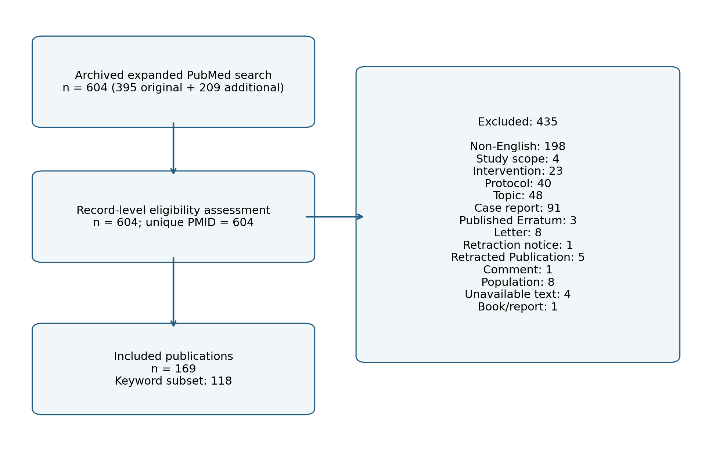
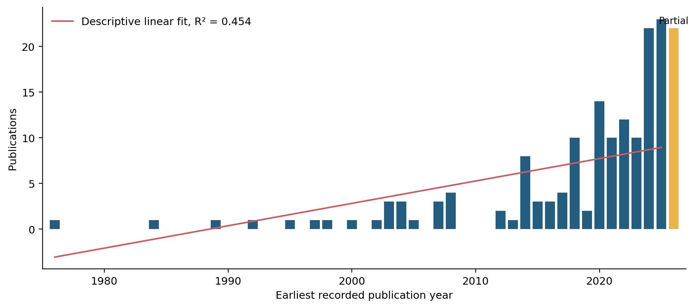
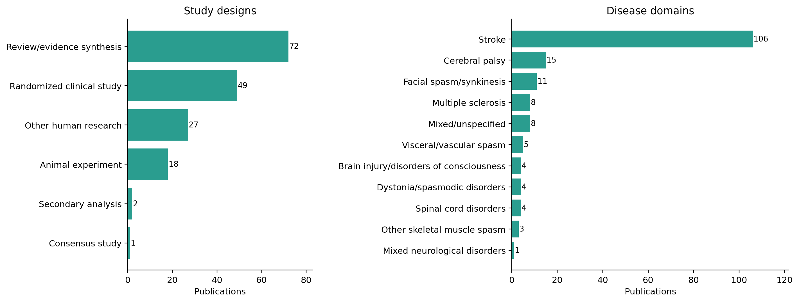
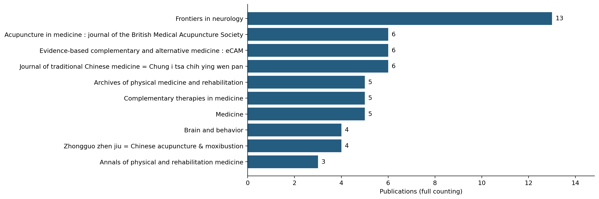
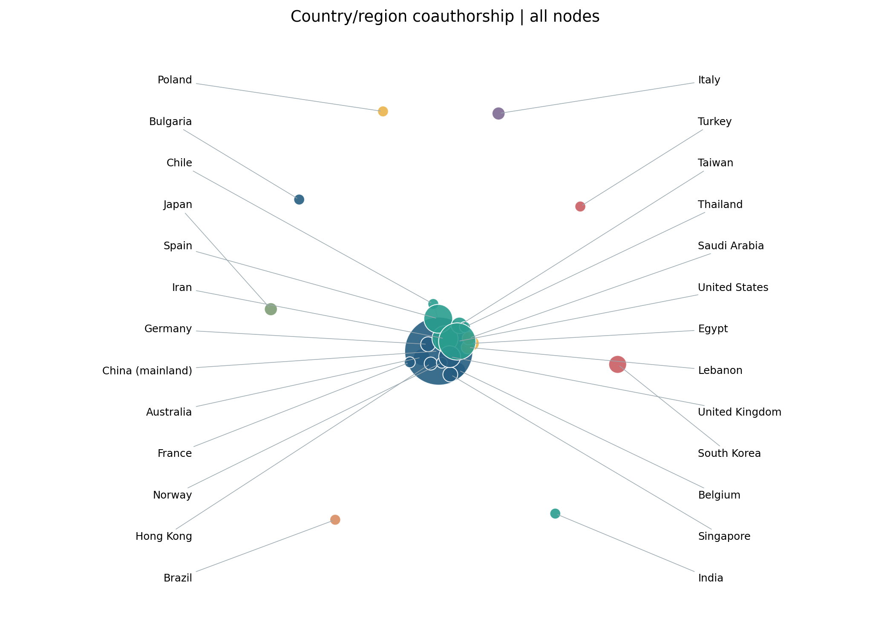
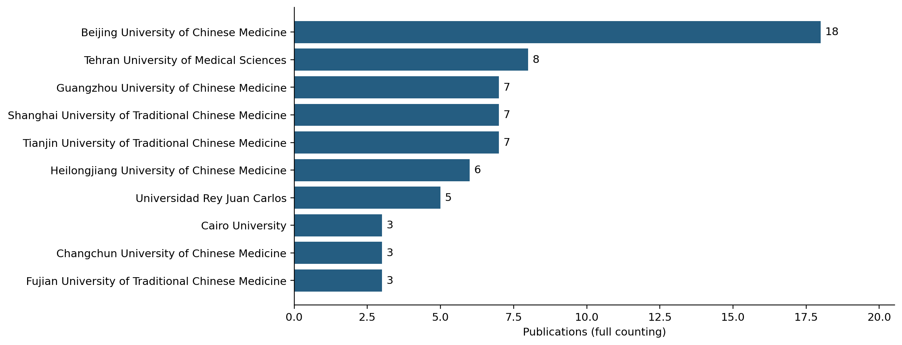
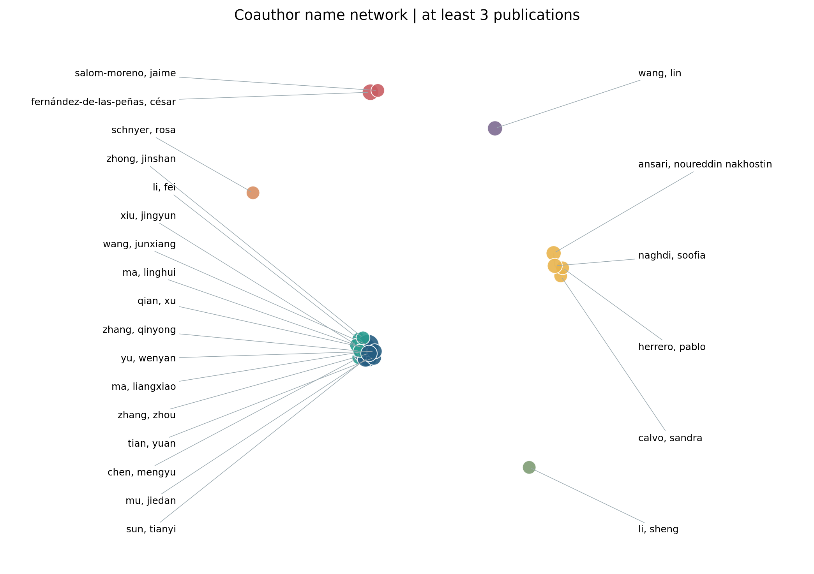
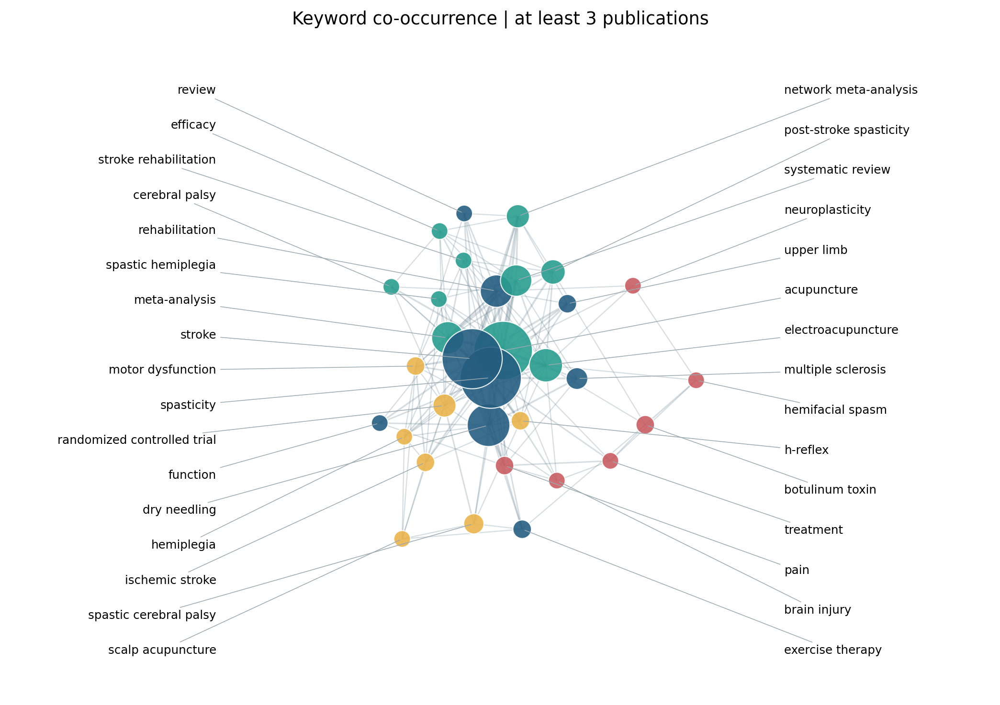
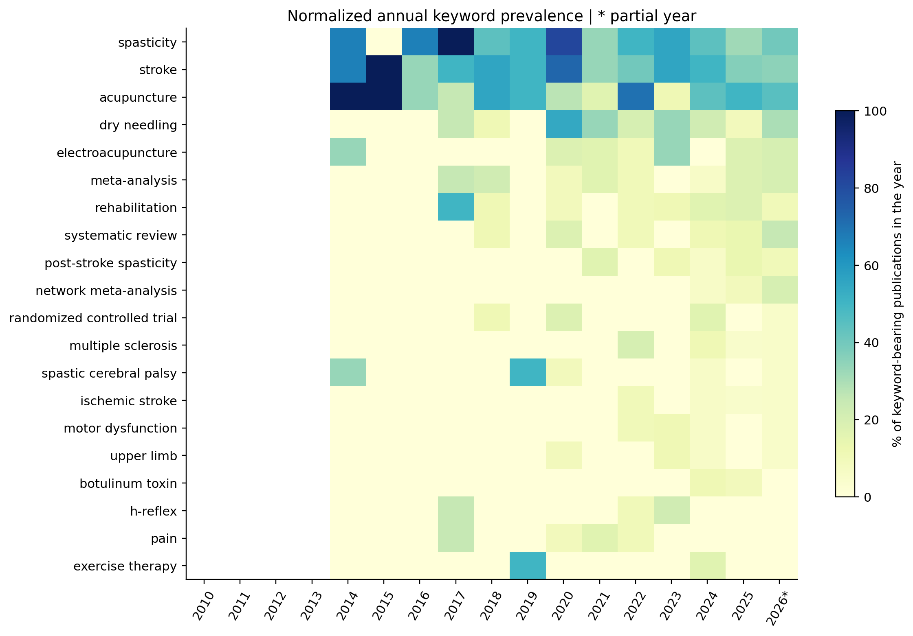
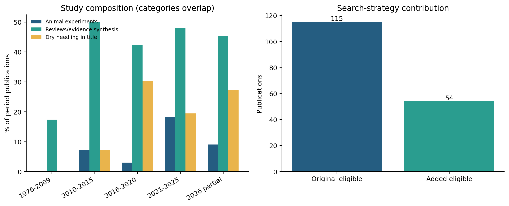

# 针灸与干针干预痉挛相关疾病的研究结构与主题分布：基于PubMed的文献计量分析

## 摘要

目的：分析针灸与干针干预痉挛相关疾病的文献分布、合作联系和主题结构，评价检索策略及关键词覆盖对领域图谱的影响。

方法：检索PubMed建库至2026年10月10日的相关文献，以主题词和自由词组合构建扩展检索策略。依据发表语言、出版类型、干预与疾病相关性完成逐条资格判断，以符合标准的论文为计量单位。采用Python开展年度分布、期刊、研究类型及国家/地区和机构分析，构建合作与关键词共现网络；采用Louvain算法进行社群划分，并通过检索策略、文献类型、疾病范围和关键词频次阈值分析检验结果稳健性。

结果：604条检索记录中纳入169篇，发表时间为1976—2026年，分布于100种期刊。扩展检索较原式补回54篇合格文献，占纳入集的31.95%；32篇以干针为主要主题的论文中，28篇由扩展检索补回。卒中相关研究106篇（62.72%），脑瘫相关研究15篇（8.88%）。综述与证据综合72篇（42.60%），随机临床研究49篇（28.99%），动物实验18篇（10.65%）。2021—2025年发表77篇，占全部文献的45.56%；2025年发表23篇，为完整观察年份中的最高值。中国大陆、美国、西班牙署名文献分别为90、26、15篇，27篇存在跨国家/地区合作。118篇具有可用关键词，共现网络包含32个节点、156条连线，模块度为0.158；高频词包括spasticity、stroke、acupuncture和dry needling。不同分析子集均保留上述核心主题，但社群边界较弱。

结论：PubMed收录的针灸与干针干预痉挛相关研究以卒中康复为中心，形成针灸及其联合康复、干针与运动功能评价等相互交织的主题。近年动物机制研究在文献构成中的占比提高，但关键词覆盖存在明显年代差异，尚不能据此认定清晰的热点更替。规范覆盖干针词形并区分疾病与研究设计，有助于获得更完整的领域研究图景。

关键词：针灸；干针；痉挛；卒中；文献计量；关键词共现。

## 1 引言

痉挛相关疾病的研究涉及多种临床情境。卒中、脑瘫、脊髓损伤和多发性硬化中的痉挛状态，面肌痉挛、痉挛性斜颈，以及内脏平滑肌痉挛，在病理机制与治疗目标上均有差异。针灸相关文献同时使用spasm、spasticity及其词形描述这些问题，因此，对广义痉挛研究进行文献计量时，需要保留疾病层面的分层，避免以一个总体网络替代不同疾病的证据解释。

针刺、电针、艾灸和干针已被用于痉挛相关研究。卒中后痉挛领域既有针灸、电针的系统评价，也有干针的随机临床研究[1–4]。这些研究采用不同的治疗方案和评价指标，研究活动的增加并不直接等于疗效证据确定性的提高。近期基础实验进一步涉及脊髓反射、γ-氨基丁酸信号及钾氯共转运体2（KCC2）等机制[5,6]；面肌痉挛和结肠痉挛研究则提示，针灸研究对象并不限于卒中后肢体痉挛[7,8]。

已有研究将文献计量与荟萃分析结合，用于评价针灸治疗卒中后痉挛性偏瘫[9]。因此，本研究的增量在于：在较广的痉挛疾病范围内区分研究设计与疾病构成，检验干针词形覆盖对纳入文献和主题结构的影响，并以明确的字段分母解释合作及关键词图谱。本研究不以文献频次或网络位置推断治疗优劣，而是描述可检索英文文献中的研究组织与主题联系。

## 2 资料与方法

### 2.1 数据来源与检索

采用PubMed作为本次分析的数据来源。原式及扩展式检索结果均于2026年10月11日保存，文献发表日期上限为2026年10月10日；原式395条记录的XML在首次检索阶段获取，扩展新增209条的XML于2026年10月18日补充获取。以保存的604个PMID为固定检索队列，而非把后续数据库实时命中数与原始结果混合。实际检索时间晚于发表截止日，故该队列不代表截止日当天的数据库历史快照。检索及数据处理过程参照PRISMA-S的可追溯报告原则[10]。

扩展检索使用Acupuncture Therapy、Spasm、Muscle Spasticity主题词，结合acupuncture、electroacupuncture、electro-acupuncture、moxibustion、dry needl*、fire needl*、spasm*和spastic*等自由词。完整数据库检索式及返回的检索转换表达式见补充方法。检索阶段不限制语言或文献类型。原始XML、检索标识符与文件校验值均予保存。原研究方案中的Web of Science合并分析调整为本次PubMed单库分析，故研究范围明确限定于该数据库收录的英文文献。

### 2.2 纳入标准与筛选

纳入英文发表的期刊研究或综述，研究对象为痉挛状态或明确的痉挛相关疾病，干预包含针刺、电针、干针、火针、温针或艾灸。纳入直接评价上述干预的临床研究、疾病动物模型实验、治疗使用调查和相关证据综合；对于混合疾病综述，要求可识别针对痉挛的讨论或结果。痉挛型脑瘫等明确疾病人群的功能或机制研究亦予纳入，不要求所有论文均以痉挛量表为主要终点。不同论文即使来自同一试验，仍以独立出版物计量，不能将文献数解释为独立试验数。

排除病例报告、书籍或报告条目、信函、评论、勘误、撤稿文章及撤稿通知、未完成的研究方案，以及非英文文献。针刀、穴位埋线、激光穴位刺激、单纯穴位按压和经皮电刺激不属于本次主分析干预范围。针灸仅为背景治疗、既往治疗或危险因素，痉挛仅为不良事件、疼痛修饰词或理论推测的论文亦排除。具有系统观察或组间比较设计的病例系列不因题名包含“病例系列”而自动排除。摘要缺失时进一步查找公开原文；仍无法取得摘要或全文的记录另行列示，不以题名推断具体研究结果。

筛选采用人工智能辅助的题名、摘要和必要开放全文核查，保存每篇记录的判断理由和支持文本；本次未进行两名研究者独立筛选。数据库出版类型与题名、摘要不一致时，优先使用可核实的实际研究内容，并保留分歧说明。以PMID、规范化DOI和题名检查重复；将各排除原因按固定优先顺序记录为互斥首要原因。机构或关键词缺失不作为总体纳入的排除条件，而是根据具体分析所需字段建立子集。

### 2.3 字段处理与分类

提取题名、作者、期刊、发表日期、语言、出版类型、机构、关键词及原始标识符。发表年份使用期刊日期与已记录电子发表日期中较早的年份，另保留纸刊年份。2026年为不完整观察年，单独标记，不用于完整年份的趋势比较。研究设计综合出版类型、题名和摘要分为综述/证据综合、随机临床研究、其他人体研究、动物实验、二次分析和共识研究。疾病按主要研究对象分类；无法限定于单一疾病的论文保留混合类别。

关键词来自PubMed XML中Owner="NOTNLM"的非NLM关键词字段，视为出版方提供的关键词；未逐篇向出版方核实其全部属于作者自拟关键词，故不将其与严格意义的作者关键词完全等同。MeSH词单独保留，不混入主网络。关键词进行大小写、连字符及明确同义词规范化，每篇文献中同一词计一次；保留stroke与ischemic stroke、spasticity与post-stroke spasticity等概念层级差异，完整转换表见补充数据。

国家/地区依据机构地址中的明确地名识别，少数缺少国家名称的地址以可明确定位的机构或城市补全，不依据作者姓名、电子邮箱域名或期刊出版地推断。机构以大学及其明确附属体系为规范化单位；未注明大学归属的医院、研究机构独立保留。因此，本研究的机构排名表示机构体系的论文贡献，不等同于各附属医院之间的独立合作排名。作者仅规范大小写和名字中的连字符，不将姓名缩写强制扩展为全名；作者网络表示规范化署名，存在残余同名及姓名顺序差异风险。

### 2.4 描述统计与网络分析

采用全计数法统计国家/地区、机构和作者贡献，同一篇文献内的重复主体只计一次。合作网络的连线权重为两个主体共同署名的文献数；关键词共现权重为两词共同出现的文献数。主关键词网络保留出现频次≥3次的词，机构网络和作者展示网络分别采用≥2篇和≥3篇的阈值。节点大小对应频次，连线表示共同出现，颜色表示Louvain社群[11]。所有节点和边按固定顺序构建，随机种子设为42；报告节点数、边数、网络密度与模块度，不以空间距离替代定量关联。

分析使用Python 3.11.7、NetworkX 3.1、NumPy 1.26.4、SciPy 1.11.4及Matplotlib 3.8.0完成，未使用CiteSpace生成本次结果。年度计数保留零发文年份，以普通最小二乘回归作描述性拟合，不作未来发文量预测。年度关键词热图以当年具有关键词的文献数为分母，表示关键词出现比例；无关键词记录的年份标为无数据。

### 2.5 稳健性与时间分析

分别比较扩展检索总体与原式检索合格子集、剔除综述后的子集、卒中子集，并在关键词频次阈值2、3、5下重建网络。时间分析采用1976—2009年、2010—2015年、2016—2020年和2021—2025年分期，2026年单列。对后两个完整时期的动物实验、综述和以干针为主题的论文比例进行探索性Fisher精确检验，对三项检验采用Benjamini–Hochberg校正。

另以两状态二项分布模型检查词频增强区段：以全时期出现比例为基线，高状态概率为基线的2倍、上限0.999；升入高状态的惩罚为ln(T)，T为年度切片数。动态规划选择代价最小的状态序列，仅保留总频次≥5、持续至少2年的区段；分析截至2025年。该结果为自定义频次增强检查，不等同于CiteSpace突现强度。参考文献列表仅在部分PubMed记录中存在，未开展总体共被引或来源期刊文献耦合分析。

## 3 结果

### 3.1 检索与纳入文献

扩展检索获得604条不重复记录，其中原式记录395条，新增记录209条。逐条筛选排除435条，纳入169篇（图1）。主要排除原因为非英文198条、病例报告91条、主题不符48条及研究方案40条；完整互斥原因见图1和逐篇筛选表。4条未取得可核实摘要或全文的记录已单列，其中3条题名明确相关；若这3条均符合其余条件，纳入量将为172篇；若4条全部符合，则为173篇。其研究类型和关键词不作推断。

图1　检索与筛选流程。排除原因互斥；本图表示记录级资格判断，不表示两名研究者独立筛选或全部文献均经全文复核。

原式包含115篇合格文献，扩展式补回54篇，占全部169篇的31.95%；相对于原式合格集合，增幅为46.96%。扩展新增合格文献中，卒中相关29篇、脑瘫相关11篇、多发性硬化相关4篇。以干针为主要主题的32篇论文中，原式检出4篇，扩展式补回28篇，说明遗漏集中影响某些干预分支，而不只是改变总体数量。

纳入文献均有可用摘要；165篇具有机构字段，163篇可识别至少一个国家/地区，159篇可识别机构体系。118篇具有可用关键词，占69.82%。关键词覆盖随年代差异明显：1976—2009年23篇均无该字段，2010—2015年为4/14篇，2016—2020年为29/33篇，2021—2025年为65/77篇，2026年为20/22篇。上述分母分别用于各分析，不把169篇统一作为网络可用样本数。

### 3.2 年度分布与研究类型

文献时间跨度为1976—2026年。2021—2025年累计77篇（45.56%），2016—2020年为33篇；2024年22篇、2025年23篇，后者为完整观察年份的最高值。2026年截至检索截止范围内为22篇，不直接与完整年份判定升降。1976—2025年的描述性线性拟合R²为0.454，提示简单线性关系不足以充分概括年度波动（图2）。

图2　年度文献分布。采用可核实的最早发表年份，保留零发文年份；2026年为不完整年份。拟合线仅为1976—2025年的描述性线性趋势。

研究设计以综述和证据综合为最多，共72篇（42.60%）；随机临床研究49篇（28.99%），其他人体研究27篇（15.98%），动物实验18篇（10.65%），二次分析2篇，共识研究1篇。分类反映论文报告的设计，不构成随机化质量或偏倚风险的评价。卒中相关文献106篇（62.72%），脑瘫15篇（8.88%），面肌痉挛/面神经联带运动11篇（6.51%），多发性硬化8篇（4.73%）；其余涉及脑损伤、脊髓疾病、肌张力障碍与内脏等痉挛场景（表1，图9）。

表1　研究类型与疾病构成（N=169）

| 维度 | 分类 | 篇数 | 比例（%） |
| --- | --- | --- | --- |
| 研究类型 | 综述与证据综合 | 72 | 42.60 |
| 研究类型 | 动物实验 | 18 | 10.65 |
| 研究类型 | 随机临床研究 | 49 | 28.99 |
| 研究类型 | 其他人体研究 | 27 | 15.98 |
| 研究类型 | 二次分析 | 2 | 1.18 |
| 研究类型 | 共识研究 | 1 | 0.59 |
| 疾病 | 卒中 | 106 | 62.72 |
| 疾病 | 面肌痉挛/面神经联带运动 | 11 | 6.51 |
| 疾病 | 脑损伤/意识障碍 | 4 | 2.37 |
| 疾病 | 脑瘫 | 15 | 8.88 |
| 疾病 | 肌张力障碍/痉挛性运动障碍 | 4 | 2.37 |
| 疾病 | 多发性硬化 | 8 | 4.73 |
| 疾病 | 脊髓疾病 | 4 | 2.37 |
| 疾病 | 内脏/血管痉挛 | 5 | 2.96 |
| 疾病 | 混合或未限定疾病 | 8 | 4.73 |
| 疾病 | 其他骨骼肌痉挛 | 3 | 1.78 |
| 疾病 | 卒中与多发性硬化混合 | 1 | 0.59 |

图9　研究设计与疾病分布。每篇论文在各维度各计一次；分类按题录及摘要核查，非偏倚风险评估。

### 3.3 期刊分布与合作联系

169篇论文分布于100种期刊。Frontiers in Neurology发表13篇（7.69%），Acupuncture in Medicine、Journal of Traditional Chinese Medicine及Evidence-Based Complementary and Alternative Medicine各6篇。期刊分布兼及神经科学、康复和补充医学，显示研究跨越多个专业渠道（表2，图3）。本研究按发文量描述来源期刊，不将其解释为影响力或疗效证据质量排序。

表2　来源期刊发文量前10位

| 来源期刊 | 篇数 | 比例（%） |
| --- | --- | --- |
| Frontiers in neurology | 13 | 7.69 |
| Acupuncture in medicine : journal of the British Medical Acupuncture Society | 6 | 3.55 |
| Evidence-based complementary and alternative medicine : eCAM | 6 | 3.55 |
| Journal of traditional Chinese medicine = Chung i tsa chih ying wen pan | 6 | 3.55 |
| Archives of physical medicine and rehabilitation | 5 | 2.96 |
| Complementary therapies in medicine | 5 | 2.96 |
| Medicine | 5 | 2.96 |
| Brain and behavior | 4 | 2.37 |
| Zhongguo zhen jiu = Chinese acupuncture & moxibustion | 4 | 2.37 |
| Annals of physical and rehabilitation medicine | 3 | 1.78 |

图3　主要来源期刊。按发文量排序，同频按期刊名排序；发文量不代表期刊影响力。

具有可定位地址的163篇论文涉及26个国家/地区。中国大陆署名文献90篇，美国26篇，西班牙15篇，伊朗12篇，英国8篇（表3，图4）。27篇具有跨国家/地区署名，占可定位文献的16.56%；其余136篇在可识别地址中均来自单一国家/地区。由于部分文献地址不完整，该比例应理解为可观察的合作比例。

表3　国家/地区贡献及合作（可定位文献163篇）

| 国家/地区 | 篇数 | 合作对象数 | 合作总强度 |
| --- | --- | --- | --- |
| China (mainland) | 90 | 7 | 12 |
| United States | 26 | 8 | 13 |
| Spain | 15 | 2 | 3 |
| Iran | 12 | 4 | 8 |
| United Kingdom | 8 | 6 | 9 |
| South Korea | 5 | 0 | 0 |
| Australia | 4 | 2 | 3 |
| Taiwan | 4 | 2 | 3 |
| Belgium | 3 | 1 | 1 |
| Egypt | 3 | 3 | 5 |

图4　国家/地区共同署名网络。以163篇可定位文献为基础，全计数；节点大小为篇数，连线权重为共同署名文献数，颜色为社群。

按机构体系全计数，北京中医药大学18篇，德黑兰医科大学8篇，广州中医药大学、上海中医药大学及天津中医药大学各7篇。规范化署名中，Ma, Liangxiao出现11篇，Wang, Junxiang出现10篇，Qian, Xu出现8篇。相关署名共同参与多篇卒中痉挛机制论文，构成可观察的重复合作联系（表4，图5—6）。机构归并和作者名称处理规则会影响边界，故不据该排序判断个人或医院的综合学术影响力。

表4　机构体系与规范化署名的发文分布

| 类别 | 名称 | 篇数 |
| --- | --- | --- |
| 机构体系 | Beijing University of Chinese Medicine | 18 |
| 机构体系 | Tehran University of Medical Sciences | 8 |
| 机构体系 | Guangzhou University of Chinese Medicine | 7 |
| 机构体系 | Shanghai University of Traditional Chinese Medicine | 7 |
| 机构体系 | Tianjin University of Traditional Chinese Medicine | 7 |
| 机构体系 | Heilongjiang University of Chinese Medicine | 6 |
| 机构体系 | Universidad Rey Juan Carlos | 5 |
| 机构体系 | Cairo University | 3 |
| 机构体系 | Changchun University of Chinese Medicine | 3 |
| 机构体系 | Fujian University of Traditional Chinese Medicine | 3 |
| 规范化署名 | ma, liangxiao | 11 |
| 规范化署名 | wang, junxiang | 10 |
| 规范化署名 | qian, xu | 8 |
| 规范化署名 | mu, jiedan | 6 |
| 规范化署名 | fernández-de-las-peñas, césar | 5 |
| 规范化署名 | ma, linghui | 5 |
| 规范化署名 | sun, tianyi | 5 |
| 规范化署名 | zhang, zhou | 5 |
| 规范化署名 | ansari, noureddin nakhostin | 4 |
| 规范化署名 | naghdi, soofia | 4 |

图5　主要机构体系。大学及题录中明确注明的附属机构合并统计；不等同于各医院独立排名。

图6　规范化署名合作网络。展示发文≥3篇的署名；未以姓名缩写推断全名，保留残余作者消歧局限。

### 3.4 关键词共现与主题结构

118篇文献提供269个规范化关键词。最常见的词为spasticity（57篇）、stroke（55篇）、acupuncture（52篇）、dry needling（27篇）、electroacupuncture（16篇）、meta-analysis和rehabilitation（各15篇）、systematic review（14篇）（表5）。这些词共同指向以卒中痉挛为中心的干预与康复研究，以及数量较多的证据综合工作。

表5　高频关键词及网络指标（关键词文献118篇）

| 关键词 | 篇数 | 子集比例（%） | 共现总强度 |
| --- | --- | --- | --- |
| spasticity | 57 | 48.31 | 145 |
| stroke | 55 | 46.61 | 141 |
| acupuncture | 52 | 44.07 | 112 |
| dry needling | 27 | 22.88 | 64 |
| electroacupuncture | 16 | 13.56 | 29 |
| meta-analysis | 15 | 12.71 | 53 |
| rehabilitation | 15 | 12.71 | 45 |
| systematic review | 14 | 11.86 | 47 |
| post-stroke spasticity | 8 | 6.78 | 16 |
| network meta-analysis | 7 | 5.93 | 24 |
| randomized controlled trial | 7 | 5.93 | 20 |
| multiple sclerosis | 6 | 5.08 | 12 |
| spastic cerebral palsy | 5 | 4.24 | 8 |
| botulinum toxin | 4 | 3.39 | 6 |
| exercise therapy | 4 | 3.39 | 9 |

频次≥3次的主网络包括32个节点和156条连线，密度为0.315，所有节点位于同一连通分量。Louvain划分为4个社群，模块度为0.158。社群分别集中于痉挛—卒中—干针与康复、针灸—电针与证据综合、随机临床评价与部分反射/运动功能术语，以及面肌痉挛—脑损伤与神经可塑性等主题联系（图7）。这些名称是根据社群成员作出的人工概括，不是自动生成并经外部验证的疾病分类。较低模块度说明主题之间联系紧密，不能将4个社群解释为4个独立且成熟的研究方向。

图7　关键词共现网络。基于118篇具有非NLM关键词的文献，保留频次≥3的词；32个节点、156条连线，Louvain模块度为0.158。颜色为社群，不代表统计学验证的独立研究方向。

### 3.5 时间特征与敏感性分析

年度归一化热图显示，stroke、spasticity和acupuncture在具有关键词覆盖的时期反复出现，dry needling构成持续可识别的主题（图8）。由于早期缺少关键词，热图不覆盖1976—2009年的真实主题结构。两状态模型在预定条件下未检出持续至少2年的词频增强区段，因此不报告“突现热点”或其起止年份。

图8　高频关键词年度热图。分母为当年具有关键词的文献数，颜色表示出现比例；无数据年份留空，不能解释为零研究关注。2026年以星号标记。

动物实验在2016—2020年为1/33篇（3.03%），2021—2025年为14/77篇（18.18%），提示近期文献构成中基础机制研究占比提高。该差异的探索性Fisher检验P=0.036，三项比较校正后P=0.108；因此仅作描述性观察，不据此断言统计学确证的主题转移。同期综述比例为42.42%和48.05%，以干针为主题的文献比例为30.30%和19.48%，均不支持简单的逐期比例增长叙述（图10）。

图10　分期研究构成与检索贡献。左图中动物实验、综述及干针主题类别并非完全互斥；右图为原式与新增检索贡献的合格文献数。

阈值2、3、5分别保留55、32、13个关键词，网络密度随阈值升高而提高，模块度则整体较低。剔除综述后，保留97篇非综述论文，其中67篇有关键词；核心高频主题仍包括spasticity、stroke、acupuncture、dry needling和electroacupuncture。卒中子集也保留相同干预核心词。原式合格子集中的关键词前列缺少dry needling，进一步说明检索词形覆盖会改变对主题重要性的判断（表6）。

表6　关键词网络敏感性分析

| 子集 | 阈值 | 节点 | 连线 | 模块度 |
| --- | --- | --- | --- | --- |
| 全部纳入 | 2 | 55 | 267 | 0.206 |
| 全部纳入 | 3 | 32 | 156 | 0.158 |
| 全部纳入 | 5 | 13 | 52 | 0.084 |
| 原式合格子集 | 2 | 38 | 161 | 0.187 |
| 原式合格子集 | 3 | 20 | 80 | 0.123 |
| 原式合格子集 | 5 | 9 | 31 | 0.045 |
| 非综述子集 | 2 | 27 | 96 | 0.218 |
| 非综述子集 | 3 | 15 | 46 | 0.133 |
| 非综述子集 | 5 | 7 | 16 | 0.082 |
| 卒中子集 | 2 | 34 | 151 | 0.167 |
| 卒中子集 | 3 | 19 | 86 | 0.126 |
| 卒中子集 | 5 | 10 | 35 | 0.078 |

## 4 讨论

### 4.1 卒中康复构成主轴，广义痉挛研究需要分层解释

本研究纳入的169篇文献中，卒中相关论文超过六成，且stroke与spasticity为高频关键词，说明该PubMed英文文献集合的主体是卒中后的痉挛与运动康复。脑瘫、多发性硬化及其他疾病构成较小分支。面肌痉挛、肌张力障碍和内脏痉挛并非上运动神经元损伤后痉挛状态的同义词，其治疗目标与评价方法也不同。因此，总体图谱用于展示研究覆盖，疾病子集更适合解释具体的临床研究问题。

关键词网络同时包含干预、疾病、功能结局及研究设计用语。meta-analysis和systematic review出现较多，与综述/证据综合占42.60%的文献构成一致。它们的高频不代表新的治疗技术，而是文献生产方式的特征。剔除综述后核心疾病与干预词仍然存在，说明该主题主轴并非完全由综述文献驱动，但不同研究设计的权重需要在解释网络时明确区分。

### 4.2 扩展检索揭示了干针分支的系统性低覆盖

扩展检索不仅增加209条候选，而且实际补回54篇合格论文，其中28篇以干针为主要主题。原式仅检出32篇干针主题论文中的4篇，说明单数形式dry needle与dry needl*等词形覆盖差异，对该分支影响显著。与此同时，扩展式还增加了spastic*及Muscle Spasticity主题词，因此不能把全部新增记录归因于单个检索词的变化。

这一发现直接影响领域解释：若仅使用原式，针灸和电针将占据更突出的位置，干针与运动功能评估的关联则会被低估。既有干针临床研究及综述已形成可辨认的研究分支[4,12,13]；本研究的检索对比说明，在同时讨论针灸与干针时，应把不同专业习惯使用的术语完整纳入，再通过资格筛选控制主题相关性。

### 4.3 机制研究增加，但不能将近期术语等同于成熟前沿

近期动物实验数量及其在文献构成中的占比提高，为观察基础研究活动提供了依据。代表性研究围绕KCC2与GABA信号、脑干与脊髓抑制、肌肉结构及反射兴奋性展开[5,6,14]。这些内容提示研究者正在把抗痉挛问题分解为可测量的神经与肌肉环节，而不是仅报告笼统的功能改善。

但是，18篇动物实验的规模仍较有限，且分期比例比较经多重校正后未达常用显著性水平。某些分子术语低频且集中在近年论文，在阈值改变时容易被剔除。关键词模型亦未形成符合预设条件的持续增强区段。因此，更稳妥的解释是近期出现了值得继续追踪的机制研究积累，而不是宣称已完成从临床疗效到分子机制的领域转型。动物发现与临床获益之间仍需通过研究设计衔接，文献计量本身不能验证这一转化。

### 4.4 合作联系与临床研究启示

国家/地区分布显示，中国大陆在这一英文文献集合中发文量最多，美国、西班牙和伊朗也有持续贡献。可识别跨国家/地区共同署名仅占16.56%，说明不少研究仍在单一国家/地区内开展，但该指标受PubMed地址覆盖限制，不能据此认定整个领域缺乏国际交流。机构体系与署名网络可作为寻找已有合作联系的线索，而不能替代团队能力和研究质量评价。

对于后续研究，较有价值的方向是围绕明确疾病人群，比较针灸或干针加入标准康复后的独立贡献，并同时报告痉挛严重程度、运动功能、患者体验和不良事件。既有随机研究既有改善结果，也存在未观察到组间优势的报告[4,15]，这些差异需要临床证据综合而非发文排名解释。本研究未评价纳入试验的偏倚风险或合并疗效量，因此不提出治疗推荐。

### 4.5 局限性

第一，本研究仅覆盖固定检索队列中的PubMed英文期刊记录，不代表全部中文研究或全球出版物。检索扩展后仍可能遗漏只使用hypertonia、muscle cramp或具体疾病名而未使用现有检索词的论文；本研究未以已知金标准评估绝对查全率。第二，筛选和分类采用人工智能辅助核查，未完成独立双人筛选，边界病例、广泛综述及出版类型冲突可能带来判断误差。全部理由和支持文本已提供，以便外部复核。

第三，4条记录未能取得可核实摘要或全文；机构与关键词缺失仍可能造成网络选择偏倚。尤其1976—2009年无可用非NLM关键词，故关键词时间图不能用于推断早期热点或整个50年间的主题更替。第四，作者同名、姓名顺序和机构归并存在不确定性，机构体系排名可能掩盖同一大学不同医院的差异。第五，网络聚类随阈值变化且模块度较低，人工主题标签应视为描述性概括。第六，纳入论文中仅79篇含PubMed参考文献列表，不能将其余论文视作没有参考文献；本研究未生成总体共被引或期刊耦合结果。最后，2026年为不完整年份，期末观察及索引延迟限制了对最新趋势的判断。

## 5 结论

PubMed收录的针灸与干针干预痉挛相关研究以卒中康复为主体，呈现针灸及联合康复、干针与运动功能评价、临床证据综合和基础机制探索相互联系的研究结构。近年文献数量增加，动物机制研究的描述性占比提高，但关键词社群边界较弱，现有时间分析未支持清晰的热点更替。扩展检索补回的文献尤其集中于干针分支，提示术语覆盖会实质性改变领域图谱。后续研究宜按疾病、干预与研究设计分层，并以规范临床研究连接机制发现与功能结局。

## 数据与方法说明

原始检索响应、604条记录的筛选理由、169篇纳入文献、字段规范化词典、年度统计、网络节点与边、敏感性分析和绘图脚本均已在项目中归档。本研究使用公开发表的书目信息，不涉及招募受试者或新增患者数据；不填写未经核实的伦理批准号。人工智能用于辅助筛选、数据处理与写作，其使用和独立筛选不足已在方法及局限性中披露。作者、单位、基金、利益冲突及作者贡献须由署名研究者据实提供。

## 参考文献

[1] Park, Si-Woon; Yi, Sook-Hee; Lee, Jung Ah; et al. Acupuncture for the treatment of spasticity after stroke: a meta-analysis of randomized controlled trials. Journal of alternative and complementary medicine (New York, N.Y.). 2014;20(9):672-82. https://doi.org/10.1089/acm.2014.0097

[2] Cai, Yiyi; Zhang, Claire Shuiqing; Liu, Shaonan; et al. Electroacupuncture for Poststroke Spasticity: A Systematic Review and Meta-Analysis. Archives of physical medicine and rehabilitation. 2017;98(12):2578-2589.e4. https://doi.org/10.1016/j.apmr.2017.03.023

[3] Xue, Chen; Jiang, Chengzhi; Zhu, Yuanyuan; et al. Effectiveness and safety of acupuncture for post-stroke spasticity: A systematic review and meta-analysis. Frontiers in neurology. 2022;13:942597. https://doi.org/10.3389/fneur.2022.942597

[4] Sánchez-Mila, Zacarías; Salom-Moreno, Jaime; Fernández-de-Las-Peñas, César. Effects of dry needling on post-stroke spasticity, motor function and stability limits: a randomised clinical trial. Acupuncture in medicine : journal of the British Medical Acupuncture Society. 2018;36(6):358-366. https://doi.org/10.1136/acupmed-2017-011568

[5] Mu, Jie-Dan; Ma, Liang-Xiao; Zhang, Zhou; et al. Acupuncture alleviates spinal hyperreflexia and motor dysfunction in post-ischemic stroke rats with spastic hypertonia via KCC2-mediated spinal GABAA activation. Experimental neurology. 2022;354:114027. https://doi.org/10.1016/j.expneurol.2022.114027

[6] Sun, Tian-Yi; Ma, Liang-Xiao; Mu, Jie-Dan; et al. Acupuncture improves the structure of spastic muscle and decreases spasticity by enhancing GABA, KCC2, and GABAAγ2 in the brainstem in rats after ischemic stroke. Neuroreport. 2022;33(9):399-407. https://doi.org/10.1097/wnr.0000000000001798

[7] Li, Sheng; Li, Wenting; Huang, Jianpeng; et al. Distal Electroacupuncture Modulates Maladaptive Brainstem and Motor Cortex Plasticity to Alleviate Hemifacial Spasm. Movement disorders : official journal of the Movement Disorder Society. 2026. https://doi.org/10.1002/mds.70455

[8] Chen, Baoling; Ma, Yanyan; Zhong, Cailing; et al. Suppression effect and safety of acupuncture on colonic spasm during colonoscopy: a randomized controlled trial. Journal of gastrointestinal oncology. 2022;13(3):1169-1177. https://doi.org/10.21037/jgo-22-407

[9] Liu, Junbing; Chen, Rong; Huang, Qimi; et al. Acupuncture for post-stroke spastic hemiplegia: A dual-dimensional evidence synthesis combining bibliometric and meta-analysis. Journal of family medicine and primary care. 2026;15(5):1873-1879. https://doi.org/10.4103/jfmpc.jfmpc_1889_25

[10] Rethlefsen ML; Kirtley S; Waffenschmidt S; et al. PRISMA-S: an extension to the PRISMA Statement for Reporting Literature Searches in Systematic Reviews. Systematic Reviews. 2021;10:39. https://doi.org/10.1186/s13643-020-01542-z

[11] Blondel VD; Guillaume JL; Lambiotte R; Lefebvre E. Fast unfolding of communities in large networks. Journal of Statistical Mechanics: Theory and Experiment. 2008;2008(10):P10008. https://doi.org/10.1088/1742-5468/2008/10/P10008

[12] Fernández-de-Las-Peñas, César; Pérez-Bellmunt, Albert; Llurda-Almuzara, Luis; et al. Is Dry Needling Effective for the Management of Spasticity, Pain, and Motor Function in Post-Stroke Patients? A Systematic Review and Meta-Analysis. Pain medicine (Malden, Mass.). 2021;22(1):131-141. https://doi.org/10.1093/pm/pnaa392

[13] Malfait, Iris; Gijsbers, Sabien; Smeets, Annemie; et al. Safety of dry needling in stroke patients: a scoping review. European journal of physical and rehabilitation medicine. 2024;60(2):225-232. https://doi.org/10.23736/s1973-9087.24.08224-8

[14] Wang, Jun-Xiang; Ma, Liang-Xiao; Mu, Jie-Dan; et al. Anti-spastic effect induced by waggle needling correlates with KCC2-GABAA pathway in post-stroke spasticity rats. Neuroscience letters. 2021;750:135810. https://doi.org/10.1016/j.neulet.2021.135810

[15] Wu, Zhenguo; Chen, Ganglin; Hu, Xianrui; et al. Effectiveness and safety of electroacupuncture in patients with upper limb spasticity after brain injury: a randomized controlled trial. Acupuncture in medicine : journal of the British Medical Acupuncture Society. 2026;44(3):125-137. https://doi.org/10.1177/09645284261433566
