# 针灸与干针干预神经性痉挛的出版物结构与主题分布：基于PubMed的文献计量分析

## 摘要

目的：描述针灸与干针干预神经性痉挛的出版物构成、合作联系与关键词主题，比较干针专题与其他针灸相关文献的疾病和研究设计分布。

方法：检索PubMed建库至2026年10月10日发表的文献，保存604条固定检索记录。依据题名、摘要和必要的可获得全文判断资格；出版类型标签与实际内容不一致时记录冲突，不以标签直接排除。以神经性痉挛为主分析范围，其他痉挛相关疾病作为范围敏感性分析。采用全计数法描述出版物、机构和国家/地区贡献，构建关键词共现网络并进行Louvain社群划分；比较不同检索子集、研究类型、词频阈值及删除研究设计词后的网络。

结果：主分析纳入146篇，发表时间为1992—2026年，分布于85种期刊；其中卒中107篇（73.29%），脑瘫16篇（10.96%）。综述与证据综合61篇、报告随机分配的临床研究43篇、动物实验19篇。34篇干针专题中，临床随机研究16篇、其他人体研究8篇、综述8篇；其余112篇中综述53篇、动物实验19篇。扩展检索较原式补入49篇主分析文献，其中干针专题29篇。109篇具有非NLM关键词，主网络包含29个节点、147条连线，模块度为0.150；核心词为spasticity、stroke、acupuncture和dry needling。

结论：PubMed英文出版物中的针灸与干针神经性痉挛研究主要集中于卒中。干针专题较多采用临床研究设计，其他针灸相关文献包含较多证据综合及动物机制研究；这些构成差异不代表干预效果或证据质量差异。关键词主题相互交织，按疾病和研究设计分层比将总体网络划分为独立热点更有解释价值。

关键词：针灸；干针；神经性痉挛；卒中康复；文献计量；研究设计。

## 1 引言

神经性痉挛可见于卒中、脑瘫、脊髓损伤和多发性硬化等疾病。不同疾病的病程、运动功能障碍和康复目标存在差异，针刺、电针与干针的使用场景也不完全相同。已有研究讨论针灸或电针对卒中后痉挛的作用，干针研究则涉及肌张力、关节活动和运动功能等结局[1–4]。文献计量可以描述这些研究如何分布，但不能以发文量或关键词频次代替疗效评价。

现有计量研究已覆盖针灸治疗卒中、卒中后痉挛的非药物治疗，以及针灸治疗卒中后痉挛性偏瘫的综合分析[5–7]。因此，再次报告高产国家或高频疾病不足以构成明确增量。值得进一步回答的问题是：将干针作为可识别专题后，疾病和研究设计构成是否不同；常见的检索与关键词处理选择是否改变所观察到的主题结构。

本研究以神经性痉挛为主分析对象，将面肌痉挛、肌张力障碍和内脏或血管痉挛保留为范围敏感性集合，不在主分析中把它们视作相同疾病。面肌痉挛与结肠痉挛已有各自的干预研究[8,9]，不宜直接并入神经性痉挛的主题解释。研究目的为描述英文出版物中的研究构成、识别干针专题与其他针灸相关文献的差异，并评价关键词图谱对数据覆盖和分析设置的敏感性。

## 2 资料与方法

### 2.1 数据来源与检索

数据来源为PubMed。原式和扩展式检索响应于2026年10月11日保存，发表日期截止于2026年10月10日。扩展式使用Acupuncture Therapy、Spasm和Muscle Spasticity主题词，结合acupuncture、electroacupuncture、electro-acupuncture、moxibustion、dry needl*、fire needl*、spasm*和spastic*等自由词。检索阶段不限制语言或出版类型，完整检索式及数据库转换表达式见补充方法；报告参照PRISMA-S的可追溯原则[10]。

原式获得395条记录，扩展式覆盖原式全部记录并新增209条。以这604个PMID组成固定队列；原式XML在首次检索阶段获取，新增记录XML于2026年10月18日补取。实际检索晚于发表截止日，因此不能将队列视为截止日当天的数据库历史快照。本研究仅评价该库收录的英文出版物，不推断全部全球研究产出。

### 2.2 资格标准与筛选

主分析纳入英文期刊出版物，要求研究对象为卒中、脑瘫、脑损伤、脊髓疾病或多发性硬化相关神经性痉挛，或明确讨论上述神经性痉挛的跨疾病研究。纳入针刺、电针、干针、火针、温针和艾灸的临床研究、动物机制研究、二次分析、治疗相关调查、共识调查及综述。明确为痉挛型脑瘫等人群的功能或神经生理研究可纳入，不要求每篇均以痉挛量表为主要结局。

针刺单用、联合治疗、不同针刺方案比较，以及针刺作为明确受评价治疗方案的前后观察均可纳入。例如针刺与针刺联合贴扎的研究反映治疗方案构成，但不能据此估计针刺独立疗效。针刺仅在常规背景治疗清单中出现、而研究问题和干预方案均不评价针刺的记录予以排除。单纯经皮电刺激、激光、穴位按压、冲击波、针刀或材料植入不属于主干预范围。

排除孤立病例报告、非英文文献、书籍条目、评论、信函、勘误、撤稿和未完成的研究方案。具有统一干预、系统结局记录和前后或组间分析的病例系列，不因数据库标为Case Reports而自动排除。其他痉挛相关疾病中符合其余要求的出版物进入广义范围敏感性集合。材料不足以核实资格的记录单列为信息不足，不等同于主题不符。

筛选采用人工智能辅助的题名、摘要及必要可获得全文核查。本轮对既往91条按病例报告排除的记录重新核查题录与可用摘要，并检查其他出版类型排除及纳入研究的设计分类。数据库类型与实际内容冲突时记录依据；冲突仍未解决时保留不确定类别。本研究未实施人类研究者双人独立筛选。逐篇状态、分类、原始摘要、支持文本和修改记录均归档；自动摘取的支持文本仅用于定位证据，不作为独立筛选者。当前范围和分类规则在修订阶段明确，属于探索性分析方案，并非预注册研究。

### 2.3 分类与数据规范化

以独立出版物为计量单位；同一试验的二次分析不等同于新的独立试验。设计分为综述与证据综合、报告随机分配的临床研究、其他人体研究、动物实验、二次分析、共识调查和设计报告冲突。动物研究依据摘要中实际动物模型判定，不限于题名含动物词。基础疾病与目标痉挛领域分别记录，避免将卒中模型中的血管痉挛误归入卒中肢体痉挛。

干针专题指题名明确含dry needl词形的出版物，并包括一篇经开放全文确认使用单丝针实施肌内电刺激的多发性硬化研究（PMID 35024159）。其余文献归入其他针灸/艾灸专题及综合讨论。此划分表示出版物主题重点，后者可能提及干针，不能解释为互不重叠的临床干预类别。分别统计专题内的疾病和设计比例，不进行疗效组间比较。

发表年份使用期刊日期与记录的电子发表日期中较早的年份。2026年为不完整观察年，单列显示。关键词使用PubMed XML中Owner="NOTNLM"字段，即非NLM提供的关键词；未逐篇向出版方核实其是否全部由作者自拟。MeSH不混入主网络。规范大小写、连字符和明确同义词，每篇中同一词计一次。

国家/地区按机构地址中的地名或可定位机构识别，缺省补全使用明确机构白名单；不根据“Chinese medicine”这类通用专业名称推断所在国家。大学与明确附属机构合并为机构体系，未说明归属的医院独立保留。作者仅进行署名拼写规范化，不把缩写强行扩展，也不假定同名即同一真实作者。

### 2.4 描述统计、网络与敏感性分析

国家/地区、机构和作者贡献采用全计数法，同一篇内重复主体只计一次。合作边权为共同署名的篇数；关键词边权为共同出现的篇数。主关键词网络阈值为频次≥3，机构和作者展示阈值分别为≥2篇和≥3篇。采用Louvain算法划分社群[11]，节点与边按固定顺序建立，随机种子42。报告节点、连线、密度和模块度，社群名称仅为描述性概括。网络图中实线为合作或共现，虚线仅为标签引导线；空间位置不作定量解释。

采用Python 3.11.7、NetworkX 3.1、NumPy 1.26.4、SciPy 1.11.4及Matplotlib 3.8.0计算。年度图呈现实际计数；热图分母为当年具有关键词的文献数，无关键词数据的年份不作零值解释。时间分期仅描述构成，不作发文量预测、突现检测或机制转向的显著性推断。

敏感性分析比较原式合格子集、非综述子集、卒中子集与广义痉挛集合，在词频阈值2、3、5下重建网络；另删除meta-analysis、systematic review等设计词后重建主网络。非综述子集仍含二次分析和共识，不能称作全部独立原始试验。对一篇设计报告冲突文献分别归入随机和其他人体研究，评估设计计数的影响。不开展基于不完整PubMed参考文献列表的总体共被引分析。

## 3 结果

### 3.1 筛选与数据覆盖

604条记录经资格评估，415条明确排除，16条因现有材料不足未能核实资格；符合广义范围标准的173篇中，146篇进入神经性痉挛主分析，27篇属于其他或混合痉挛领域，仅用于范围敏感性分析（图1）。类型冲突核查补入一篇210人干针随机研究、一篇168人脑瘫针灸推拿对照研究、一篇12人多发性硬化干针前后研究；另有一篇32人面肌痉挛联合治疗研究仅进入广义集合。信息不足记录、排除原因和逐篇依据见补充数据。

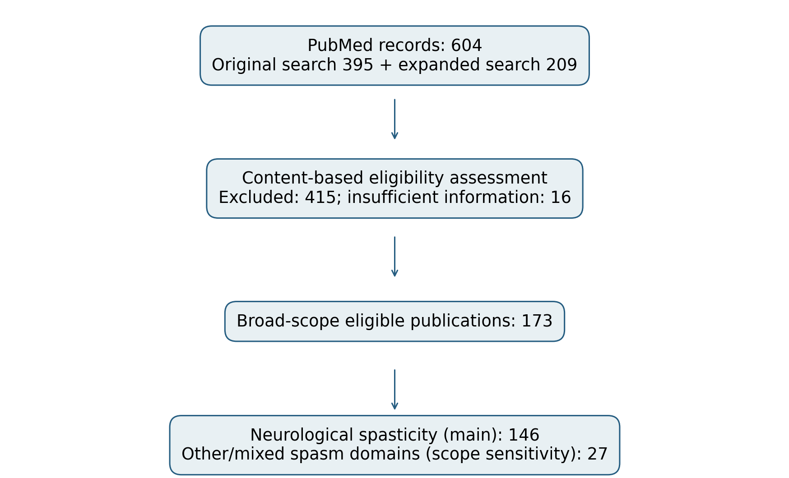

图1　检索与资格评估流程。信息不足记录与明确不合格记录分列；神经性痉挛为主分析，其他领域仅用于范围敏感性分析。

主分析中，原式检出97篇，扩展式补入49篇（33.56%）。干针专题34篇中原式检出5篇，扩展式补入29篇。该结果表示相对于固定扩展集合的检索贡献，不是以外部金标准测得的绝对查全率。

主分析144篇具有机构字段，143篇可识别国家/地区，139篇可识别机构体系；109篇具有可用关键词（74.66%）。1992—2009年15篇均无该关键词字段，2010—2015年为4/10篇，2016—2020年为28/32篇，2021—2025年为59/69篇，2026年为18/20篇。各分析使用对应字段可用文献作为分母。

### 3.2 年度、疾病与研究设计构成

主分析发表时间为1992—2026年，2021—2025年共有69篇，占47.26%；2026年截至检索范围有20篇。年度分布显示近期出版物较多，但不将不完整的2026年与完整年份直接判断升降（图2）。

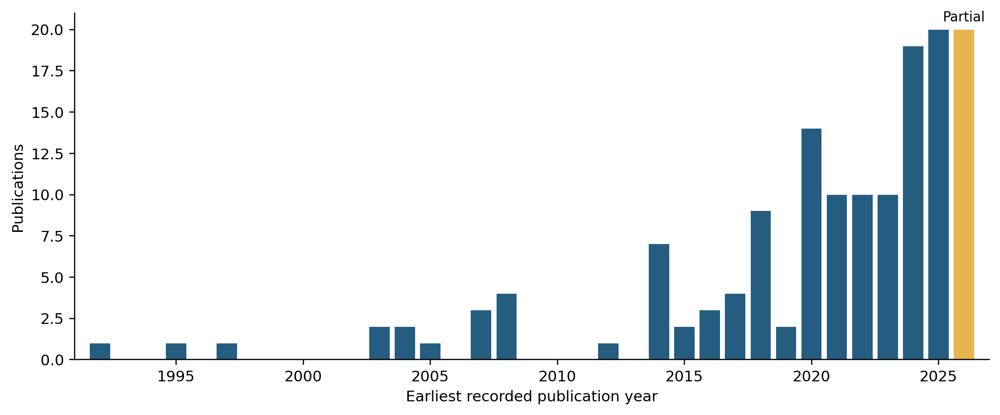

图2　主分析年度出版物数量。按较早的已记录发表年份计数；2026年为不完整年份，未作回归拟合或预测。

研究构成以卒中最多，为107篇（73.29%），其次为脑瘫16篇和多发性硬化9篇。综述与证据综合61篇（41.78%），报告随机分配的临床研究43篇（29.45%），动物实验19篇（13.01%）；其余类别见表1与图3。设计报告冲突的1篇单列，没有根据题名或数据库标签任意归入其他类别。

表1　主分析研究设计与疾病构成（N=146）

| 维度 | 分类 | 篇数 | 比例（%） |
| --- | --- | --- | --- |
| 研究设计 | 综述与证据综合 | 61 | 41.78 |
| 研究设计 | 动物实验 | 19 | 13.01 |
| 研究设计 | 报告随机分配的临床研究 | 43 | 29.45 |
| 研究设计 | 其他人体研究 | 19 | 13.01 |
| 研究设计 | 设计报告存在冲突 | 1 | 0.68 |
| 研究设计 | 二次分析 | 2 | 1.37 |
| 研究设计 | 共识调查 | 1 | 0.68 |
| 疾病 | 卒中 | 107 | 73.29 |
| 疾病 | 脑损伤/意识障碍 | 4 | 2.74 |
| 疾病 | 脑瘫 | 16 | 10.96 |
| 疾病 | 多发性硬化 | 9 | 6.16 |
| 疾病 | 脊髓疾病 | 4 | 2.74 |
| 疾病 | 混合或未限定的神经性痉挛 | 5 | 3.42 |
| 疾病 | 卒中与多发性硬化混合 | 1 | 0.68 |

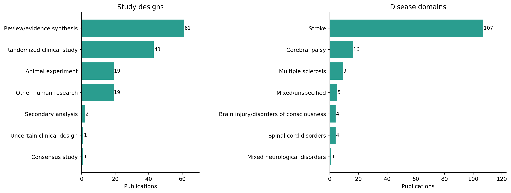

图3　主分析研究设计与疾病构成。每篇在每个维度各计一次；设计类别不表示偏倚风险等级。

### 3.3 干针专题与其他针灸相关文献的差异

干针专题34篇中，报告随机分配的临床研究16篇（47.06%）、其他人体研究8篇（23.53%）、综述8篇（23.53%），未见动物实验；疾病以卒中26篇和多发性硬化5篇为主。其余112篇中，综述53篇（47.32%）、动物实验19篇（16.96%）、报告随机分配的临床研究27篇（24.11%），卒中81篇、脑瘫15篇（表2，图4）。这些比较描述所收录出版物的设计分布，不表示一种干预比另一种更有效或证据更可靠。

表2　干针专题与其他针灸相关出版物的交叉分布

| 分类 | 干针专题，n（%） | 其他/综合专题，n（%） |
| --- | --- | --- |
| 总文献量 | 34 | 112 |
| 综述与证据综合 | 8（23.53） | 53（47.32） |
| 动物实验 | 0（0.00） | 19（16.96） |
| 报告随机分配的临床研究 | 16（47.06） | 27（24.11） |
| 其他人体研究 | 8（23.53） | 11（9.82） |
| 设计报告存在冲突 | 0（0.00） | 1（0.89） |
| 二次分析 | 1（2.94） | 1（0.89） |
| 共识调查 | 1（2.94） | 0（0.00） |
| 卒中 | 26（76.47） | 81（72.32） |
| 脑损伤/意识障碍 | 0（0.00） | 4（3.57） |
| 脑瘫 | 1（2.94） | 15（13.39） |
| 多发性硬化 | 5（14.71） | 4（3.57） |
| 脊髓疾病 | 0（0.00） | 4（3.57） |
| 混合或未限定的神经性痉挛 | 1（2.94） | 4（3.57） |
| 卒中与多发性硬化混合 | 1（2.94） | 0（0.00） |

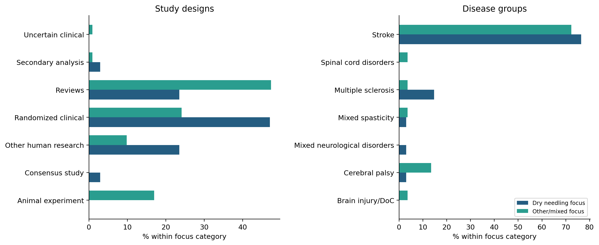

图4　干针专题与其他/综合专题的研究设计和疾病分布。分母分别为34篇与112篇，专题分类不等于互斥的临床干预类型。

### 3.4 来源期刊与合作联系

146篇论文发表于85种期刊。Frontiers in Neurology发表14篇，Evidence-Based Complementary and Alternative Medicine发表6篇，另有多个针灸、康复及补充医学期刊各发表5篇（表3，图5）。排名按发文量，不代表期刊当前影响因子或研究质量；已撤稿记录在筛选时排除。

表3　来源期刊发文量前10位

| 期刊 | 篇数 | 占全部（%） |
| --- | --- | --- |
| Frontiers in neurology | 14 | 9.59 |
| Evidence-based complementary and alternative medicine : eCAM | 6 | 4.11 |
| Acupuncture in medicine : journal of the British Medical Acupuncture Society | 5 | 3.42 |
| Archives of physical medicine and rehabilitation | 5 | 3.42 |
| Complementary therapies in medicine | 5 | 3.42 |
| Journal of traditional Chinese medicine = Chung i tsa chih ying wen pan | 5 | 3.42 |
| Brain and behavior | 4 | 2.74 |
| Annals of physical and rehabilitation medicine | 3 | 2.05 |
| Journal of acupuncture and meridian studies | 3 | 2.05 |
| Journal of alternative and complementary medicine (New York, N.Y.) | 3 | 2.05 |

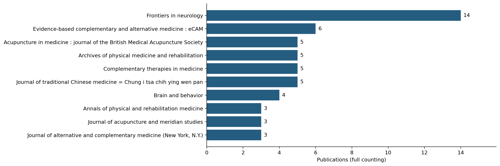

图5　主要来源期刊。按发文量排名，同频按名称排序；不表示当前期刊影响因子。

可识别国家/地区的143篇中，中国大陆署名79篇，美国23篇，西班牙15篇，伊朗12篇；26篇存在跨国家/地区共同署名，占18.18%（表4，图6）。该比例仅反映可取得地址中的合作，不能据此断言整个领域缺少国际交流。

表4　国家/地区贡献与合作

| 国家/地区 | 篇数 | 合作对象数 | 合作总强度 |
| --- | --- | --- | --- |
| China (mainland) | 79 | 8 | 12 |
| United States | 23 | 8 | 13 |
| Spain | 15 | 2 | 3 |
| Iran | 12 | 4 | 8 |
| United Kingdom | 6 | 5 | 8 |
| South Korea | 5 | 0 | 0 |
| Australia | 4 | 2 | 3 |
| Taiwan | 4 | 2 | 3 |
| Belgium | 3 | 1 | 1 |
| Egypt | 3 | 3 | 5 |

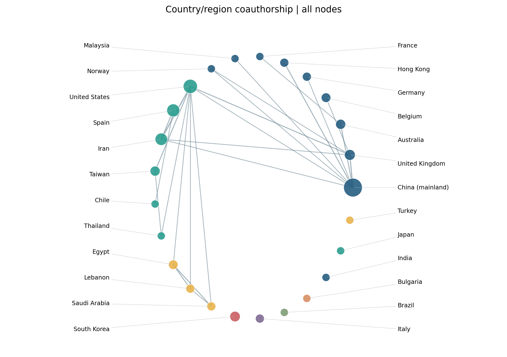

图6　国家/地区共同署名网络。基于143篇可定位文献，全计数；大小为篇数，连线权重为共同署名篇数，颜色为社群。

按机构体系全计数，北京中医药大学18篇，上海中医药大学和德黑兰医科大学各8篇。规范化署名Ma, Liangxiao与Wang, Junxiang分别出现11篇和10篇；这些结果描述重复署名联系，仍受机构归并和姓名消歧不足影响（表5，图7—8）。

表5　主要机构体系与规范化署名

| 类别 | 名称 | 篇数 |
| --- | --- | --- |
| 机构体系 | Beijing University of Chinese Medicine | 18 |
| 机构体系 | Shanghai University of Traditional Chinese Medicine | 8 |
| 机构体系 | Tehran University of Medical Sciences | 8 |
| 机构体系 | Heilongjiang University of Chinese Medicine | 6 |
| 机构体系 | Tianjin University of Traditional Chinese Medicine | 6 |
| 机构体系 | Universidad Rey Juan Carlos | 5 |
| 机构体系 | Guangzhou University of Chinese Medicine | 4 |
| 机构体系 | Cairo University | 3 |
| 机构体系 | Fujian University of Traditional Chinese Medicine | 3 |
| 机构体系 | Hebei Medical University | 3 |
| 规范化署名 | ma, liangxiao | 11 |
| 规范化署名 | wang, junxiang | 10 |
| 规范化署名 | qian, xu | 8 |
| 规范化署名 | mu, jiedan | 6 |
| 规范化署名 | fernández-de-las-peñas, césar | 5 |
| 规范化署名 | ma, linghui | 5 |
| 规范化署名 | sun, tianyi | 5 |
| 规范化署名 | zhang, zhou | 5 |
| 规范化署名 | ansari, noureddin nakhostin | 4 |
| 规范化署名 | naghdi, soofia | 4 |

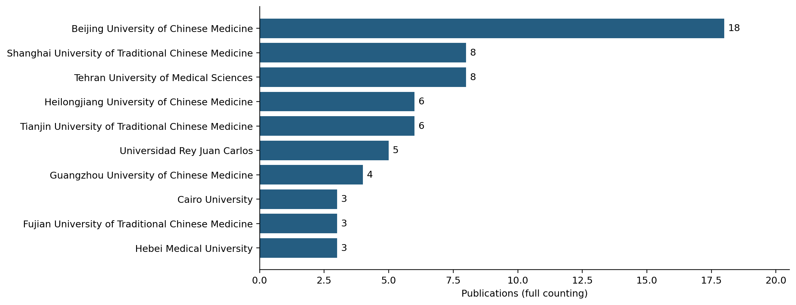

图7　主要机构体系发文量。大学及明确附属体系归并，不等同于医院独立排名。

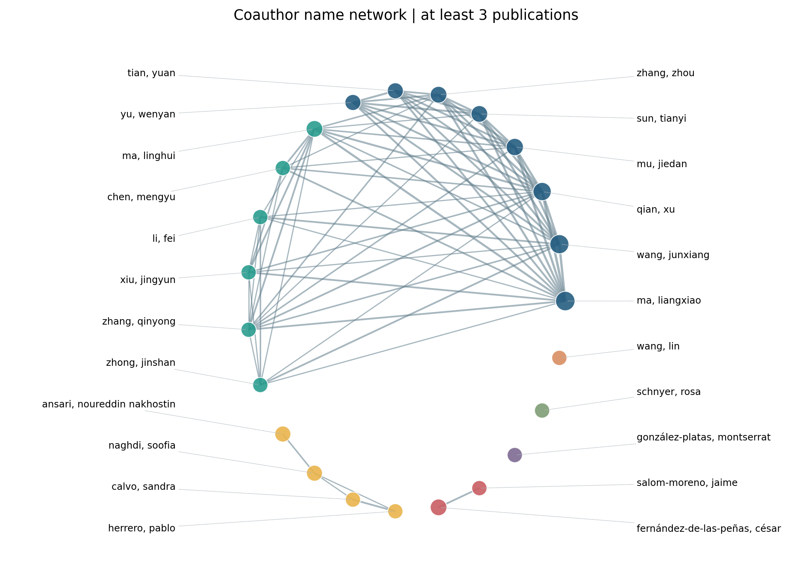

图8　规范化署名合作网络。显示发文≥3篇的署名，存在残余同名及拼写差异风险。

### 3.5 关键词主题与时间分布

109篇文献提供230个规范化关键词，核心高频词包括spasticity、stroke、acupuncture及dry needling（表6）。频次≥3的主网络有29个节点、147条连线，密度为0.362，全部节点位于同一连通分量，Louvain模块度为0.150（图9）。三个社群分别涉及痉挛—卒中—干针及功能评价、针灸—电针及证据综合，以及随机临床评价—脑瘫与反射/运动功能等联系；这些主题相互交织，不宜解释为三个独立成熟方向。

表6　高频关键词与共现联系（关键词文献109篇）

| 关键词 | 篇数 | 子集比例（%） | 共现总强度 |
| --- | --- | --- | --- |
| spasticity | 58 | 53.21 | 145 |
| stroke | 56 | 51.38 | 142 |
| acupuncture | 49 | 44.95 | 112 |
| dry needling | 29 | 26.61 | 68 |
| meta-analysis | 15 | 13.76 | 53 |
| rehabilitation | 15 | 13.76 | 44 |
| systematic review | 14 | 12.84 | 47 |
| electroacupuncture | 13 | 11.93 | 26 |
| post-stroke spasticity | 8 | 7.34 | 15 |
| multiple sclerosis | 7 | 6.42 | 14 |
| network meta-analysis | 7 | 6.42 | 24 |
| randomized controlled trial | 7 | 6.42 | 20 |
| spastic cerebral palsy | 5 | 4.59 | 10 |
| cerebral palsy | 4 | 3.67 | 10 |
| h-reflex | 4 | 3.67 | 10 |

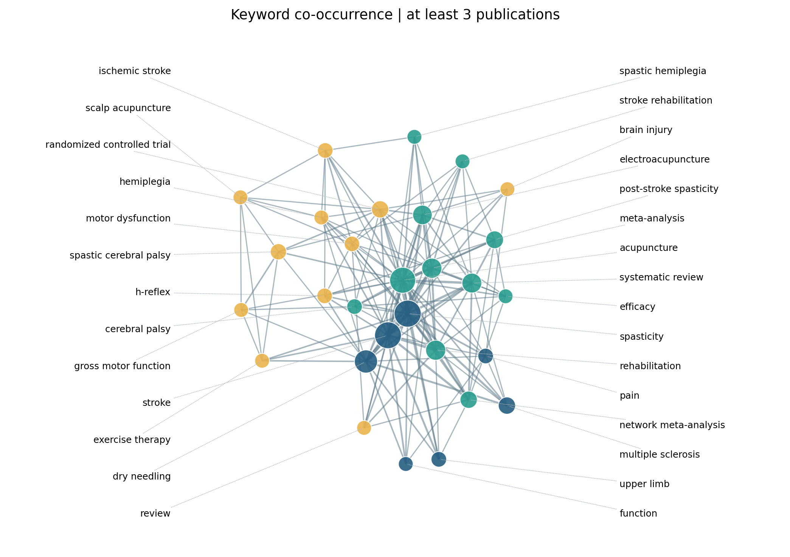

图9　关键词共现网络。109篇可用文献，频次≥3，29个节点、147条连线，模块度0.150；颜色为描述性社群。

年度归一化热图显示核心疾病与干预词在有关键词覆盖的年份反复出现（图10）。2010—2015年仅4篇具有关键词，早期比例易受单篇文献影响；1992—2009年完全缺少该字段，不能由空白推断早期没有相关研究。2026年结果仅代表不完整观察期。

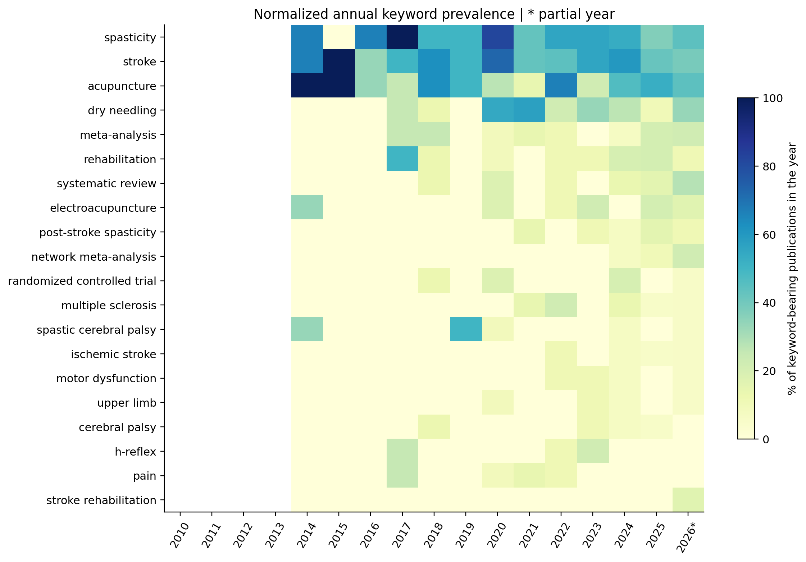

图10　高频关键词年度比例。分母为当年有关键词的文献数；空白为无数据而非零关注，2026年星号表示不完整年份。

动物实验在2016—2020年为1/32篇，2021—2025年为14/69篇；同期综述分别为14/32篇与30/69篇，干针专题分别为10/32篇与17/69篇（图11）。这些是固定集合内的描述性构成变化，未进行显著性检验，不据此宣称研究领域已发生机制转向。

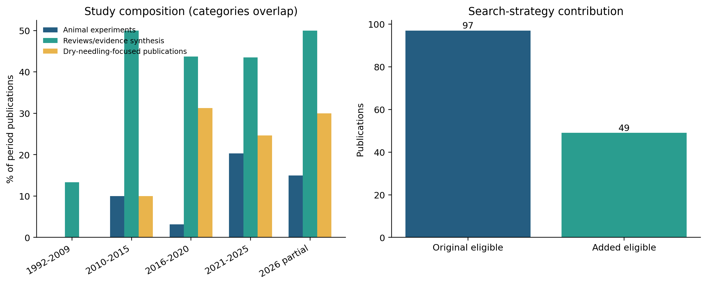

图11　时期构成与检索贡献。左图三类可重叠，分母为各时期全部主分析文献；干针专题含一篇全文证实的针介导肌内电刺激研究。右图为原式与扩展新增的主分析数量。

### 3.6 敏感性分析

阈值2、3、5下主分析网络分别保留50、29、13个关键词。非综述子集85篇，其中63篇有关键词，其核心词仍包括spasticity、stroke、acupuncture和dry needling。广义范围的173篇中122篇有关键词，其阈值3网络模块度为0.167；加入其他痉挛领域改变网络规模，但未形成清晰分离的社群（表7）。

删除研究设计词后，主分析保留24个节点与92条连线，模块度为0.130，疾病、干预和功能主题依然相互联系。将设计冲突的1篇归入随机临床研究，会使该类别由43变为44篇；若归入其他人体研究，该类别由19变为20篇。两种情景均不改变总文献量和综述为最大设计类别的观察。

表7　关键词网络敏感性分析

| 子集/处理 | 词频阈值 | 节点 | 连线 | 模块度 |
| --- | --- | --- | --- | --- |
| 主分析 | 2 | 50 | 246 | 0.188 |
| 主分析 | 3 | 29 | 147 | 0.150 |
| 主分析 | 5 | 13 | 52 | 0.088 |
| 原式子集 | 2 | 33 | 145 | 0.156 |
| 原式子集 | 3 | 18 | 74 | 0.088 |
| 原式子集 | 5 | 9 | 31 | 0.045 |
| 非综述子集 | 2 | 26 | 92 | 0.222 |
| 非综述子集 | 3 | 16 | 51 | 0.149 |
| 非综述子集 | 5 | 7 | 16 | 0.083 |
| 卒中子集 | 2 | 34 | 151 | 0.167 |
| 卒中子集 | 3 | 19 | 86 | 0.127 |
| 卒中子集 | 5 | 10 | 35 | 0.079 |
| 广义痉挛集合 | 2 | 57 | 275 | 0.212 |
| 广义痉挛集合 | 3 | 33 | 162 | 0.167 |
| 广义痉挛集合 | 5 | 13 | 52 | 0.088 |
| 删除设计词 | 3 | 24 | 92 | 0.130 |

## 4 讨论

### 4.1 以神经性痉挛为共同临床问题的研究结构

主分析显示，卒中相关出版物占73.29%，是针灸与干针神经性痉挛研究的主要来源。脑瘫、多发性硬化、脑损伤和脊髓疾病的研究规模较小，因此总体关键词图谱主要反映卒中研究的术语联系，不能直接代表各疾病拥有同样的研究基础。将面肌、内脏及血管痉挛单列，有助于避免以相同英文词形掩盖临床问题的差异。

与已有针灸卒中或非药物痉挛文献计量研究相比[5–7]，本研究进一步将干针专题与其他针灸相关文献的设计构成并列呈现。干针专题以人体临床研究为主，而其他类别包含较多综述和动物实验。这一差异说明两类出版物的研究问题和生产方式不同；但专题按题名及明确全文信息识别，综合综述也可能讨论干针，因此不能视作两种干预的严格头对头比较。

### 4.2 临床研究、证据综合与机制研究的衔接

综述与证据综合占全部出版物的41.78%，提示该集合中已有较多总结既有研究的工作。综述数量多不等于独立临床证据丰富，同一试验可能在多篇综述中反复被引用。后续研究更需要围绕明确疾病人群、对照方案、长期随访和功能结局开展研究，而不是仅增加重复综述。

干针临床文献关注肌张力、关节活动和运动功能等问题[4,12,13]；针灸机制研究涉及KCC2、GABA信号和脊髓反射等环节[14–16]。主分析19篇动物研究以及近期比例的描述性变化，可以支持“存在持续的机制研究活动”，却不能证明机制已在患者中获得验证。将机制指标与临床功能、患者体验及不良事件连接，仍需具体实验和临床设计。

本研究没有合并效应量、评估随机化质量或建立证据等级。研究标签为随机临床研究，也不表示低偏倚风险。既有临床报告的结果并不一致[4,17]，不能用本研究中某类文献数量更多来推导治疗推荐。

### 4.3 检索覆盖与图谱解释

扩展式补入49篇主分析文献，其中29篇属于干针专题，表明术语选择会影响观察到的干预分布。然而扩展式同时增加干针词形、spastic词形和主题词，不能把新增量全部归因于某一个词。没有外部已知文献集或多库核验，本研究也不能把固定扩展集合当作完整研究总体。

关键词网络中同时存在疾病、干预、研究设计和功能术语。删除设计词后模块度仍较低，说明弱社群边界不完全由综述术语造成。相比为每个社群赋予“前沿热点”的强标签，用高频词及其共同出现描述研究重点更符合数据能力。早期关键词缺失还限制了跨年代解释，年度热图适合观察可用字段中的构成，不适合重建整个研究史。

### 4.4 局限性

首先，本研究采用PubMed单库英文固定队列，可能遗漏其他数据库、非英文研究，以及只使用hypertonia或具体疾病名而未命中现有检索词的出版物。原式与扩展式比较提供的是内部覆盖检验，不能替代查全率验证。16条广义候选因材料不足未能核实资格，可能造成额外选择偏倚。

其次，筛选与分类为AI辅助核查，没有人类研究者独立双筛；范围在修订时明确而非事先注册。虽然病例报告标签冲突、动物实验误分和非随机研究误分已进行纠正，仍不能排除其他判断误差。结构化依据和修改日志用于支持复核，不等于外部验证。

第三，机构、国家和关键词字段并非完整，作者未做全面身份消歧；国家与机构全计数体现署名贡献，不是人才实力或治疗质量评价。第四，干针专题分类不是逐篇临床干预编码，其他专题可能含干针讨论。第五，低频词、词形归并和阈值影响网络；不同论文可能源于同一试验，综述间也可能共享基础研究，不能把出版物数解释为独立证据数。最后，2026年不完整及索引延迟限制了最新年度的解释。

## 5 结论

PubMed英文出版物中的针灸与干针神经性痉挛研究以卒中为主。干针专题较集中于人体临床研究，其他针灸相关文献兼有较多证据综合和动物机制研究；疾病和研究设计分层揭示了总体排名之外的构成差异。关键词网络呈现相互联系的疾病、干预与功能主题，不支持将社群直接解释为独立成熟热点。后续研究宜围绕明确人群和对照方案连接机制指标与临床功能结局，并加强长期效果与安全性评价。

## 数据可用性与研究声明

固定检索标识符、原始题录、逐篇筛选依据、分类规则、修改日志、规范化词典、统计数据及绘图脚本已归档，随补充数据提供。本研究分析公开发表的书目信息，不招募受试者或新增患者数据。人工智能参与筛选辅助、数据处理和文字修订；未声称完成人类研究者独立双筛。署名作者应核验并承担数据、解释与最终文本的责任。

## 参考文献

[1] Park, Si-Woon; Yi, Sook-Hee; Lee, Jung Ah; et al. Acupuncture for the treatment of spasticity after stroke: a meta-analysis of randomized controlled trials. Journal of alternative and complementary medicine (New York, N.Y.). 2014;20(9):672-82. https://doi.org/10.1089/acm.2014.0097

[2] Cai, Yiyi; Zhang, Claire Shuiqing; Liu, Shaonan; et al. Electroacupuncture for Poststroke Spasticity: A Systematic Review and Meta-Analysis. Archives of physical medicine and rehabilitation. 2017;98(12):2578-2589.e4. https://doi.org/10.1016/j.apmr.2017.03.023

[3] Xue, Chen; Jiang, Chengzhi; Zhu, Yuanyuan; et al. Effectiveness and safety of acupuncture for post-stroke spasticity: A systematic review and meta-analysis. Frontiers in neurology. 2022;13:942597. https://doi.org/10.3389/fneur.2022.942597

[4] Sánchez-Mila, Zacarías; Salom-Moreno, Jaime; Fernández-de-Las-Peñas, César. Effects of dry needling on post-stroke spasticity, motor function and stability limits: a randomised clinical trial. Acupuncture in medicine : journal of the British Medical Acupuncture Society. 2018;36(6):358-366. https://doi.org/10.1136/acupmed-2017-011568

[5] Liu, Junbing; Chen, Rong; Huang, Qimi; et al. Acupuncture for post-stroke spastic hemiplegia: A dual-dimensional evidence synthesis combining bibliometric and meta-analysis. Journal of family medicine and primary care. 2026;15(5):1873-1879. https://doi.org/10.4103/jfmpc.jfmpc_1889_25

[6] Zhang Z; Yin L; Huang J; et al. Non-Pharmacological Therapies for Post-Stroke Spastic Paralysis: A Bibliometric Analysis of Global Research from 2000 to 2024. Journal of Multidisciplinary Healthcare. 2024;17:5949–5965. https://doi.org/10.2147/JMDH.S507752

[7] Guan C; Feng Y; Cao L; et al. Acupuncture for stroke: A bibliometric analysis of global research from 2000 to 2022. Heliyon. 2024;10:e33827. https://doi.org/10.1016/j.heliyon.2024.e33827

[8] Li, Sheng; Li, Wenting; Huang, Jianpeng; et al. Distal Electroacupuncture Modulates Maladaptive Brainstem and Motor Cortex Plasticity to Alleviate Hemifacial Spasm. Movement disorders : official journal of the Movement Disorder Society. 2026. https://doi.org/10.1002/mds.70455

[9] Chen, Baoling; Ma, Yanyan; Zhong, Cailing; et al. Suppression effect and safety of acupuncture on colonic spasm during colonoscopy: a randomized controlled trial. Journal of gastrointestinal oncology. 2022;13(3):1169-1177. https://doi.org/10.21037/jgo-22-407

[10] Rethlefsen ML; Kirtley S; Waffenschmidt S; et al. PRISMA-S: an extension to the PRISMA Statement for Reporting Literature Searches in Systematic Reviews. Systematic Reviews. 2021;10:39. https://doi.org/10.1186/s13643-020-01542-z

[11] Blondel VD; Guillaume JL; Lambiotte R; Lefebvre E. Fast unfolding of communities in large networks. Journal of Statistical Mechanics: Theory and Experiment. 2008;2008(10):P10008. https://doi.org/10.1088/1742-5468/2008/10/P10008

[12] Fernández-de-Las-Peñas, César; Pérez-Bellmunt, Albert; Llurda-Almuzara, Luis; et al. Is Dry Needling Effective for the Management of Spasticity, Pain, and Motor Function in Post-Stroke Patients? A Systematic Review and Meta-Analysis. Pain medicine (Malden, Mass.). 2021;22(1):131-141. https://doi.org/10.1093/pm/pnaa392

[13] Malfait, Iris; Gijsbers, Sabien; Smeets, Annemie; et al. Safety of dry needling in stroke patients: a scoping review. European journal of physical and rehabilitation medicine. 2024;60(2):225-232. https://doi.org/10.23736/s1973-9087.24.08224-8

[14] Mu, Jie-Dan; Ma, Liang-Xiao; Zhang, Zhou; et al. Acupuncture alleviates spinal hyperreflexia and motor dysfunction in post-ischemic stroke rats with spastic hypertonia via KCC2-mediated spinal GABAA activation. Experimental neurology. 2022;354:114027. https://doi.org/10.1016/j.expneurol.2022.114027

[15] Sun, Tian-Yi; Ma, Liang-Xiao; Mu, Jie-Dan; et al. Acupuncture improves the structure of spastic muscle and decreases spasticity by enhancing GABA, KCC2, and GABAAγ2 in the brainstem in rats after ischemic stroke. Neuroreport. 2022;33(9):399-407. https://doi.org/10.1097/wnr.0000000000001798

[16] Wang, Jun-Xiang; Ma, Liang-Xiao; Mu, Jie-Dan; et al. Anti-spastic effect induced by waggle needling correlates with KCC2-GABAA pathway in post-stroke spasticity rats. Neuroscience letters. 2021;750:135810. https://doi.org/10.1016/j.neulet.2021.135810

[17] Wu, Zhenguo; Chen, Ganglin; Hu, Xianrui; et al. Effectiveness and safety of electroacupuncture in patients with upper limb spasticity after brain injury: a randomized controlled trial. Acupuncture in medicine : journal of the British Medical Acupuncture Society. 2026;44(3):125-137. https://doi.org/10.1177/09645284261433566
